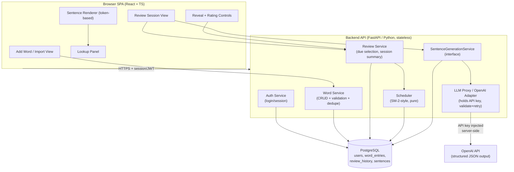
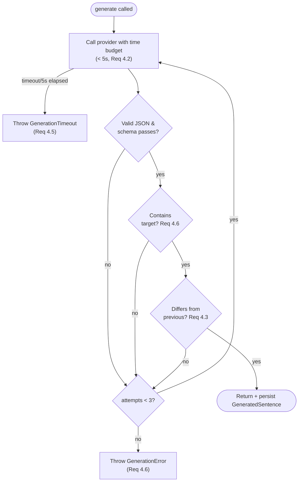

# Design Document

## Overview

The Japanese Vocabulary Trainer is a **web application** that helps a Learner memorize Japanese vocabulary in context. During a Review_Session the app presents each Due_Word embedded in a freshly generated Japanese Example_Sentence, with the Target_Word visually emphasized. The Learner reveals the answer, self-rates recall on four Difficulty_Rating levels, and a spaced-repetition Scheduler (an SM-2 / Anki-style scheme) computes the next review date.

Two design pressures shape the architecture:

1. **Fresh sentence per review (Requirement 4).** Example_Sentences are produced by an LLM, abstracted behind a **Sentence Generation Service** interface so the provider can be swapped. The LLM returns **structured JSON** — the full sentence plus a per-token tokenization with reading/furigana, meaning, and target-word markers — which drives target emphasis (Req 3), non-target lookups (Req 5), and furigana display without any separate morphological analyzer or dictionary API.
2. **"opencode-style" easy login (confirmed decision).** The Learner never handles an OpenAI API key. The Learner authenticates to *our* application; the **backend holds the provider API key server-side** and proxies LLM calls on the Learner's behalf.

Data (users, word entries, review history, scheduling state) persists in a backend database. The system is organized as a thin frontend (SPA) + stateless backend API so it can later be wrapped as a native Mac app with minimal change (see [Mac Wrapping Strategy](#mac-wrapping-strategy)).

### Technology Stack (recommended)

| Concern | Choice | Rationale |
| --- | --- | --- |
| Frontend | **React + TypeScript + Vite** | Component model fits token-rendered sentences and lookup panel; TS gives shared types with the LLM schema. Vite build wraps cleanly in a native shell. |
| Styling | Tailwind CSS (or CSS modules) | Fast, observable style changes for Target_Word emphasis (Req 3.2). |
| Backend framework | **FastAPI (Python)** | Modern, beginner-friendly docs, type-hint based, auto-generated interactive API docs (Swagger at `/docs`), and strong async support that suits slow LLM calls. The main alternative considered was **Django + DRF**, but FastAPI is a better fit for this small, LLM/JSON-heavy API and for a learner. |
| Validation / schema | **Pydantic** | One modeling layer reused for API request/response validation **and** for validating the LLM structured JSON output (Req 4.6 retry). Replaces Zod. |
| Database | **PostgreSQL** | Relational data (users → words → review history), transactional writes for scheduling (Req 7.5). SQLite acceptable for local/dev and for the Mac-wrapped single-user build. |
| ORM / query | **SQLAlchemy** + **Alembic** (migrations) | Typed data access and schema migrations; maps cleanly to the data model below. Replaces Prisma. |
| Auth / password hashing | **passlib[argon2]** (hashing) + **python-jose** (JWT) | Backend-owned identity so the backend can authorize LLM proxy calls; argon2 for password hashing, JWT for stateless sessions. |
| LLM provider | **OpenAI Python SDK** (primary), behind `SentenceGenerationService` | Swappable; structured output via JSON response format / function calling. |
| PBT library | **Hypothesis** (Python) | Property-based tests for scheduler, sentence-diff, schema validation. Replaces fast-check. |
| Test runner | **pytest** | Runs unit, integration, and Hypothesis property tests. |
| Package / env management | **uv** or **Poetry** | Reproducible dependency and virtual-env management for the Python backend. |
| Mac wrapper (future) | **Tauri** (preferred) or Electron | Loads the same web build; Tauri is lighter and can run a bundled Python backend/SQLite via a sidecar process. |

## Architecture

The system has four layers: the **Browser SPA**, the **Backend API** (auth + domain services + LLM proxy), the **Database**, and the **external LLM provider**. The browser never talks to the LLM provider directly — all provider calls flow through the authenticated backend proxy, which injects the server-held API key.



### Key architectural decisions

- **Backend-mediated LLM access (confirmed auth model).** The OpenAI key is a server-side secret (env/secret manager). The SPA requests sentence generation from `/api/review/.../sentence`; the backend authenticates the Learner, then calls the provider. This is the "opencode-style" model: users log in to our app, not to OpenAI. It also lets us enforce per-user rate limits and centralizes retry/validation.
- **Structured LLM output over post-processing.** Instead of generating plain text and segmenting it with a morphological analyzer, the LLM returns a validated token array. This removes the kuromoji/dictionary dependency, and makes Req 3 (emphasis), Req 5 (lookup/furigana), and Req 4 (word-count, target presence) checkable on structured data.
- **Pure Scheduler.** The scheduling computation is a side-effect-free function `compute_next_interval(rating, history) -> interval_days`. Persistence is a separate step. This makes the monotonicity invariant (Req 7.3) directly property-testable and makes failure handling (Req 7.5) a clean transaction boundary.
- **Stateless API + SPA split.** Session state lives in the DB and client; the API is stateless. This is what makes the later Mac wrapping (Tauri/Electron loading the same build) a packaging change rather than a rewrite.

## Components and Interfaces

### Frontend components

- **Add Word / Import View** — form for the manual input format (Req 1); surfaces per-field validation and duplicate errors returned by the backend. Hosts the optional Anki import entry point (Req 2) behind a feature flag.
- **Review Session View** — orchestrates the session loop (Req 8): requests the due list, presents one Target_Word at a time, requests a sentence, handles reveal/rating, and renders the end-of-session summary.
- **Sentence Renderer** — renders the Example_Sentence from the structured token array. Each token is an interactive span. Tokens flagged `isTarget` get an emphasis style differing in at least one observable attribute (Req 3.2). A per-sentence "show furigana" toggle renders `reading` in parentheses after each token (confirmed decision 3b).
- **Lookup Panel** — on clicking a Non_Target_Word, shows that token's `meaning` and `reading`, and `furigana` when the token `containsKanji` (Req 5.1, 5.2). Replaces content on a new selection (Req 5.3); shows an unavailable message and clears prior content when meaning is absent (Req 5.4); persists until another selection or dismissal (Req 5.5).
- **Reveal + Rating Controls** — reveal control shows Target_Word reading + meaning (Req 6.1); rating controls appear only after reveal (Req 6.2, 6.3) and offer exactly four ordered levels; selecting a level sends the rating and shows the selection (Req 6.4).

### Backend services and interfaces

The backend service interfaces are expressed as Python abstract base classes / `Protocol`s; concrete adapters (e.g. the OpenAI sentence generator) implement them. `Difficulty` is an `IntEnum` over 1..4 (hardest=1 .. easiest=4, Req 6.2, 7.1).

```python
from abc import ABC, abstractmethod
from enum import IntEnum
from typing import Protocol


class Difficulty(IntEnum):
    """Ordered discrete rating set, hardest=1 .. easiest=4 (Req 6.2, 7.1)."""
    VERY_HARD = 1
    HARD = 2
    GOOD = 3
    VERY_EASY = 4


class WordService(ABC):
    @abstractmethod
    def add_word(self, user_id: str, data: "WordInput") -> "WordEntry":
        """Req 1: validate (lengths, whitespace), dedupe by exact word form,
        set next_review_date = today. Raises ValidationError / DuplicateError."""
        ...

    @abstractmethod
    def list_collection(self, user_id: str) -> list["WordEntry"]:
        ...


class ReviewService(ABC):
    @abstractmethod
    def start_session(self, user_id: str, today: "date") -> "ReviewSession | NoDueWords":
        """Req 8.1 / 8.5: due = next_review_date <= today; empty -> no session."""
        ...

    @abstractmethod
    def record_rating(
        self, user_id: str, session_id: str, word_id: str, rating: Difficulty
    ) -> "RatingResult":
        """Req 6/7/8.3/8.4: validate rating, require revealed, schedule,
        persist (one transaction), advance or summarize."""
        ...


class Scheduler(Protocol):
    def compute_next_interval(
        self, rating: Difficulty, history: list["ReviewRecord"]
    ) -> int:
        """PURE. Req 7.1-7.3: integer interval in [1, 365] days;
        monotonic non-decreasing in difficulty. No side effects."""
        ...


class SentenceGenerationService(ABC):
    @abstractmethod
    async def generate(
        self, target: "WordEntry", previous: "GeneratedSentence | None"
    ) -> "GeneratedSentence":
        """Req 4: produce a sentence containing the target, 1-50 words,
        differing from previous, within the time budget; returns validated
        structured output. async to suit the slow provider call."""
        ...
```

- **Auth Service** — login/logout and session/JWT issuance; every domain and sentence route requires an authenticated Learner. Owns the identity the LLM proxy authorizes against.
- **Word Service** — Req 1 validation, exact-match dedupe within a Learner's collection, and the "due immediately" rule (Req 1.5). Also backs optional Anki import (Req 2) with the same validation/dedupe reused per record.
- **Review Service** — Req 8 orchestration: due selection, one-at-a-time presentation, rating validation (Req 6.5, 8.6), delegation to Scheduler, transactional persistence (Req 7.4/7.5), advance-or-summarize (Req 8.3/8.4).
- **Scheduler** — pure SM-2-style interval computation (see [Spaced-Repetition Algorithm](#spaced-repetition-algorithm)).
- **SentenceGenerationService + LLM Proxy** — the interface is provider-agnostic; the OpenAI adapter injects the server-held key, requests structured JSON, validates it, and runs the retry logic (Req 4.6) and timeout handling (Req 4.2/4.5).

## Project Structure

The project is a **monorepo** with a React SPA `frontend/` and a FastAPI Python `backend/`, each independently buildable. The backend uses clear layer separation so business logic stays testable without HTTP or a database.

```
japanese-vocab-trainer/
├── frontend/                      # React + TypeScript + Vite SPA (unchanged)
│   ├── src/
│   │   ├── components/            # SentenceRenderer, LookupPanel, RatingControls, ...
│   │   ├── views/                 # AddWord/Import, ReviewSession
│   │   └── api/                   # typed HTTP client to the backend
│   ├── index.html
│   └── package.json
│
├── backend/                       # FastAPI Python package
│   ├── app/
│   │   ├── main.py                # FastAPI entry (app factory, router registration)
│   │   ├── config.py              # env settings (Pydantic BaseSettings)
│   │   ├── api/                   # HTTP layer ONLY — routing, (de)serialization, status codes
│   │   │   ├── deps.py            # dependencies: current user, DB session, service wiring
│   │   │   └── routes/
│   │   │       ├── auth.py        # /api/auth/*
│   │   │       ├── words.py       # /api/words*
│   │   │       └── review.py      # /api/review/*
│   │   ├── schemas/               # Pydantic request/response + LLM sentence schema
│   │   │   ├── word.py
│   │   │   ├── review.py
│   │   │   └── sentence.py        # SentenceTokenSchema, GeneratedSentenceSchema
│   │   ├── models/                # SQLAlchemy ORM (DB tables)
│   │   │   ├── user.py
│   │   │   ├── word_entry.py
│   │   │   ├── review_record.py
│   │   │   └── generated_sentence.py
│   │   ├── services/              # business logic — no FastAPI imports here
│   │   │   ├── word_service.py
│   │   │   ├── review_service.py
│   │   │   ├── scheduler.py       # PURE function; primary Hypothesis target
│   │   │   └── sentence_generation/
│   │   │       ├── base.py        # SentenceGenerationService interface
│   │   │       └── openai_adapter.py  # holds key, structured JSON, validate + retry
│   │   ├── auth/
│   │   │   └── security.py        # passlib[argon2] hashing + python-jose JWT
│   │   └── db/
│   │       └── session.py         # SQLAlchemy engine / session factory
│   ├── alembic/                   # migrations
│   │   └── versions/
│   ├── tests/
│   │   ├── properties/            # Hypothesis property tests (Properties 1–20)
│   │   ├── unit/                  # example / edge-case tests
│   │   └── integration/           # provider boundary, DB, auth-protected routes
│   ├── pyproject.toml             # deps + tool config (uv / Poetry, pytest, Hypothesis)
│   └── .env.example               # DB_URL, OPENAI_API_KEY, JWT_SECRET
│
└── README.md
```

**Layer separation (why it matters for correctness and testing):**

- **`api/`** — HTTP concerns only: route definitions, request/response (de)serialization, status codes, and auth dependencies. It calls services; it contains no business rules.
- **`services/`** — the business logic. The **pure `scheduler.py`** and the **LLM proxy** (`sentence_generation/`) live here and are independently testable without a web server. The scheduler takes plain inputs and returns an interval; the sentence generator depends only on the `SentenceGenerationService` interface, so the provider is mockable.
- **`models/`** — SQLAlchemy ORM, the only layer that touches the database.
- **`schemas/`** — Pydantic validation for both the API boundary and the untrusted LLM output.

This separation keeps Properties 10–15 (scheduler and sentence validation) exercisable as fast, deterministic Hypothesis tests against `services/` alone.

## Data Models

The domain data models are Pydantic models (used for API/service boundaries and derived from the SQLAlchemy ORM rows). `SentenceToken` and `GeneratedSentence` double as the validated LLM-output shape (see the sentence schema below).

```python
from datetime import date, datetime
from pydantic import BaseModel


class User(BaseModel):
    id: str                       # uuid
    email: str                    # unique; identity for auth + LLM proxy authorization
    password_hash: str | None = None   # passlib[argon2] hash; None for OAuth
    created_at: datetime


class WordEntry(BaseModel):
    id: str                       # uuid
    user_id: str                  # owner
    word_form: str                # Japanese word, 1-50 chars (Req 1.1), unique per user (Req 1.4)
    reading: str                  # 1-100 chars
    meaning: str                  # 1-500 chars
    next_review_date: date        # scheduling state (Req 7.4); set to creation date (Req 1.5)
    ease_factor: float = 2.5      # SM-2 ease, default 2.5 (scheduler state)
    interval_days: int = 0        # last computed interval, default 0
    repetitions: int = 0          # consecutive successful reviews, default 0
    created_at: datetime


class ReviewRecord(BaseModel):
    id: str
    word_id: str                  # FK -> WordEntry
    rating: Difficulty            # 1..4
    interval_days: int            # interval assigned by this review
    reviewed_at: datetime


class SentenceToken(BaseModel):
    surface: str                  # token text as it appears in the sentence
    reading: str                  # hiragana reading / furigana source
    meaning: str | None           # None -> unavailable lookup (Req 5.4)
    is_target: bool               # True for the target word token(s) (Req 3.2)
    contains_kanji: bool          # controls furigana display (Req 5.2)


class GeneratedSentence(BaseModel):
    id: str
    word_id: str                  # FK -> WordEntry
    text: str                     # full sentence
    tokens: list[SentenceToken]   # structured tokenization (drives render + lookup)
    created_at: datetime          # latest row = "immediately preceding review" (Req 4.3)
```

These Pydantic models map to SQLAlchemy ORM tables in `app/models/` (migrated with Alembic). Relationships: `User 1—* WordEntry`, `WordEntry 1—* ReviewRecord`, `WordEntry 1—* GeneratedSentence`. A unique constraint on `(user_id, word_form)` enforces per-collection dedupe (Req 1.4). The most recent `GeneratedSentence` row for a word is the "immediately preceding" sentence used for the difference check (Req 4.3).

## LLM Structured Output: Schema, Validation, and Retry

The Sentence Generation Service asks the provider for an Example_Sentence as JSON matching the schema below (enforced with the provider's structured-output / JSON mode and re-validated with **Pydantic** on the backend — never trust the model output). This is the Pydantic equivalent of the former Zod `GeneratedSentenceSchema`: per-field constraints, a 1–50 token list, and a model validator requiring at least one target token.

```python
from pydantic import BaseModel, Field, field_validator, model_validator


class SentenceTokenSchema(BaseModel):
    surface: str = Field(min_length=1)
    reading: str = Field(min_length=1)
    meaning: str | None
    is_target: bool
    contains_kanji: bool


class GeneratedSentenceSchema(BaseModel):
    text: str = Field(min_length=1)
    # 1-50 words (Req 4.4)
    tokens: list[SentenceTokenSchema] = Field(min_length=1, max_length=50)

    @model_validator(mode="after")
    def _must_contain_target(self) -> "GeneratedSentenceSchema":
        # target present (Req 4.1 / 4.6)
        if not any(t.is_target for t in self.tokens):
            raise ValueError("no target token")
        return self

    @field_validator("tokens")
    @classmethod
    def _reconstruction_sanity(
        cls, tokens: list[SentenceTokenSchema]
    ) -> list[SentenceTokenSchema]:
        joined = "".join(t.surface for t in tokens)
        if len("".join(joined.split())) == 0:
            raise ValueError("empty reconstruction")
        return tokens
```

**The prompt** instructs the model to (a) write a natural Japanese sentence containing the Target_Word in surface or dictionary form, (b) keep it between 1 and 50 words, (c) tokenize it into words, (d) give each token its hiragana reading and a short meaning, (e) mark the target token(s) with `isTarget: true` and set `containsKanji` per token, and (f) when a previous sentence is supplied, produce a sentence differing by at least one non-target word (Req 4.3). The previous sentence text is included in the prompt for this purpose.

**Validation + retry pipeline** (satisfies Req 4.1, 4.2, 4.5, 4.6):



The frontend maps `GenerationTimeout`/`GenerationError` to the generation-error message, keeps the Target_Word in the session, and shows a retry control (Req 4.5).

## API Endpoints

All routes except auth require an authenticated Learner (session cookie / Bearer JWT). The LLM key is never exposed to the client.

| Method | Path | Purpose | Requirements |
| --- | --- | --- | --- |
| POST | `/api/auth/login` | Authenticate Learner, issue session | Auth model |
| POST | `/api/auth/logout` | End session | Auth model |
| POST | `/api/words` | Add a word (validate, dedupe, due-today) | 1.1–1.5 |
| GET | `/api/words` | List the Word_Collection | 8 support |
| POST | `/api/words/import` | Optional Anki import (feature-flagged) | 2.1–2.5 |
| POST | `/api/review/sessions` | Start session, return due words or no-due | 8.1, 8.5 |
| POST | `/api/review/sessions/:id/words/:wordId/sentence` | Generate (proxy) a new sentence | 3, 4 |
| POST | `/api/review/sessions/:id/words/:wordId/rating` | Record rating, schedule, advance/summarize | 6, 7, 8.3, 8.4, 8.6 |

The rating endpoint enforces reveal-before-rate server-side as well (Req 6.5) by rejecting a rating for a word whose answer the session has not marked revealed, and rejects out-of-set rating values (Req 8.6).

## Spaced-Repetition Algorithm

The Scheduler uses an SM-2 / Anki-style scheme over four discrete Difficulty_Rating levels (1 = very hard … 4 = very easy). It is a **pure function** of the rating and the word's review history (ease, repetitions, last interval), returning an interval clamped to `[1, 365]` days (Req 7.1). The next review date is `today + interval`.

**Per-level base behavior**

- **Level 1 (very hard):** reset repetitions; interval = 1 day (minimum). Decrease ease (floor 1.3).
- **Level 2 (hard):** small interval; slight ease decrease.
- **Level 3 (good):** standard SM-2 growth: `interval = round(previousInterval * ease)`; repetitions++.
- **Level 4 (very easy):** SM-2 growth with an easy bonus and ease increase: `interval = round(previousInterval * ease * easyBonus)`; repetitions++.

**No prior history (Req 7.2):** the interval depends only on the rating — a fixed initial interval table, e.g. L1→1, L2→1, L3→1, L4→4 days — independent of any (absent) history.

**Monotonicity (Req 7.3) — the central invariant.** For the *same* word with the *same* history, the interval must be **non-decreasing** in difficulty level: `interval(1) ≤ interval(2) ≤ interval(3) ≤ interval(4)`. The implementation guarantees this by construction: each higher level uses a growth multiplier (and bonus) greater than or equal to the next lower level, then applies the same `[1,365]` clamp (clamping with identical bounds preserves ordering). This is the primary property-based test target.

**Clamping (Req 7.1):** every computed interval is clamped into `[1, 365]`; results are integer days.

**Persistence (Req 7.4 / 7.5):** the computed `nextReviewDate`, `intervalDays`, `easeFactor`, and `repetitions` are written in one transaction together with the new `ReviewRecord`. If the write fails, the word's previous `nextReviewDate` is retained and a "scheduling not saved" error is surfaced; the word stays unrated in the session.

## Correctness Properties

*A property is a characteristic or behavior that should hold true across all valid executions of a system — essentially, a formal statement about what the system should do. Properties serve as the bridge between human-readable specifications and machine-verifiable correctness guarantees.*

The properties below were derived from the acceptance criteria via the prework analysis, with redundant criteria consolidated (e.g. the reveal-gating criteria and the Lookup_Panel state criteria were each merged into a single comprehensive property, and the import counting criteria were merged into one accounting invariant).

### Property 1: Valid word is created and stored faithfully

*For any* WordInput whose fields are within bounds (word form 1–50, reading 1–100, meaning 1–500 characters) and non-whitespace, adding it creates a Word_Entry whose word form, reading, and meaning equal the input.

**Validates: Requirements 1.1**

### Property 2: Invalid word is rejected naming exactly the offending fields

*For any* WordInput in which some non-empty subset of fields is missing/whitespace-only or exceeds its maximum length, the submission is rejected, no Word_Entry is created, and the returned validation error names exactly that subset of fields.

**Validates: Requirements 1.2, 1.3**

### Property 3: Duplicate word form is rejected without modifying the existing entry

*For any* Word_Collection and any new input whose word form exactly matches an existing entry's word form, the submission is rejected with a duplicate error, the collection size is unchanged, and the existing entry is left unmodified.

**Validates: Requirements 1.4**

### Property 4: Newly created words are due immediately

*For any* valid word added on a given date, that word's next review date is on or before that date, so it is selected as a Due_Word on that date.

**Validates: Requirements 1.5**

### Property 5: Import accounting is exact (optional feature)

*For any* well-formed deck, the import summary satisfies `created + skippedMissingField + skippedDuplicate == totalRecordsProcessed`, where created equals the number of records with a non-empty word form that are not duplicates (against existing entries or earlier records in the same import).

**Validates: Requirements 2.1, 2.2, 2.3, 2.5**

### Property 6: Target word is always emphasized distinctly

*For any* generated token array, when the sentence is rendered, every token marked `isTarget` carries an emphasis attribute that differs from non-target tokens in at least one observable attribute (color, weight, or background).

**Validates: Requirements 3.2**

### Property 7: Reveal gating controls meaning and rating visibility

*For any* review state: while the answer is not revealed, the Target_Word meaning is withheld and no Difficulty_Rating option is offered (and a rating attempt is rejected, leaving the word unrated); once the answer is revealed, the Example_Sentence remains visible and the Target_Word reading and meaning are both shown.

**Validates: Requirements 3.1, 3.3, 3.4, 6.1, 6.3, 6.5**

### Property 8: Lookup panel reflects only the most recent selection

*For any* sequence of Non_Target_Word selections, the Lookup_Panel displays exactly the most recently selected token's reading and meaning (plus furigana when that token contains kanji); if that token's meaning is undeterminable, the panel shows the unavailable message and clears any prior content; with no further selection or dismissal the content remains unchanged, and dismissal clears it.

**Validates: Requirements 5.1, 5.2, 5.3, 5.4, 5.5**

### Property 9: Exactly four ordered rating options after reveal

*For any* revealed Target_Word, exactly four Difficulty_Rating options are offered, ordered from very hard (level 1) to very easy (level 4), and selecting a level records that level and marks it as selected.

**Validates: Requirements 6.2, 6.4**

### Property 10: Accepted sentence contains the target within the retry budget

*For any* sequence of provider outputs, generation accepts the first output that is schema-valid and contains the Target_Word, performing at most 3 retries; if no output within the budget contains the target, generation yields a generation error (and no sentence is accepted).

**Validates: Requirements 4.1, 4.6**

### Property 11: New sentence differs from the previous by a non-target word

*For any* previous sentence and candidate sentence, the candidate is accepted only if it differs from the previous sentence in at least one word other than the Target_Word.

**Validates: Requirements 4.3**

### Property 12: Accepted sentence length is between 1 and 50 words

*For any* candidate sentence, it is accepted only if its token count is between 1 and 50 inclusive.

**Validates: Requirements 4.4**

### Property 13: Scheduling interval is clamped to [1, 365] days

*For any* Difficulty_Rating in {1,2,3,4} and any review history, the Scheduler computes an integer interval of at least 1 and at most 365 days.

**Validates: Requirements 7.1**

### Property 14: Initial interval depends only on the rating

*For any* Word_Entry with no prior review history, the computed interval equals a fixed per-rating value that depends only on the selected Difficulty_Rating.

**Validates: Requirements 7.2**

### Property 15: Interval is monotonic non-decreasing in ease

*For any* Word_Entry and fixed review history, the interval assigned to an easier Difficulty_Rating is greater than or equal to the interval assigned to a harder one: `interval(1) ≤ interval(2) ≤ interval(3) ≤ interval(4)`.

**Validates: Requirements 7.3**

### Property 16: Stored next review date matches the computed schedule

*For any* successful rating recorded on a given date, the stored next review date equals that date plus the computed interval.

**Validates: Requirements 7.4**

### Property 17: Due selection is exactly the non-future words

*For any* Word_Collection and current date, starting a session selects exactly the Word_Entries whose next review date is on or before the current date.

**Validates: Requirements 8.1**

### Property 18: Session presents each due word once, one at a time

*For any* Review_Session, while unreviewed Due_Words remain exactly one Target_Word is presented at a time, each Due_Word is presented exactly once, and recording a rating for a non-final word advances to an unreviewed Due_Word.

**Validates: Requirements 8.2, 8.3**

### Property 19: Session summary counts are exact

*For any* completed Review_Session, the summary's total reviewed count equals the number of Due_Words selected, and the per-rating counts equal the tally of ratings the Learner submitted.

**Validates: Requirements 8.4**

### Property 20: Invalid rating values are rejected and the word is retained

*For any* value that is not one of the defined Difficulty_Rating levels {1,2,3,4}, recording it is rejected, no rating is recorded, and the current Target_Word is retained for re-rating.

**Validates: Requirements 8.6**

## Error Handling

| Condition | Requirement | Handling |
| --- | --- | --- |
| Invalid word input (empty/over-length) | 1.2, 1.3 | 400 with per-field error list; no write. Frontend highlights each named field. |
| Duplicate word form | 1.4 | 409 duplicate error; existing entry untouched. |
| Malformed/unrecognized import file | 2.4 | Abort whole import, zero writes, invalid-file error. |
| No sentence available for target | 3.5 | Present target without sentence + "no example available" indicator. |
| Sentence generation timeout (>5s) | 4.2, 4.5 | `GenerationTimeout`; keep word in session; show generation-error + retry control. |
| LLM output invalid / missing target after 3 retries | 4.6 | `GenerationError`; show generation-error + retry control; word retained. |
| Non-target lookup meaning undeterminable | 5.4 | Show unavailable-lookup message; clear prior panel content. |
| Rating attempted before reveal | 6.5 | Reject (server + client); word stays unrated. |
| Rating save failure | 6.6 | Word stays unrated; "rating not saved" error; no schedule change. |
| Invalid rating value | 8.6 | Reject; "invalid rating" message; retain current Target_Word. |
| Scheduling write failure | 7.5 | Transaction rolled back; previous next review date retained; "scheduling not saved" error. |
| No due words at session start | 8.5 | "No words due" message; no session created. |

Scheduling and rating persistence (the new `ReviewRecord` plus the word's `nextReviewDate`/`easeFactor`/`repetitions`) are written in a **single transaction**, so a failure leaves the word in its prior state (Req 6.6, 7.5). All LLM output is treated as untrusted and re-validated server-side before use.

## Testing Strategy

The strategy pairs **property-based tests** (universal invariants, 100+ generated inputs each) with **example / integration tests** (specific flows, timing, external behavior). Backend tests run under **pytest**; property tests use **Hypothesis**. (Frontend UI tests stay on the React side — see UI tests below.)

### Property-based tests

- Library: **Hypothesis** (Python), run via **pytest**, configured for a **minimum of 100 iterations** per property (`@settings(max_examples=100)`).
- Each property test implements exactly one property from the Correctness Properties section and carries a tag comment of the form:
  `# Feature: japanese-vocab-trainer, Property {number}: {property_text}`
- Coverage: Properties 1–20. The highest-value targets are **Property 15 (scheduler monotonicity)**, **Property 13 (interval bounds)**, **Property 11 (sentence difference)**, **Property 10 (target-presence retry)**, and **Property 2 (field-exact validation errors)**. The pure `scheduler.py` and the Pydantic-based LLM-output validator are isolated, side-effect-free units, which makes these tests fast and deterministic (mock the provider; never call the real API in property tests).
- Strategies (Hypothesis generators): word inputs across/over the length bounds; difficulty ratings 1–4; arbitrary review histories (ease, repetitions, last interval); token lists with varied length, `is_target`, `contains_kanji`, and None meanings; sequences of provider outputs (valid, invalid, missing-target); collections with varied next-review dates.

### Example / unit tests

For specific scenarios and failure branches that are not universal: malformed import file abort (2.4), no-sentence-available fallback (3.5), timeout error + retry control (4.5), rating-save failure (6.6), scheduling-write failure (7.5), and no-due-words message (8.5). These use injected failures and 1–3 representative inputs.

### Integration tests

For behavior crossing the external/provider and persistence boundaries, using 1–3 examples rather than property iteration: the generation **time budget** (4.2) via a simulated slow provider; the authenticated **LLM proxy** path (key injected server-side, never reaching the client); end-to-end session flow against a test database; and auth-protected route access.

### UI tests

UI tests remain on the **React/TypeScript** side (the frontend stack is unchanged): snapshot / rendering tests for the Sentence Renderer emphasis (supporting Property 6) and Lookup_Panel state transitions (supporting Property 8), plus the reveal-then-rate control flow (supporting Properties 7 and 9).

## Mac Wrapping Strategy

Targeting web first keeps the Mac path a packaging exercise, not a rewrite:

- The frontend is a static SPA build (Vite). A **Tauri** (preferred) or Electron shell loads that same build as its web view — no UI changes.
- Because the API is stateless and the client talks to it over HTTP, the Mac app can either point at a hosted backend or bundle the backend locally. For a single-user local build, the Python **FastAPI** app runs as a bundled local backend — packaged with a bundled Python runtime (e.g. **PyInstaller**) or launched as a **sidecar process** by the Tauri shell — using **SQLite** instead of PostgreSQL (the SQLAlchemy data model is unchanged). The OpenAI key is stored in the **OS keychain** rather than a server secret store — preserving the "user never pastes a key" model.
- The `SentenceGenerationService` and auth boundaries stay identical between the web and Mac builds; only the deployment/packaging (hosted vs. bundled FastAPI + SQLite) and the key-storage location differ.
