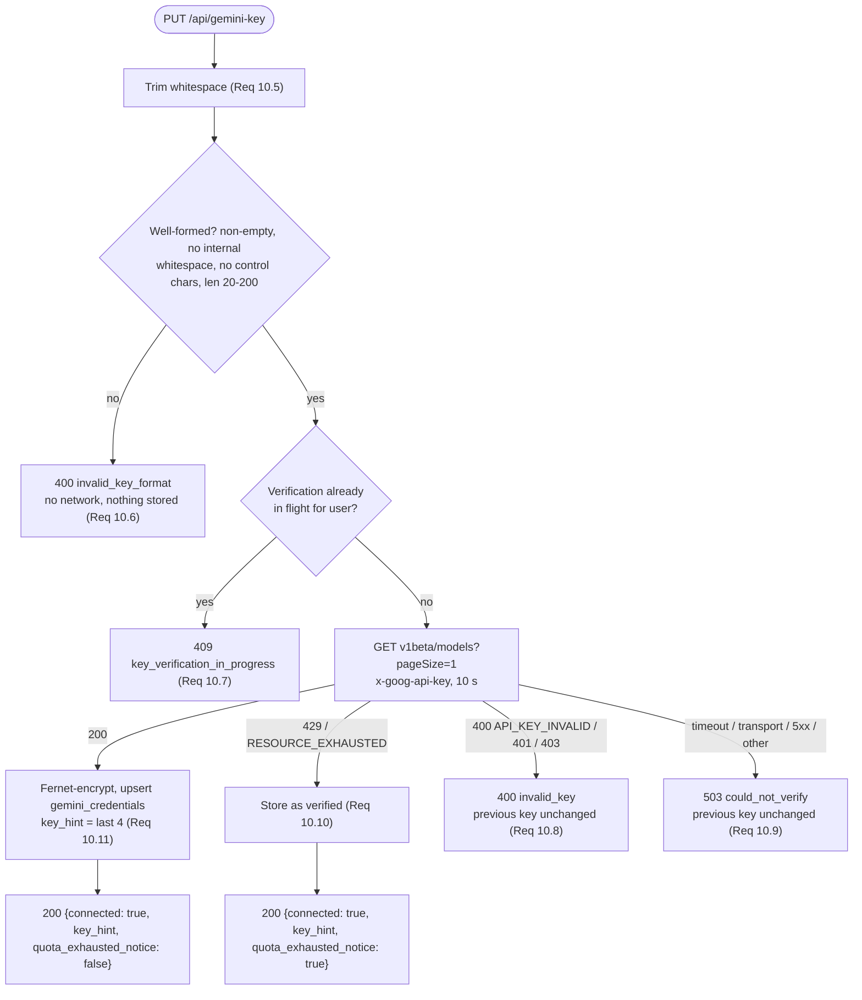
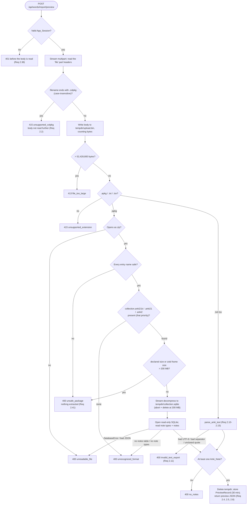
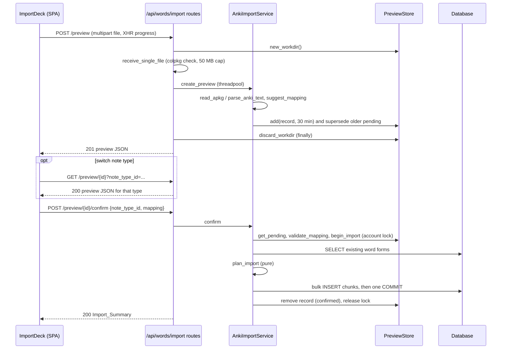
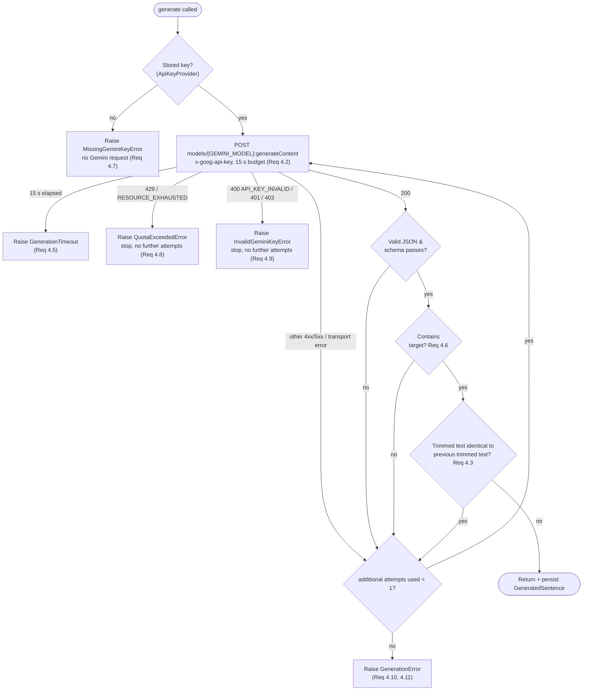

# Design Document

## Overview

The Japanese Vocabulary Trainer is a **web application** that helps a Learner memorize Japanese vocabulary in context. During a Review_Session the app presents each selected word (due Review_Words first, then New_Words, each group capped by the Learner's Study_Settings) embedded in a freshly generated Japanese Example_Sentence, with the Target_Word visually emphasized. The Learner reveals the answer, self-rates recall on four Difficulty_Rating levels, and a spaced-repetition Scheduler (an SM-2 / Anki-style scheme) computes the next review date.

Four design pressures shape the architecture:

1. **Fresh sentence per review (Requirement 4).** Example_Sentences are produced by an LLM, abstracted behind a **Sentence Generation Service** interface so the provider can be swapped. The LLM returns **structured JSON** — the full sentence plus a per-token tokenization with Japanese reading/furigana, a Korean (한국어) meaning, and target-word markers — which drives target emphasis (Req 3), non-target lookups (Req 5), and furigana display without any separate morphological analyzer or dictionary API.
2. **"Sign in with Google" for identity + bring-your-own Gemini API key for generation (Requirements 9, 10).** Identity and generation are deliberately separate:
   - **Identity (Req 9).** The Learner signs in with **"Sign in with Google"** — OAuth 2.0 Authorization Code flow with **PKCE (S256)** and **OpenID Connect**, requesting exactly the scopes `openid email profile`. The backend exchanges the code at Google's token endpoint with a confidential web-application client, validates the Google_ID_Token (issuer, audience, expiry with ≤ 300 s leeway, RS256 signature via Google's JWKS, nonce, `email_verified`), keys the application account on the Subject_Identifier `(iss, sub)`, and issues its **own** signed App_Session. Google access and refresh tokens are discarded after sign-in and never persisted. Google sign-in grants no Gemini usage.
   - **Generation (Req 4, 10).** Each Learner creates a free Gemini_API_Key in Google AI Studio by following the in-app **Key_Setup_Guide**, and pastes it into the app. The backend checks the key format locally, verifies it with one non-generating Gemini_API call, and stores it **encrypted at rest (Fernet)** per Learner. Only the Key_Hint (last 4 characters) ever reaches the browser. The `GeminiAdapter` calls the Gemini `generateContent` endpoint with the Learner's own key and JSON structured output. The application holds no developer-owned Gemini key and uses no OpenAI or ChatGPT service.
3. **Untrusted Anki deck files (Requirement 2).** A Learner uploads an `.apkg` deck package or an Anki plain-text export (`.txt`/`.tsv`), previews it, maps fields to word / reading / meaning, and confirms. The upload is untrusted input from the network, so the backend treats it as data only: the zip directory is checked before anything is read, only the newest collection file is decompressed (with size caps), the SQLite file is opened read-only with no extension loading, and media is never extracted. All decisions (cleanup, furigana, mapping, skip classification, text parsing) are pure functions, and the import itself runs in one database transaction. No Gemini key is needed.
4. **Per-session study limits on a 07:00 KST day (Requirements 1.5, 2.26, 8, 11).** "Today" is the Study_Day, which starts at 07:00 Asia/Seoul time, not the server's local calendar date. One pure helper, `study_day(now_utc)` in `app/services/study_day.py`, computes it, and every place that previously used `date.today()` (due selection, manual add, Anki import) calls `current_study_day()` instead. Each Learner's Study_Settings (`new_word_limit`, default 50; `review_word_limit`, default 100) are two columns on `users`. `ReviewService.start_session` selects up to `review_word_limit` due Review_Words, then up to `new_word_limit` New_Words, and the Learner edits both limits in a new "학습 설정" view.

Data (users, Gemini credentials, word entries, review history, scheduling state) persists in a backend database. The system is organized as a thin frontend (SPA) + stateless backend API so it can later be wrapped as a native Mac app with minimal change (see [Mac Wrapping Strategy](#mac-wrapping-strategy)).

### Research findings that inform the design

- **Google OAuth 2.0 / OIDC for web server apps.** Google's authorization endpoint is `https://accounts.google.com/o/oauth2/v2/auth`, the token endpoint is `https://oauth2.googleapis.com/token`, and signing keys are published at `https://www.googleapis.com/oauth2/v3/certs`. Web-application clients are confidential and send `client_secret` on the code exchange; PKCE (`code_challenge_method=S256`) is supported in addition. ID tokens carry `iss` of either `https://accounts.google.com` or `accounts.google.com`, so both values must be accepted. Not sending `access_type=offline` means Google does not issue a refresh token in the normal case. Sources: [Using OAuth 2.0 for Web Server Applications](https://developers.google.com/identity/protocols/oauth2/web-server), [OpenID Connect](https://developers.google.com/identity/openid-connect/openid-connect).
- **Gemini API keys and authentication.** Keys are created in [Google AI Studio](https://aistudio.google.com/apikey) and sent in the `x-goog-api-key` request header. Keeping the key out of the URL means request lines logged by `httpx` never contain it. Source: [Using Gemini API keys](https://ai.google.dev/gemini-api/docs/api-key).
- **Structured output.** `generateContent` accepts `generationConfig.responseMimeType = "application/json"` with a `responseSchema` (OpenAPI-subset schema) so the model returns JSON in the requested shape. The model output is still re-validated server-side. Sources: [Structured output](https://ai.google.dev/gemini-api/docs/structured-output), [generateContent reference](https://ai.google.dev/api/generate-content).
- **Error shape.** Gemini errors use the Google RPC envelope `{"error": {"code", "message", "status", "details": [{"@type": ".../google.rpc.ErrorInfo", "reason": ...}]}}`. An invalid key is HTTP 400 with `reason: "API_KEY_INVALID"`; permission problems are 403 `PERMISSION_DENIED`; quota exhaustion is 429 `RESOURCE_EXHAUSTED`. Source: [Gemini API troubleshooting](https://ai.google.dev/gemini-api/docs/troubleshooting), [rate limits](https://ai.google.dev/gemini-api/docs/rate-limits).
- **Terms.** The Gemini API terms require users to be 18+ and require paid (billing-enabled) keys for users in the EEA, Switzerland, and the UK; the free tier is rate limited. These are surfaced verbatim as notices in the Key_Setup_Guide (Req 10.4). Source: [Gemini API Additional Terms of Service](https://ai.google.dev/gemini-api/terms).
- **`.apkg` package versions.** Anki's own package code maps three package versions to three collection file names: `collection.anki2` and `collection.anki21` are legacy (schema 11), and `collection.anki21b` is the latest (schema 18) and is **zstd-compressed** inside the zip. Newer Anki exports also include a small `collection.anki2` stub for old clients, which is why the reader must prefer the newest file present (Req 2.7). Source: [ankitects/anki `rslib/src/import_export/package/meta.rs`](https://github.com/ankitects/anki/blob/main/rslib/src/import_export/package/meta.rs).
- **Collection schema.** In every schema, notes live in the `notes` table (`id`, `guid`, `mid`, `flds`, …) and `flds` holds all field values joined by the `0x1f` character, in the note type's field order. Legacy schema 11 keeps note types as JSON in `col.models` (keyed by note type id, each with `name` and `flds[{name, ord}]`). Schema 15 and later moved them to the `notetypes (id, name, …)` and `fields (ntid, ord, name, …)` tables, whose `name` columns use Anki's custom **`unicase` collation**; plain SQLite fails with "no such collation sequence" on queries that touch it unless the reader registers a collation of that name. Sources: [anki `schema11.sql`](https://github.com/ankitects/anki/blob/main/rslib/src/storage/schema11.sql), [anki `schema15_upgrade.sql`](https://github.com/ankitects/anki/blob/main/rslib/src/storage/upgrades/schema15_upgrade.sql), [Processing Anki's .apkg files](https://github.com/SergioFacchini/anki-cards-web-browser/blob/master/documentation/Processing%20Anki's%20.apkg%20files.md).
- **Plain-text exports.** Anki's text format uses `#key:value` header lines at the top of the file (`#separator:`, `#html:`, `#columns:`, `#notetype column:`, `#deck column:`, `#tags column:`, `#guid column:`). The parsing rules this design implements are the ones fixed in Req 2.10–2.16, not Anki's separator guessing. Source: [Anki manual: Text Files](https://docs.ankiweb.net/manual/importing/text-files).
- **Streaming uploads.** Starlette spools a whole `UploadFile` to disk before the handler runs, so a size check inside the handler comes too late to bound disk use. `python-multipart` (the parser FastAPI uses for forms) exposes a callback-based streaming `MultipartParser`, which lets the route see the part headers (file name) first and then count body bytes as they arrive. Source: [python-multipart API](https://multipart.fastapiexpert.com/api/).
- **Time zones in Python.** The standard-library `zoneinfo.ZoneInfo("Asia/Seoul")` reads the system IANA time zone database and falls back to the first-party `tzdata` package when no system database exists (Windows, slim containers, frozen PyInstaller builds). Asia/Seoul has had no daylight saving time since 1988, so KST is a fixed UTC+9 offset for every date the app handles. Subtracting a `timedelta` from an aware `datetime` is wall-clock arithmetic in Python, so `(local - timedelta(hours=7)).date()` gives exactly "the local date if the local time is 07:00 or later, else the previous date". Source: [zoneinfo documentation](https://docs.python.org/3/library/zoneinfo.html).

Content from these sources was rephrased for compliance with licensing restrictions.

### Technology Stack (recommended)

| Concern | Choice | Rationale |
| --- | --- | --- |
| Frontend | **React + TypeScript + Vite** | Component model fits token-rendered sentences and lookup panel; TS gives shared types with the LLM schema. Vite build wraps cleanly in a native shell. The Vite dev server proxies `/api` to the backend, so the OAuth redirect URI is `http://localhost:5173/api/auth/callback`. |
| Styling | Tailwind CSS (or CSS modules) | Fast, observable style changes for Target_Word emphasis (Req 3.2). |
| Backend framework | **FastAPI (Python)** | Modern, beginner-friendly docs, type-hint based, auto-generated interactive API docs (Swagger at `/docs`), and strong async support that suits slow LLM calls. The main alternative considered was **Django + DRF**, but FastAPI is a better fit for this small, LLM/JSON-heavy API and for a learner. |
| Validation / schema | **Pydantic** | One modeling layer reused for API request/response validation **and** for validating the LLM structured JSON output (Req 4.6 retry). `SecretStr` is used for the submitted Gemini_API_Key so it is masked in `repr` and logs. |
| Database | **PostgreSQL** | Relational data (users → words → review history), transactional writes for scheduling (Req 7.5). SQLite acceptable for local/dev and for the Mac-wrapped single-user build. |
| ORM / query | **SQLAlchemy** + **Alembic** (migrations) | Typed data access and schema migrations; maps cleanly to the data model below. |
| Authentication (identity) | **"Sign in with Google"** — OAuth 2.0 Authorization Code + **PKCE (S256)** + **OIDC**, scopes `openid email profile` | No local passwords. Google is the identity provider only; it grants no Gemini usage. |
| OIDC / ID-token verification | **python-jose** + Google **JWKS** (`https://www.googleapis.com/oauth2/v3/certs`) | RS256 signature, issuer, audience, expiry (≤ 300 s leeway), nonce, and `email_verified` checks in one pure function. |
| OAuth / PKCE client | **httpx**-based client in `app/auth/oauth.py` | Builds the authorization URL, exchanges the code (30 s timeout), fetches JWKS. No OAuth SDK is needed for this small flow. |
| App session | **python-jose** HS256 JWT (existing `app/auth/session.py`, `SESSION_SECRET`) with a server-side revocation list for logout | Issued only after ID-token validation; independent of any Google token (Req 9.9, 9.13). |
| Secret encryption | **cryptography.Fernet** with `TOKEN_ENCRYPTION_KEY` | Encrypts the Gemini_API_Key at rest (Req 10.11) and the short-lived authorization-start cookie. The variable keeps its existing name because the auth-start cookie already uses it; renaming adds churn with no behavior change. |
| LLM provider | **Google Gemini API** `generateContent` (model from `GEMINI_MODEL`, default `gemini-flash-lite-latest`), behind `SentenceGenerationService` | Invoked from the backend with the Learner's own key via `x-goog-api-key`; JSON structured output via `responseMimeType` + `responseSchema`. |
| HTTP client | **httpx** (async) | Used for Google token/JWKS calls and all Gemini calls; easy to mock with `httpx.MockTransport`. |
| Anki package reading | stdlib **`zipfile`** + **`sqlite3`**, plus **`zstandard`** | `zipfile` reads the central directory without extracting, so entry names can be checked first. `sqlite3` opens the collection read-only through a `file:…?mode=ro&immutable=1` URI. `zstandard` decompresses `collection.anki21b` as a stream with a byte cap. |
| Upload parsing | **`python-multipart`** streaming `MultipartParser` | Reads the file name before the body and enforces the 50 MB limit while bytes arrive (Req 2.2, 2.3). |
| PBT library | **Hypothesis** (Python) | Property-based tests for scheduler, sentence-identity check, schema validation, key handling, error mapping, ID-token validation, and the Anki import pure functions (text round-trip, cleanup, furigana, mapping, zip safety). |
| Test runner | **pytest** | Runs unit, integration, and Hypothesis property tests. |
| Package / env management | **uv** or **Poetry** | Reproducible dependency and virtual-env management for the Python backend. |
| Mac wrapper (future) | **Tauri** (preferred) or Electron | Loads the same web build; Tauri is lighter and can run a bundled Python backend/SQLite via a sidecar process. |

**Dependency changes:** remove `openai` (no longer imported anywhere) and `authlib` (the PKCE/code-exchange client is plain `httpx`). Keep `httpx`, `python-jose[cryptography]`, and `cryptography`. Add `zstandard>=0.22` (for `collection.anki21b`) and `python-multipart>=0.0.18` (streaming upload parsing; 0.0.18 and later include the fix for the multipart boundary denial-of-service issue). The project supports Python 3.11+, so the standard-library `compression.zstd` module (3.14+) is not relied on. Add `tzdata>=2024.1` so `ZoneInfo("Asia/Seoul")` resolves on hosts without a system time zone database (Req 1.5, 8.1).

## Architecture

The system has four layers: the **Browser SPA**, the **Backend API** (auth + domain services + Gemini key service + LLM proxy), the **Database**, and **external Google services**: the Google OAuth/OIDC endpoints (authorization, token, JWKS) for sign-in, and the Gemini_API for key verification and generation. For **generation and key verification**, the browser never talks to Gemini directly; all Gemini calls go through the authenticated backend, which decrypts the signed-in Learner's own key server-side. For **sign-in**, the browser takes part in the standard OAuth redirect: it is sent to Google's authorization endpoint and returns to the backend callback (through the Vite `/api` proxy) with an authorization code, which the backend exchanges and validates.

```mermaid
graph TD
    subgraph Client["Browser SPA (React + TS)"]
        UI_Login["Login View<br/>('Google로 계속하기')"]
        UI_Key["GeminiKeySetup View<br/>(Key_Setup_Guide)"]
        UI_Add["Add Word View<br/>(직접 입력 / Anki 덱 가져오기)"]
        UI_Import["ImportDeck panel<br/>(upload, preview, mapping, summary)"]
        UI_Review["Review Session View"]
        UI_Sentence["Sentence Renderer (token-based)"]
        UI_Lookup["Lookup Panel"]
        UI_Rate["Reveal + Rating Controls"]
        UI_Settings["StudySettings View<br/>(학습 설정)"]
    end

    subgraph Backend["Backend API (FastAPI / Python, stateless)"]
        Auth["Auth Service<br/>(Google OAuth/PKCE + OIDC,<br/>app session, logout revocation)"]
        KeySvc["GeminiKeyService<br/>(format check, verify,<br/>encrypt/store, hint)"]
        WordSvc["Word Service<br/>(CRUD + validation + dedupe)"]
        ImportSvc["AnkiImportService<br/>(readers, cleanup, mapping,<br/>one-transaction import)"]
        PreviewStore["PreviewStore<br/>(in-process, 30 min TTL,<br/>per-account import lock)"]
        ReviewSvc["Review Service<br/>(capped review + new selection,<br/>session summary)"]
        SettingsSvc["StudySettingsService<br/>(get / update limits)"]
        StudyDay["study_day()<br/>(pure, 07:00 KST boundary)"]
        Scheduler["Scheduler<br/>(SM-2-style, pure)"]
        SentenceSvc["SentenceGenerationService<br/>(interface)"]
        Gemini["GeminiAdapter<br/>(per-user key, structured JSON,<br/>validate + retry, error mapping)"]
    end

    DB[("PostgreSQL<br/>users (+ study limits), gemini_credentials,<br/>revoked_app_sessions,<br/>word_entries, review_history,<br/>sentences")]
    GOIDC["Google OAuth / OIDC<br/>(authorize, token, JWKS)"]
    GAPI["Gemini API<br/>(models.list for verify,<br/>generateContent)"]
    TMP[("Per-preview temp dir<br/>(tempfile, deleted after parsing)")]

    UI_Login --> Auth
    UI_Key --> KeySvc
    UI_Add --> WordSvc
    UI_Add --> UI_Import
    UI_Import -->|"multipart upload,<br/>preview, confirm, cancel"| ImportSvc
    ImportSvc --> PreviewStore
    ImportSvc --> TMP
    ImportSvc -->|"existing word forms,<br/>bulk insert (1 transaction)"| DB
    UI_Review --> ReviewSvc
    UI_Review --> SentenceSvc
    UI_Sentence --> UI_Lookup
    UI_Rate --> ReviewSvc

    Auth --> DB
    KeySvc --> DB
    KeySvc -->|"verify: GET models?pageSize=1<br/>x-goog-api-key"| GAPI
    WordSvc --> DB
    ReviewSvc --> DB
    ReviewSvc --> KeySvc
    ReviewSvc --> Scheduler
    ReviewSvc -->|"limits from users row"| DB
    UI_Settings -->|"GET / PUT /api/study-settings"| SettingsSvc
    SettingsSvc --> DB
    ReviewSvc --> StudyDay
    WordSvc --> StudyDay
    ImportSvc --> StudyDay
    Scheduler --> DB
    SentenceSvc --> Gemini
    Gemini -->|"get_api_key(user_id)"| KeySvc
    Gemini -->|"generateContent<br/>x-goog-api-key (Learner's key)"| GAPI
    SentenceSvc --> DB

    Client -->|"OAuth redirect<br/>(authorize)"| GOIDC
    Auth -->|"code exchange + JWKS<br/>(ID token validation)"| GOIDC
    Client -->|"HTTPS + app session"| Backend
```



### Key architectural decisions

- **Identity and generation are separate credentials.** Google sign-in yields only an identity (the Google_ID_Token). The Google access token and any refresh token returned by the token exchange are held in local variables for the duration of the callback and then dropped; they are never written to the database, a cookie, or a log (Req 9.12). Generation uses only the Learner's own Gemini_API_Key (Req 10.16). There is no developer-held fallback key, and Google sign-in tokens, Gemini CLI OAuth tokens, or Google AI subscriptions are never used to call Gemini (Req 10.17). Because no Gemini-related scope is requested, Google sign-in tokens could not authorize Gemini calls anyway.
- **Backend-mediated Gemini access with per-user BYOK.** The SPA requests sentence generation from `/api/review/.../sentence`. The backend authenticates the Learner by App_Session, the `GeminiAdapter` obtains the decrypted key from `GeminiKeyService.get_api_key(user_id)`, and calls Gemini. The key lives in memory only for the duration of the request. Centralizing the call in the backend keeps the key out of the browser (Req 10.12) and lets the backend enforce the retry/validation pipeline and error mapping.
- **Fail early when no key is connected.** `POST /api/review/sessions` checks for a stored key **before** due selection and returns `409 {code: "gemini_key_required"}`, so the SPA opens the Key_Setup_Guide instead of starting a session (Req 10.1). Word management routes do not require a key (Req 10.2).
- **Structured LLM output over post-processing.** Instead of generating plain text and segmenting it with a morphological analyzer, the LLM returns a validated token array. This removes the kuromoji/dictionary dependency, and makes Req 3 (emphasis), Req 5 (lookup/furigana), and Req 4 (word-count, target presence) checkable on structured data.
- **Pure Scheduler.** The scheduling computation is a side-effect-free function `compute_next_interval(rating, history) -> interval_days`. Persistence is a separate step. This makes the monotonicity invariant (Req 7.3) directly property-testable and makes failure handling (Req 7.5) a clean transaction boundary.
- **Pure decision functions at the provider boundaries.** Key format checking, Key_Hint derivation, Gemini error classification (verification and generation), and Google_ID_Token validation are pure functions over plain inputs (strings, status codes, JSON bodies, claims + JWKS + clock). The I/O wrappers only perform HTTP calls and delegate every decision to these functions, which makes Properties 21–25 fast Hypothesis tests with no network.
- **Anki import as a two-step, server-held preview.** The upload is parsed once into an in-memory `ParsedDeck` held in a `PreviewRecord` (owner, 30-minute expiry, state). Switching note types and confirming work from that record, so the file is never re-read and its temporary directory is deleted as soon as parsing ends. The import itself is one pure planning step (`plan_import`) followed by one database transaction, so the summary counts and the rollback guarantee (Req 2.31) are both easy to test. Like the consumed-state registry for sign-in, the preview store is in-process; a multi-instance deployment would need a shared store (see [Anki Import](#anki-import-requirement-2)).
- **One Study_Day source.** Due selection, manual add, and Anki import all take their date from `current_study_day()`, so a word added at 06:30 KST on 3 June gets `next_review_date = 2 June` and a session started at 06:59 KST still uses 2 June. The scheduler's `session_date + interval` therefore lands on Study_Days too. The helper is pure (`study_day(now_utc)`), so the 07:00 boundary is a fast property test (Property 35).
- **Study_Settings live on `users`.** Requirement 11.1 asks for exactly one Study_Settings per account. Two NOT NULL columns with server defaults on `users` give that by construction, need no join on session start, and give existing rows the defaults of Req 11.2 during the migration. A separate `study_settings` table was rejected: it adds a 1–1 row that must be created lazily or backfilled and adds nothing the two columns cannot hold.
- **Review_Word means "has a ReviewRecord".** Classification uses an `EXISTS` subquery on `review_records`, not `repetitions > 0`. A lapse (rating 1) resets `repetitions` to 0, and the glossary says such a word is still a Review_Word. `interval_days` is not used either, because it is 0 only before the first rating and is not documented as a classification field.
- **Stateless API + SPA split.** The API is stateless apart from the database: the client presents the **app's own session** (a short-lived signed JWT issued only after the backend validated the Google_ID_Token). The only server-side session state is a revocation list of logged-out session IDs (Req 9.13). This is what makes the later Mac wrapping (Tauri/Electron loading the same build) a packaging change rather than a rewrite.

## Components and Interfaces

### Frontend components

- **Login View** — shows a single "Google로 계속하기" button that navigates the browser to `GET /api/auth/login`. It also renders the callback error states returned by the bridge (Req 9.4, 9.5, 9.7, 9.10): "login could not be verified", "sign-in was not completed", "sign-in could not be completed", and "account could not be verified", each with a retry control that starts a new login (Req 9.5). It is the entry point shown after logout or on any `401` (Req 9.13, 9.14).
- **App shell / header** — after the bridge stores the App_Session, the shell calls `GET /api/auth/me`. The header shows the Learner's name or email, a **"Gemini 키 설정"** entry that opens the GeminiKeySetup view at any time (showing "연결됨 ····abcd" when connected), a **"학습 설정"** entry directly after it that opens the StudySettings view, and a logout control. In `App.tsx`, `type View = Tab | 'key' | 'settings'`. The new button copies the key entry's classes and active state (`aria-current="page"` and `border-forest/30 bg-forest-soft text-forest` when `view === 'settings'`), shows the glyph `設` with the label "학습 설정" from the `lg` breakpoint, carries `title="학습 설정"`, `aria-label="학습 설정"`, and `data-testid="header-settings-entry"`, and calls `setView('settings')`. `main` renders `<StudySettings />` when `view === 'settings'`. When `/me` reports `gemini_key.connected == false` right after sign-in, the shell opens GeminiKeySetup automatically. The guide offers a "나중에" control that returns to the Add Word view, because adding words stays available without a key (Req 10.2).
- **GeminiKeySetup View (Key_Setup_Guide)** — implements Req 10.3–10.15 on the client:
  - Five numbered steps in order (Req 10.3): (1) open the Google AI Studio API key page via a link to `https://aistudio.google.com/apikey` with `target="_blank" rel="noopener noreferrer"`; (2) sign in with a Google_Account; (3) create a key by choosing an existing Google Cloud project or creating a new one; (4) copy the key; (5) paste it into the input below.
  - Notices (Req 10.4): creating a key is free and needs no payment card; the free tier is rate limited; the Gemini API terms require users to be 18 or older; users in the EEA, Switzerland, or the UK must use a paid (billing-enabled) key.
  - A paste input with `type="password"`, a show/hide toggle, `autocomplete="off"`, and `spellcheck={false}`. The key is held only in component state; it is never written to `localStorage`, `sessionStorage`, URLs, or console output, and the field is cleared after a successful connect.
  - A **"연결 확인"** button that calls `putGeminiKey`. The button and input are disabled while a verification is in flight, so a second submission cannot start before the first finishes (Req 10.7).
  - Result states: format error (Req 10.6), invalid key (Req 10.8), could-not-verify-now (Req 10.9), connected with Key_Hint (Req 10.11), connected with a quota-exhausted notice (Req 10.10).
  - When connected: a status line with the Key_Hint, a **replace** action that reopens the input while the current key stays in use until a new key is stored (Req 10.14), and a **remove** action that calls `deleteGeminiKey` after confirmation and shows the not-connected status (Req 10.15).
  - It can be opened in "replace" mode from the Review view after an invalid-key error (Req 4.9).
- **Add Word View** — form for the manual input format (Req 1); surfaces per-field validation and duplicate errors returned by the backend. A two-tab switch at the top of the right-hand card, **"직접 입력"** and **"Anki 덱 가져오기"**, selects between the existing form and the ImportDeck panel. The left intro column stays; its copy changes per tab. There is no feature flag. Import needs an App_Session but no Gemini key (Req 10.2).
- **ImportDeck panel** (`views/ImportDeck.tsx`, Req 2) — a state machine `idle → uploading → preview → confirming → summary`, with error states that return to `idle` or stay on `preview` as listed below. It uses the existing washi/ink/forest/vermilion tokens (`surface-card`, `border-line`, `text-ink-muted`, `bg-forest-soft`/`text-forest` for success, `text-vermilion` accents, `bg-danger-soft`/`text-danger` for errors, `font-serif-jp` for Japanese headings, `focus-ring`).
  - **Idle: drop zone.** A dashed `border-line` drop zone with a vermilion "파일 선택" button over a hidden `<input type="file" accept=".apkg,.txt,.tsv">`. It accepts drag-and-drop of one file and shows the accepted extensions and the 50 MB limit. A collapsible help box, "Anki에서 내보내는 방법", says: open Anki, choose **파일(File) → 내보내기(Export…)**, pick **"Anki Deck Package (.apkg)"** or **"Notes in Plain Text (.txt)"** as the format, choose the deck, and press export. It also says that review history and media are not imported (Req 2.30) and that collection packages (`.colpkg`) are not supported. The menu names appear in English in parentheses because Anki's UI language varies.
  - **Client prechecks (UX only; the server stays authoritative).** A `.colpkg` file shows the unsupported-format message from Req 2.2 at once, and a file larger than 52,428,800 bytes shows the size message, both without uploading. Other extensions are uploaded so the server's ordered checks (Req 2.3) decide.
  - **Uploading.** A forest progress bar with a percentage, driven by `XMLHttpRequest.upload.onprogress`, and a cancel control that aborts the request. When the upload reaches 100 % the label changes to "덱을 읽는 중…" until the preview arrives.
  - **Preview** (Req 2.5, 2.8, 2.9, 2.20):
    - A header line with the file name and "노트 N개".
    - For `.apkg`, a "노트 유형" `<select>` listing `name (N개)`, defaulting to `selected_note_type_id`. Changing it calls `getImportPreview(id, noteTypeId)` and replaces the fields, suggested mapping, samples, and note count.
    - Three labelled selects: **단어 (필수)**, **읽기 (선택)** with a first option **"없음"**, and **뜻 (필수)**. Options are the available field names. They start at `suggested_mapping`; a `null` word or meaning starts at a placeholder "필드를 선택하세요".
    - A sample table: one column per available field, up to 5 rows of cleaned values. Mapped columns get a small role badge (단어 / 읽기 / 뜻) in the header. Long values are clamped to two lines with the full value in `title`.
    - Inline mapping errors: `validateMappingClient()` (same rules as the server's `validate_mapping`) runs on every change and shows a `text-danger` message under each invalid select ("단어 필드를 선택하세요", "다른 항목과 같은 필드예요"). The confirm button stays enabled so server errors can also be shown, but a client-invalid mapping is not sent. A server `invalid_mapping` response puts its per-role errors under the same selects (Req 2.22).
    - Actions: a vermilion **"N개 노트 가져오기"** confirm button (disabled while confirming) and a quiet **"취소"** button. Cancel calls `cancelImportPreview` and returns to idle (Req 2.35). Leaving the view with a pending preview also sends a best-effort cancel; the 30-minute expiry covers the rest.
  - **Summary card** (Req 2.33, 2.34): a `bg-forest-soft` headline "단어 N개를 추가했어요". Three count chips follow: "빈 항목 N" (missing field), "중복 N" (duplicate), and "길이 초과 N" (invalid length). When anything was skipped, a list shows the first 20 skipped notes: the word form, or "(빈 단어)" when `word_form` is `null`, plus the reason label. A note "건너뛴 노트 중 처음 20개만 보여요" appears when the total skipped is above 20. Buttons: "다른 덱 가져오기" (back to idle) and "복습하러 가기".
  - **Error states.**
    - Upload errors (each invalid-file code): a `bg-danger-soft` message for that code, then back to idle.
    - `invalid_mapping`: stays on preview.
    - `import_in_progress`: stays on preview with "다른 가져오기가 진행 중이에요. 끝난 뒤 다시 시도해 주세요." (Req 2.42).
    - `preview_expired`: "미리보기가 만료되었어요. 파일을 다시 올려 주세요.", then back to idle (Req 2.36).
    - `import_failed`: "가져오기에 실패해 단어를 하나도 추가하지 않았어요.", then back to idle (Req 2.31).
- **StudySettings View** (`views/StudySettings.tsx`, Req 11.3–11.5) — one `surface-card` with the heading "학습 설정" and the line "한 번의 복습 세션에 포함할 단어 수를 정해요. 저장한 값은 다음 세션부터 적용돼요."
  - **Load.** On mount it calls `getStudySettings()` and shows a spinner until the values arrive. A load failure shows `bg-danger-soft` text "설정을 불러오지 못했어요." with a "다시 시도" button. A 401 is handled by the shell's `onSignedOut`.
  - **Inputs.** Two labelled inputs: **신규 단어** (`new_word_limit`, helper text "처음 학습하는 단어, 기본 50") and **복습 단어** (`review_word_limit`, helper text "복습 날짜가 된 단어, 기본 100"). Each is `<input type="number" inputMode="numeric" min={0} max={1000} step={1}>`. The value is held as the raw string, so an empty or partial entry is never silently coerced.
  - **Inline validation.** `validateStudyLimit(text)` (exported from the view module) accepts exactly a string matching `^\d+$` whose integer value is at most 1000. It runs on every change and shows "0부터 1000 사이의 정수를 입력하세요" in `text-danger` under each invalid input, with `aria-invalid` and `aria-describedby` set (Req 11.5). While either input is invalid, **저장** is disabled and nothing is sent.
  - **Save.** **저장** (vermilion, disabled while a request is in flight) calls `putStudySettings({new_word_limit, review_word_limit})` with both values as numbers. On success the inputs take the returned values and a `bg-forest-soft text-forest` status line (`role="status"`) says "저장했어요. 다음 복습 세션부터 적용돼요." The line clears on the next edit. A server `invalid_study_settings` error puts each `fieldErrors` entry under its matching input and keeps the typed values. Any other error shows "저장하지 못했어요. 잠시 후 다시 시도해 주세요." and leaves the inputs as typed.
- **Review Session View** — orchestrates the session loop (Req 8): requests the session's word list, presents one Target_Word at a time, requests a sentence, handles reveal/rating, and renders the end-of-session summary. The view needs no change for the limits. `ReviewSessionOut.due_words` keeps its name and now holds the Review_Words followed by the New_Words in presentation order, the progress counter's total is still `due_words.length`, and the summary total is the server's `total_reviewed`. The existing no-due screen covers Req 8.5, including the case where both limits are 0. Gemini-specific states:
  - `409 gemini_key_required` on session start → opens the Key_Setup_Guide instead of starting the session (Req 10.1).
  - `409 gemini_key_required` on sentence generation → "Gemini API 키를 설정하세요" message with a control that opens the Key_Setup_Guide; the word stays unrated (Req 4.7, 10.15). After a key is connected, the view re-requests the sentence for the same word.
  - `422 invalid_gemini_key` → invalid-key message with a control that opens GeminiKeySetup in replace mode; the word stays unrated (Req 4.9).
  - `429 gemini_quota_exceeded` → quota message saying the Gemini_Quota is exhausted and to wait and retry later, with a retry control; the word stays unrated (Req 4.8).
  - `502 generation_timeout` / `502 generation_failed` → generation-error message with a retry control (Req 4.5, 4.10, 4.11, 4.12).
- **Sentence Renderer** — renders the Example_Sentence from the structured token array. Each token is an interactive span. Tokens flagged `isTarget` get an emphasis style differing in at least one observable attribute (Req 3.2). A per-sentence "show furigana" toggle renders `reading` in parentheses after each token (confirmed decision 3b).
- **Lookup Panel** — on clicking a Non_Target_Word, shows that token's Korean (한국어) `meaning` together with its Japanese `surface` and `reading` (Req 5.6), and `furigana` when the token `containsKanji` (Req 5.1, 5.2). Replaces content on a new selection (Req 5.3); shows an unavailable message and clears prior content when meaning is absent (Req 5.4); persists until another selection or dismissal (Req 5.5).
- **Reveal + Rating Controls** — reveal control shows Target_Word reading + meaning (Req 6.1); rating controls appear only after reveal (Req 6.2, 6.3) and offer exactly four ordered levels; selecting a level sends the rating and shows the selection (Req 6.4).

**Typed client functions** (`frontend/src/api/client.ts`), all built on the existing `request<T>()` helper that attaches the App_Session bearer token and turns non-2xx responses into an `ApiError { status, code, message }`:

```ts
export interface GeminiKeyStatus { connected: boolean; key_hint: string | null }
export interface Me { email: string; name: string | null; gemini_key: GeminiKeyStatus }
export interface GeminiKeyConnectResult {
  connected: true; key_hint: string; quota_exhausted_notice: boolean
}
export type GeminiKeyErrorCode =
  | "invalid_key_format" | "invalid_key" | "could_not_verify" | "key_verification_in_progress"
export type SentenceErrorCode =
  | "gemini_key_required" | "invalid_gemini_key" | "gemini_quota_exceeded"
  | "generation_timeout" | "generation_failed"

export function getMe(): Promise<Me>                                   // GET /api/auth/me
export function logout(): Promise<void>                                // POST /api/auth/logout
export function getGeminiKeyStatus(): Promise<GeminiKeyStatus>         // GET /api/gemini-key
export function putGeminiKey(apiKey: string): Promise<GeminiKeyConnectResult> // PUT /api/gemini-key
export function deleteGeminiKey(): Promise<GeminiKeyStatus>            // DELETE /api/gemini-key
```

`loginUrl()` returns `/api/auth/login`; login is a full-page navigation, not a fetch.

**Anki import client functions** (`frontend/src/api/endpoints.ts`, types in `types.ts`). These replace the existing `importWords(file)` → `POST /api/words/import` function and the old `ImportSummary` type; nothing else calls them except `endpoints.test.ts`, which is updated.

```ts
export type ImportFileKind = "apkg" | "text"
export interface ImportNoteType { id: string; name: string; note_count: number }
export interface ImportField { index: number; name: string }
export interface FieldMapping { word: number | null; reading: number | null; meaning: number | null }
export interface ImportPreview {
  preview_id: string
  file_kind: ImportFileKind
  note_types: ImportNoteType[]          // [] for .txt/.tsv
  selected_note_type_id: string | null  // null for .txt/.tsv
  fields: ImportField[]                 // available fields of the selected note type
  suggested_mapping: FieldMapping
  note_count: number                    // included notes (selected note type only)
  samples: string[][]                   // <= 5 rows, cleaned, one value per field
  expires_at: string                    // ISO 8601 UTC
}
export type SkipReason = "missing_field" | "duplicate" | "invalid_length"
export interface ImportSummary {
  created: number
  skipped_missing_field: number
  skipped_duplicate: number
  skipped_invalid_length: number
  skipped: { word_form: string | null; reason: SkipReason }[]   // first 20, file order
}
export type ImportErrorCode =
  | "unsupported_colpkg" | "file_too_large" | "unsupported_extension" | "unreadable_file"
  | "unrecognized_format" | "no_notes" | "invalid_text_export" | "unsafe_package"
  | "invalid_note_type" | "invalid_mapping" | "preview_expired" | "import_in_progress"
  | "import_failed"

export function createImportPreview(                    // POST /api/words/import/preview
  file: File, onProgress?: (fraction: number) => void, signal?: AbortSignal,
): Promise<ImportPreview>
export function getImportPreview(id: string, noteTypeId?: string): Promise<ImportPreview>
                                                         // GET /api/words/import/preview/{id}?note_type_id=
export function confirmImport(id: string, body: { note_type_id?: string; mapping: FieldMapping }): Promise<ImportSummary>
                                                         // POST /api/words/import/preview/{id}/confirm
export function cancelImportPreview(id: string): Promise<void>   // DELETE /api/words/import/preview/{id}
```

Client helper changes in `client.ts`:
- **Upload progress.** `fetch` has no upload progress events, so `createImportPreview` uses a new `uploadForm<T>(path, formData, {onProgress, signal})` helper built on `XMLHttpRequest`. It attaches the same bearer token and calls `signOutLocally()` on 401. It builds errors with the same `classify()` function as `request<T>()`, which is exported internally as `toApiError(status, payload)`.
- **Error codes.** The `ImportErrorCode` values are added to `CODED_ERRORS` and to `ApiErrorCode`.
- **Per-role errors.** `classify()` passes a coded detail's `errors` array through as `fieldErrors`, so `invalid_mapping` arrives as `fieldErrors: [{field: "word" | "reading" | "meaning", message}]`.

**Study settings client functions** (`frontend/src/api/endpoints.ts`, types in `types.ts`, Req 11):

```ts
export interface StudySettings { new_word_limit: number; review_word_limit: number }
export type StudySettingsErrorCode = 'invalid_study_settings'

export const STUDY_SETTINGS_PATH = '/api/study-settings'
export function getStudySettings(): Promise<StudySettings>               // GET /api/study-settings
export function putStudySettings(settings: StudySettings): Promise<StudySettings>
                                                                        // PUT /api/study-settings
```

Both use `request<T>()`, so the bearer token and the 401 sign-out behave as on every other route. `'invalid_study_settings'` is added to `CODED_ERRORS` (and its type parameter list gains `StudySettingsErrorCode`), and `StudySettingsErrorCode` joins the `ApiErrorCode` union. This is required, not cosmetic: without it, `classify()` falls through to `case 422` and reports the error as `invalid_rating`. Because the backend sends `{code, message, errors}`, the existing `toFieldErrors` path delivers `fieldErrors: [{field: "new_word_limit" | "review_word_limit", message}]` with no other client change.

### Backend services and interfaces

The backend service interfaces are expressed as Python abstract base classes / `Protocol`s; concrete adapters (e.g. the Gemini sentence generator) implement them. `Difficulty` is an `IntEnum` over 1..4 (hardest=1 .. easiest=4, Req 6.2, 7.1).

```python
from abc import ABC, abstractmethod
from dataclasses import dataclass
from enum import Enum, IntEnum
from typing import Protocol


# ---- Sentence generation failures (replace PlanIneligibleError,
# ---- UsageCapExceededError, TokenRefreshError) ----

class SentenceGenerationError(Exception):
    """Base class for generation failures. Messages never contain a key."""


class MissingGeminiKeyError(SentenceGenerationError):
    """Req 4.7 / 10.15: the Learner has no stored key; no Gemini request sent."""


class InvalidGeminiKeyError(SentenceGenerationError):
    """Req 4.9: Gemini rejected the key (400 API_KEY_INVALID, 401, 403
    PERMISSION_DENIED). The request stops; no further attempts."""


class QuotaExceededError(SentenceGenerationError):
    """Req 4.8: Gemini returned 429 / RESOURCE_EXHAUSTED. The request stops;
    no further attempts."""


class GenerationTimeout(SentenceGenerationError):
    """Req 4.2 / 4.5: an attempt exceeded its 15 s budget."""


class GenerationError(SentenceGenerationError):
    """Req 4.10 / 4.11: retry budget exhausted by discarded outputs or
    transient provider errors."""


class Difficulty(IntEnum):
    """Ordered discrete rating set, hardest=1 .. easiest=4 (Req 6.2, 7.1)."""
    VERY_HARD = 1
    HARD = 2
    GOOD = 3
    VERY_EASY = 4


class AuthService(ABC):
    @abstractmethod
    def build_authorization_url(self) -> "AuthStart":
        """Req 9.1, 9.2, 9.11: Google authorization URL with
        response_type=code, scope='openid email profile', fresh state,
        fresh nonce, PKCE S256 code_challenge, redirect_uri; no
        access_type=offline. Returns the URL plus state/nonce/verifier and
        expires_at = now + 10 min for the encrypted auth-start cookie."""
        ...

    @abstractmethod
    async def handle_callback(
        self, *, code: str | None, state: str | None, error: str | None,
        expected: "AuthStart | None",
    ) -> "AppSession":
        """Req 9.3-9.12: reject provider errors (AuthorizationDeniedError);
        verify state is present, matches, unexpired, unused, then mark used
        (AuthStateError); exchange code + verifier once (30 s,
        TokenExchangeError); validate the Google_ID_Token
        (AccountVerificationError); discard Google tokens; upsert the
        account by (iss, sub); issue the App_Session."""
        ...

    @abstractmethod
    def logout(self, session_id: str, expires_at: "datetime") -> None:
        """Req 9.13: record the session ID as revoked until it expires."""
        ...


@dataclass(frozen=True)
class GeminiKeyStatus:
    connected: bool
    key_hint: str | None          # last 4 chars, or None when not connected


@dataclass(frozen=True)
class GeminiKeyConnectResult:
    key_hint: str
    quota_exhausted_notice: bool  # Req 10.10


class KeyFormatError(Exception): ...                # Req 10.6  -> 400 invalid_key_format
class KeyRejectedError(Exception): ...              # Req 10.8  -> 400 invalid_key
class KeyVerificationUnavailableError(Exception): ...  # Req 10.9 -> 503 could_not_verify
class KeyVerificationInProgressError(Exception): ...   # Req 10.7 -> 409 key_verification_in_progress


class GeminiKeyService(ABC):
    @abstractmethod
    def status(self, user_id: str) -> GeminiKeyStatus: ...

    @abstractmethod
    async def connect(self, user_id: str, raw_key: str) -> GeminiKeyConnectResult:
        """Req 10.5-10.11, 10.14: trim, format-check (no network on failure),
        verify with exactly one GET models?pageSize=1 (10 s), then encrypt and
        upsert, replacing any previous key only after success."""
        ...

    @abstractmethod
    def remove(self, user_id: str) -> GeminiKeyStatus:
        """Req 10.15: delete the stored key; returns not-connected status."""
        ...

    @abstractmethod
    def get_api_key(self, user_id: str) -> str:
        """Decrypt and return the Learner's key for server-side use only.
        Raises MissingGeminiKeyError when none is stored."""
        ...


class ApiKeyProvider(Protocol):
    """Injected into GeminiAdapter; bound to GeminiKeyService.get_api_key."""
    def __call__(self, user_id: str) -> str: ...


class WordService(ABC):
    @abstractmethod
    def add_word(
        self, user_id: str, data: "WordInput", today: "date | None" = None
    ) -> "WordEntry":
        """Req 1: validate (lengths, whitespace), dedupe by exact word form,
        set next_review_date = today, where an omitted today means
        current_study_day() (Req 1.5). Raises ValidationError / DuplicateError."""
        ...

    @abstractmethod
    def list_collection(self, user_id: str) -> list["WordEntry"]:
        ...


class ReviewService(ABC):
    @abstractmethod
    def start_session(self, user_id: str, day: "date") -> "ReviewSessionOut | NoDueWords":
        """Req 10.1, then 8.1 / 8.5 / 11.4 / 11.6 / 11.7. `day` is the current
        Study_Day (positional, so existing callers keep working).
        1. Raise MissingGeminiKeyError if no key is stored, before any query.
        2. Read new_word_limit and review_word_limit from the User row.
        3. Review_Words: the user's words with at least one ReviewRecord and
           next_review_date <= day, ordered (next_review_date, created_at, id),
           LIMIT review_word_limit.
        4. New_Words: the user's words with no ReviewRecord, any
           next_review_date, ordered (created_at, id), LIMIT new_word_limit.
        5. Session word list = Review_Words + New_Words; empty -> NoDueWords
           and no session is registered."""
        ...

    @abstractmethod
    def record_rating(
        self, user_id: str, session_id: str, word_id: str, rating: Difficulty
    ) -> "RatingResult":
        """Req 6/7/8.3/8.4: validate rating, require revealed, schedule,
        persist (one transaction), advance or summarize."""
        ...


class StudySettingsService:
    """Req 11: read and update one Learner's Study_Settings (two columns on
    users). Concrete class, no ABC: there is one storage and nothing to swap.
    Every method is keyed by the App_Session's user id, so a Learner can read
    or modify only their own settings (Req 11.8)."""

    def __init__(self, db: "Session") -> None: ...

    def get(self, user_id: str) -> "StudySettingsOut":
        """Req 11.2, 11.3: the stored values, which are 50 / 100 until the
        Learner saves (server defaults)."""
        ...

    def update(self, user_id: str, data: "StudySettingsIn") -> "StudySettingsOut":
        """Req 11.4: set both columns on the user's row and commit once. Takes
        an already-validated StudySettingsIn, so invalid values never reach
        the database (Req 11.5). On a database error: rollback, re-raise."""
        ...


class Scheduler(Protocol):
    def compute_next_interval(
        self, rating: Difficulty, history: list["ReviewRecord"]
    ) -> int:
        """PURE. Req 7.1-7.3: integer interval in [1, 365] days;
        monotonic non-decreasing in difficulty. No side effects."""
        ...


class SentenceGenerationService(ABC):
    @abstractmethod
    async def generate(
        self, user_id: str, target: "WordEntry", previous: "GeneratedSentence | None"
    ) -> "GeneratedSentence":
        """Req 4: produce a sentence containing the target, 1-50 words,
        whose whitespace-trimmed text is not identical to the previous
        sentence's trimmed text, within the time budget; returns validated
        structured output. GeminiAdapter obtains the key via the injected
        ApiKeyProvider (once per request) and calls generateContent. Raises
        MissingGeminiKeyError (4.7), QuotaExceededError (4.8),
        InvalidGeminiKeyError (4.9), GenerationTimeout (4.5),
        GenerationError (4.10, 4.11)."""
        ...
```

**Pure helper functions** (no I/O; the main Hypothesis targets for Properties 21–25):

```python
def normalize_gemini_key(raw: str) -> str:
    """Trim leading/trailing whitespace (Req 10.5); then raise KeyFormatError if
    the trimmed value is empty, contains any internal whitespace character,
    contains any non-printable or control character, or has length < 20 or > 200.
    Otherwise return the trimmed value as well-formed. The check is
    format-agnostic: it asserts no particular prefix or length shape, so any key
    Google issues (for example an `AQ.`- or `AIza`-prefixed key, and future
    shapes) passes to the verification request, which decides real validity
    (Req 10.6)."""

def key_hint(key: str) -> str:
    """Return key[-4:] (Req 10.11, 10.12)."""

def redact(text: str, secret: str) -> str:
    """Replace every occurrence of `secret` in `text` with '[REDACTED]'."""

class VerificationOutcome(Enum):
    VALID = "valid"; INVALID = "invalid"; QUOTA_EXHAUSTED = "quota"; UNAVAILABLE = "unavailable"

def classify_verification(status: int | None, body: bytes | None) -> VerificationOutcome:
    """status None = timeout/transport failure. 200 -> VALID;
    400 with ErrorInfo.reason API_KEY_INVALID, 401, 403 -> INVALID;
    429 or error.status RESOURCE_EXHAUSTED -> QUOTA_EXHAUSTED;
    anything else (other 4xx, 5xx, None) -> UNAVAILABLE."""

class GeminiFailure(Enum):
    INVALID_KEY = "invalid_key"; QUOTA = "quota"; TRANSIENT = "transient"

def classify_generation_failure(status: int, body: bytes | None) -> GeminiFailure:
    """429 / RESOURCE_EXHAUSTED -> QUOTA; 400 API_KEY_INVALID, 401,
    403 PERMISSION_DENIED -> INVALID_KEY; everything else -> TRANSIENT."""

def validate_google_id_token(
    id_token: str, jwks: Mapping[str, Any], *, client_id: str,
    expected_nonce: str, now: datetime, leeway_seconds: int = 300,
) -> GoogleIdentity:
    """Req 9.8 / 9.10: accept only if all six checks pass, else raise
    IDTokenValidationError: (1) iss in {https://accounts.google.com,
    accounts.google.com}; (2) aud == client_id; (3) exp > now - leeway;
    (4) RS256 signature verifies with the JWKS key whose kid matches the
    token header (alg must be RS256); (5) nonce == expected_nonce
    (constant-time compare); (6) email_verified is true. Returns
    GoogleIdentity(issuer='https://accounts.google.com', subject, email, name)
    with the issuer normalized to its canonical https form."""
```

**Study_Day helper** (`app/services/study_day.py`, new, pure; Property 35):

```python
from collections.abc import Callable
from datetime import UTC, date, datetime, timedelta, time
from zoneinfo import ZoneInfo

STUDY_DAY_ZONE = ZoneInfo("Asia/Seoul")      # KST, UTC+9, no DST
STUDY_DAY_START = time(7, 0)                 # a Study_Day starts at 07:00 KST
_START_OFFSET = timedelta(hours=STUDY_DAY_START.hour, minutes=STUDY_DAY_START.minute)


def _utc_now() -> datetime:
    return datetime.now(UTC)


def study_day(now_utc: datetime) -> date:
    """The Study_Day of an instant (glossary: Study_Day).

    A naive datetime is treated as UTC, because the app stores and compares
    UTC instants (SQLite CURRENT_TIMESTAMP and datetime.now(UTC) are both UTC).
    An aware datetime in any zone is converted to KST first. The result is the
    KST date when the KST wall time is 07:00 or later, else the previous date.
    Equivalently, for KST's fixed offset: (now_utc in UTC + 2 h).date()."""
    if now_utc.tzinfo is None:
        now_utc = now_utc.replace(tzinfo=UTC)
    local = now_utc.astimezone(STUDY_DAY_ZONE)
    return (local - _START_OFFSET).date()   # wall-clock arithmetic


def current_study_day(clock: Callable[[], datetime] | None = None) -> date:
    """study_day(clock()). The clock is injectable for tests. `_utc_now` is
    looked up at call time, not bound as a default, so tests can also
    monkeypatch `app.services.study_day._utc_now`."""
    return study_day((clock or _utc_now)())
```

Callers (each replaces a `date.today()` call that used the server's local calendar date):

| Call site | Change | Requirement |
| --- | --- | --- |
| `app/api/routes/review.py` `start_session` | `service.start_session(user.id, current_study_day())` | 8.1 |
| `app/services/word_service.py` `WordService.add_word` | `creation_date = today if today is not None else current_study_day()` | 1.5 |
| `app/services/anki_import/import_service.py` `AnkiImportService.__init__` | default `today: Callable[[], date] = current_study_day` | 2.26 |

`add_words_bulk` and `_entry_values` already take `today` from the caller and stay unchanged. `get_anki_import_service` in `deps.py` passes no `today`, so it picks up the new default. Tests keep injecting fixed dates through the same `today` parameters, so the existing unit tests need no new fakes.

- **Auth Service (Sign in with Google)** — drives the OAuth 2.0 Authorization Code + PKCE + OIDC flow (Req 9), shown in the sequence diagram below.
  - **Login (Req 9.1, 9.2, 9.11).** Generates a fresh `state` (32 random bytes, base64url), a fresh `nonce`, and a PKCE verifier (43–128 chars) with its S256 challenge. These go into the existing **encrypted, HttpOnly, SameSite=Lax authorization-start cookie** (Fernet, `TOKEN_ENCRYPTION_KEY`), path `/api/auth`, `Max-Age=600`, `Secure` when the redirect URI is HTTPS, with `expires_at = now + 10 min`. The browser is redirected (302) to `https://accounts.google.com/o/oauth2/v2/auth` with `client_id`, `redirect_uri`, `response_type=code`, `scope=openid email profile`, `state`, `nonce`, `code_challenge`, `code_challenge_method=S256`, and `prompt=select_account`. `access_type=offline` is not sent.
  - **Callback state check (Req 9.3, 9.4).** The callback always deletes the auth-start cookie. If Google returned `error` (e.g. `access_denied`) the attempt ends with `AuthorizationDeniedError` (Req 9.5). Otherwise the state must be present, decrypt from the cookie, match the cookie's state under constant-time comparison, be unexpired, and be unused. "Unused" is enforced by a **consumed-state registry**: a SHA-256 hash of each accepted state is recorded with its expiry, so replaying a captured cookie within its 10 minutes is rejected. The registry is in-process with a TTL for the single-process dev server; a multi-instance deployment would back it with a table. Any failure raises `AuthStateError`, and no token exchange happens.
  - **Code exchange (Req 9.6, 9.7).** One `POST https://oauth2.googleapis.com/token` with `grant_type=authorization_code`, `code`, `code_verifier`, `redirect_uri`, `client_id`, `client_secret`, and a 30 s timeout. A timeout, transport error, non-2xx response, or a response without `id_token` raises `TokenExchangeError`.
  - **ID-token validation (Req 9.8, 9.10).** JWKS is fetched from `https://www.googleapis.com/oauth2/v3/certs` and cached per its `Cache-Control: max-age`; an unknown `kid` triggers one refetch. `validate_google_id_token` runs the six checks. A failure, including a JWKS fetch failure, raises `AccountVerificationError`, and no account is created or modified.
  - **Token disposal (Req 9.12).** `access_token`, `refresh_token`, and the raw token response are never persisted or logged and go out of scope when the callback returns, whether it succeeds or fails.
  - **Account association (Req 9.9).** The account is looked up or created by `(oidc_issuer, oidc_subject)` using the normalized issuer, so the two `iss` spellings resolve to the same account. `email` and `name` are refreshed on each sign-in but are never used as the key.
  - **Session and bridge.** The callback issues the App_Session (`app/auth/session.py`, HS256 JWT with `sid`, 12 h TTL). The existing browser-navigation **HTML bridge** in the callback route stores the session token in the SPA and returns to `/`. Error outcomes go through the same bridge with a safe error code that the Login View renders.
  - **Logout and revocation (Req 9.13, 9.14).** `POST /api/auth/logout` requires the bearer session and inserts its `sid` into `revoked_app_sessions` until the session's `exp`. `get_current_user` rejects revoked, missing, invalid, or expired sessions with the same `401`, and the SPA returns to the Login View.
- **GeminiKeyService** — implements Req 10.5–10.15 (see the key-connect flow below).
  - **Format check.** `connect` first calls `normalize_gemini_key`. On a format failure nothing is stored and no HTTP request is made (Req 10.6).
  - **Single in-flight verification (Req 10.7).** A per-user non-blocking lock is taken before verification. A concurrent submission gets `KeyVerificationInProgressError` → `409`. The SPA also disables the button, so this is a backstop.
  - **Verification.** One `GET https://generativelanguage.googleapis.com/v1beta/models?pageSize=1` with the `x-goog-api-key` header and a 10 s total timeout (Req 10.7, 10.9). This request generates no content. The result is mapped by `classify_verification`: `VALID` or `QUOTA_EXHAUSTED` → encrypt and upsert into `gemini_credentials` in one transaction (Req 10.10, 10.11). `INVALID` → `KeyRejectedError` (Req 10.8). `UNAVAILABLE` → `KeyVerificationUnavailableError` (Req 10.9). Nothing is written on any failure, so the previously stored key is unchanged and stays in use until the upsert commits (Req 10.14).
  - **Remove and read.** `remove` deletes the row (Req 10.15). `get_api_key` decrypts on demand for the adapter.
  - **Secrecy (Req 10.12, 10.13).** The key is never logged. Exceptions from `httpx` are caught and re-raised as the service's own exception types with fixed messages (`raise ... from None`), so the original exception and its context are dropped. Any provider message that is logged is first passed through `redact(message, key)`.
- **Word Service** — Req 1 validation, exact-match dedupe within a Learner's collection, and the "due immediately" rule (Req 1.5): `next_review_date` is the current Study_Day from `current_study_day()` unless a test injects `today`. Works without a stored Gemini_API_Key (Req 10.2). For the Anki import it gains two methods that keep the same rules in one place: `existing_word_forms(user_id) -> set[str]` and `add_words_bulk(user_id, inputs: Sequence[WordInput], today, chunk_size=1000) -> int`. `add_words_bulk` builds rows the same way `add_word` does (a shared private `_entry_values` helper; `next_review_date = today`, `ease_factor = 2.5`, `interval_days = 0`, `repetitions = 0`). It inserts them with SQLAlchemy 2.0 ORM bulk `insert(WordEntry)` in chunks and **does not commit**; the caller owns the transaction. `add_word` keeps its current behavior.
- **AnkiImportService** — Req 2; see [Anki Import](#anki-import-requirement-2) below.
- **Review Service** — Req 8 orchestration: Gemini key presence check before selection (Req 10.1), capped selection of Review_Words and New_Words, one-at-a-time presentation, rating validation (Req 6.5, 8.6), delegation to Scheduler, transactional persistence (Req 7.4/7.5), advance-or-summarize (Req 8.3/8.4).
  - **Unchanged.** The constructor (`db`, `has_gemini_key`), the key gate as the first statement of `start_session`, `reveal`, `record_rating`, the in-memory `_sessions` registry, `SessionState`, and the summary logic stay as they are. `SessionState.session_date` now holds the Study_Day, so `record_rating` stores `session_date + interval` (Req 7.4). The summary's `total_reviewed = len(state.rated_word_ids)` already counts the session's own word list, because the session ends only after every listed word is rated (Req 8.4).
  - **Selection (replaces the single `next_review_date <= today` query).**

    ```python
    def start_session(self, user_id: str, day: date) -> ReviewSessionOut | NoDueWords:
        if self._has_gemini_key is not None and not self._has_gemini_key(user_id):
            raise MissingGeminiKeyError()                    # Req 10.1, before any query

        user = self._db.get(User, user_id)                    # limits from the User row
        review_limit = user.review_word_limit if user else DEFAULT_REVIEW_WORD_LIMIT
        new_limit = user.new_word_limit if user else DEFAULT_NEW_WORD_LIMIT

        has_review = (
            select(ReviewRecord.id)
            .where(ReviewRecord.word_id == WordEntry.id)
            .exists()                                         # correlated EXISTS
        )
        review_words: list[WordEntry] = []
        if review_limit > 0:                                  # Req 11.7
            review_words = list(self._db.execute(
                select(WordEntry)
                .where(WordEntry.user_id == user_id, has_review,
                       WordEntry.next_review_date <= day)     # Due_Word on the Study_Day
                .order_by(WordEntry.next_review_date, WordEntry.created_at, WordEntry.id)
                .limit(review_limit)
            ).scalars())
        new_words: list[WordEntry] = []
        if new_limit > 0:                                     # Req 11.6
            new_words = list(self._db.execute(
                select(WordEntry)
                .where(WordEntry.user_id == user_id, ~has_review)   # any next_review_date
                .order_by(WordEntry.created_at, WordEntry.id)
                .limit(new_limit)
            ).scalars())

        words = review_words + new_words                      # reviews first (Req 8.1, 8.2)
        if not words:
            return NoDueWords()                               # Req 8.5, no session registered
        ...  # register SessionState(session_date=day, word_ids=[w.id for w in words])
        return ReviewSessionOut(session_id=..., due_words=[WordEntryOut.model_validate(w) for w in words])
    ```

  - **Why the groups are disjoint.** One query requires `EXISTS` and the other `NOT EXISTS` on the same correlated subquery, so no word can be in both lists, and the concatenation never repeats an id (Req 8.2).
  - **Creation order.** "Creation order" is `(created_at, id)`. `created_at` comes from the database `CURRENT_TIMESTAMP`, which has one-second resolution on SQLite, and words imported in one transaction share one value. Ties are then broken by `id`. That order is deterministic (Property 36), but within one second it is UUID order, not insertion order. This is a known limitation; see the note in Data Models.
  - **Missing user row.** `CurrentUser` guarantees the row exists on the HTTP path. The fallback to the defaults only keeps direct service calls in tests with a bare user id working.
- **StudySettingsService** — Req 11. `get` loads `User` by id and returns `StudySettingsOut(new_word_limit, review_word_limit)`. `update` sets both attributes from an already-validated `StudySettingsIn` and commits once, so either both values are stored or neither is (Req 11.4, 11.5). A database error rolls back and propagates as a 500. It needs an App_Session and no Gemini key.
- **Scheduler** — pure SM-2-style interval computation (see [Spaced-Repetition Algorithm](#spaced-repetition-algorithm)).
- **SentenceGenerationService + GeminiAdapter** — the interface is provider-agnostic. `GeminiAdapter`:
  - **Key lookup.** Calls the injected `ApiKeyProvider` once per generation request. `MissingGeminiKeyError` propagates before any HTTP request is made (Req 4.7).
  - **Request.** Each attempt is one `POST https://generativelanguage.googleapis.com/v1beta/models/{GEMINI_MODEL}:generateContent` with the `x-goog-api-key` header. The body carries `systemInstruction`, the user prompt (target + previous sentence), and `generationConfig = {responseMimeType: "application/json", responseSchema: GEMINI_RESPONSE_SCHEMA}`. The `systemInstruction` asks for each token's `meaning` in Korean (한국어), while `text`, `surface`, and `reading` stay Japanese (Req 5.6).
  - **Identity check (Req 4.3, 4.6).** A schema-valid candidate that contains the target is discarded and retried only if its full sentence `text`, after trimming leading and trailing whitespace, is identical to the trimmed `text` of the immediately preceding `GeneratedSentence` for that word. Any other difference in the text is accepted.
  - **Time budget.** Each attempt is bounded at 15 s of wall-clock time by `asyncio.wait_for` around the httpx call (Req 4.2).
  - **Pipeline.** Runs the validation + retry pipeline below, which also applies the error mapping. The Review Service maps each exception to its HTTP error code, and the Target_Word stays in the session.

### Google sign-in sequence

```mermaid
sequenceDiagram
    participant B as Browser (SPA)
    participant V as Vite /api proxy
    participant A as Backend /api/auth
    participant G as Google OAuth/OIDC

    B->>V: GET /api/auth/login
    V->>A: forward
    A->>A: new state, nonce, PKCE verifier + S256 challenge
    A-->>B: 302 to accounts.google.com/o/oauth2/v2/auth<br/>Set-Cookie: encrypted auth-start (HttpOnly, 10 min)
    B->>G: authorize (scope=openid email profile)
    G-->>B: 302 to localhost:5173/api/auth/callback?code&state
    B->>V: GET /api/auth/callback (cookie)
    V->>A: forward
    A->>A: delete cookie; verify state (match, unexpired, unused) and mark used
    A->>G: POST oauth2.googleapis.com/token (code, verifier, client_secret) 30 s
    G-->>A: id_token (+ access_token, discarded)
    A->>G: GET oauth2/v3/certs (cached JWKS)
    A->>A: validate iss, aud, exp(±300 s), RS256, nonce, email_verified
    A->>A: upsert user by (iss, sub); issue App_Session
    A-->>B: HTML bridge stores session, navigates to SPA
    B->>A: GET /api/auth/me
    A-->>B: {email, name, gemini_key: {connected, key_hint}}
```

### Gemini key connect flow



### Anki Import (Requirement 2)

The import is a two-step flow: **upload → Import_Preview** and **confirm → Import_Summary**. A cancel step and a 30-minute expiry discard the preview. Every decision is made by a pure function. Only the upload reader, the package reader, and the final write touch I/O.

#### Module layout

```
backend/app/
├── api/
│   ├── upload.py                  # streaming multipart reader (HTTP concern)
│   └── routes/word_import.py      # /api/words/import/* routes
├── schemas/word_import.py         # Pydantic DTOs (preview, confirm body, summary)
└── services/anki_import/
    ├── __init__.py
    ├── errors.py                  # AnkiImportError(code, message) and one subclass per code
    ├── models.py                  # NoteType, AnkiNote, ParsedDeck, FieldMapping, plan dataclasses
    ├── file_kind.py               # PURE extension rules (.colpkg, .apkg, .txt/.tsv)
    ├── apkg_reader.py             # zip safety, collection selection, zstd, read-only SQLite
    ├── text_reader.py             # PURE Anki_Text_Parser + Anki_Text_Printer + column naming
    ├── cleanup.py                 # PURE Field_Cleanup + furigana functions
    ├── mapping.py                 # PURE suggest_mapping + validate_mapping + choose_default_note_type
    ├── preview_store.py           # in-process PreviewStore, temp dirs, expiry, per-account lock
    └── import_service.py          # PURE plan_import + AnkiImportService (preview, confirm, cancel)
```

#### Upload and preview pipeline

The checks run in the order fixed by Req 2.2 and 2.3. Each stops processing, creates no Import_Preview, and deletes the temp directory.



`unsafe_package` and `invalid_text_export` are the package-specific and text-specific forms of the "unreadable or corrupted" reason, so they sit at that position in the Req 2.3 order. A wrong extension is reported before them, and a missing collection file or zero notes after them.

#### Upload reader (`app/api/upload.py`)

```python
MAX_UPLOAD_BYTES = 52_428_800          # Req 2.3
MULTIPART_OVERHEAD_BYTES = 1_048_576   # allowance for boundaries and non-file parts

@dataclass(frozen=True)
class ReceivedFile:
    filename: str      # client file name, basename only (path parts split on "/" and "\\" dropped)
    path: Path         # <workdir>/upload.bin
    size: int

async def receive_single_file(request: Request, workdir: Path) -> ReceivedFile:
    """Stream the multipart body through python-multipart's MultipartParser.
    - Content-Type must be multipart/form-data with a boundary, else UnreadableFileError.
    - On the headers of the part named 'file': if is_colpkg(filename), raise
      UnsupportedColpkgError at once, before any body byte is stored (Req 2.2).
    - File-part bytes are appended to workdir/upload.bin. Once the count passes
      MAX_UPLOAD_BYTES, the reader stops and raises FileTooLargeError (Req 2.3).
    - Bytes of other parts are discarded. The total body is capped at
      MAX_UPLOAD_BYTES + MULTIPART_OVERHEAD_BYTES (FileTooLargeError).
    - No 'file' part -> UnreadableFileError.
    Content-Length is never used for a decision; only counted bytes are."""
```

The route resolves `CurrentUser` before it reads the body, because the handler declares no body parameter. A request without a valid App_Session is therefore rejected with `401` before any byte is stored (Req 2.38).

#### File kind (`file_kind.py`, pure)

- `extension_of(filename) -> str`: the lowercased suffix starting at the last `.` of the basename, or `""` when there is none.
- `is_colpkg(filename) -> bool`: true when `extension_of(filename) == ".colpkg"`.
- `file_kind_for(filename) -> FileKind`: `.apkg` → `APKG`; `.txt` or `.tsv` → `TEXT`; anything else raises `UnsupportedExtensionError`.

#### Package reader (`apkg_reader.py`)

```python
COLLECTION_PRIORITY = ("collection.anki21b", "collection.anki21", "collection.anki2")  # Req 2.7
MAX_COLLECTION_BYTES = 200 * 1024 * 1024                                            # Req 2.41

def is_unsafe_entry_name(name: str) -> bool:
    """PURE. True when the name starts with '/', starts with a drive prefix such as
    'C:', contains '\\', or has a '..' segment after splitting on '/'."""

def check_entry_names(names: Iterable[str]) -> None:
    """PURE. Raise UnsafePackageError if any name is unsafe."""

def read_apkg(path: Path, workdir: Path) -> ParsedDeck: ...
```

`read_apkg` steps:

1. **Open the zip.** `zipfile.ZipFile(path)`. `BadZipFile`, `OSError`, or an encrypted entry raises `UnreadableFileError`.
2. **Check names before reading anything.** `check_entry_names(info.filename for info in zf.infolist())`. `infolist()` reads only the central directory, so an unsafe package is rejected with no entry opened or extracted (Req 2.41).
3. **Select the collection.** Take the first name in `COLLECTION_PRIORITY` that exists. If none exists, raise `UnrecognizedFormatError`. Media entries (`media`, `0`, `1`, …) and the `meta` entry are never opened (Req 2.30, 2.40).
4. **Check the size before extraction.** If `info.file_size > MAX_COLLECTION_BYTES`, raise `UnsafePackageError`. For `collection.anki21b`, read the zstd frame header (the first 18 bytes of the entry stream, kept in memory) and call `zstandard.frame_content_size()`. A known size above the cap also raises `UnsafePackageError`.
5. **Extract only the collection.** Stream `zf.open(info)`, through `zstandard.ZstdDecompressor().stream_reader()` for `anki21b`, into `workdir/collection.sqlite` in 1 MiB chunks while counting bytes. If the count passes the cap, the partial file is deleted and `UnsafePackageError` is raised. This guards against headers that understate the size. The decompressor keeps its default window-size limit, which bounds memory. `zlib.error`, `zstandard.ZstdError`, and CRC failures raise `UnreadableFileError`.
6. **Open SQLite read-only as data only (Req 2.39).**
   - `sqlite3.connect(f"file:{pathname2url(str(db_path))}?mode=ro&immutable=1", uri=True)`.
   - `enable_load_extension` is never called, and Python's `sqlite3` keeps extension loading disabled by default.
   - `PRAGMA query_only = ON` and `PRAGMA trusted_schema = OFF` are set.
   - An authorizer allows only `SQLITE_SELECT`, `SQLITE_READ`, and `SQLITE_FUNCTION` and denies everything else.
   - The reader registers its own `unicase` collation, a Python `casefold` comparison, so Anki's `COLLATE unicase` columns can be read. This is application code, not code from the file.
   - `sqlite3.DatabaseError` (for example "file is not a database") raises `UnreadableFileError`.
7. **Detect the schema.** Read `sqlite_master`. The file must have a `notes` object of type `table`. If tables `notetypes` and `fields` exist, the file uses the **new schema**. Otherwise, if a `col` table exists, it uses the **legacy schema**. Otherwise raise `UnrecognizedFormatError`. The schema is detected from the tables, not from the file name, so a `collection.anki21` written in either layout is handled.
8. **Read note types.**
   - New schema: `SELECT id, name FROM notetypes` and `SELECT ntid, ord, name FROM fields ORDER BY ntid, ord`.
   - Legacy schema: `SELECT models FROM col LIMIT 1`, parsed with `json.loads` into `{id: {"name", "flds": [{"name", "ord"}]}}`, with fields sorted by `ord`.
   - JSON or shape errors raise `UnreadableFileError`. Note type ids are kept as **strings**, because ids from a crafted file may exceed JavaScript's 2^53 safe-integer range.
9. **Read notes.** `SELECT id, mid, flds FROM notes ORDER BY id` (ascending note id is the file order, Req 2.5). `flds` is split on `"\x1f"`, padded with `""` up to the note type's field count, and truncated to it. Notes whose `mid` has no note type are ignored, since they have no field names. Zero remaining notes raises `NoNotesError`.
10. **Build the result.** Return `ParsedDeck(kind=APKG, note_types, notes_by_type)`. `note_types` lists only types with at least one note, each with its `note_count` (Req 2.8). The connection is closed in `finally`.

#### Text reader (`text_reader.py`, pure)

```python
@dataclass(frozen=True)
class TextExport:
    headers: dict[str, str]     # lowercased key -> raw value, from '#key:value' lines
    rows: list[list[str]]

def parse_anki_text(data: bytes) -> TextExport:          # Anki_Text_Parser (Req 2.10, 2.11)
def print_anki_text(rows: Sequence[Sequence[str]]) -> str:  # Anki_Text_Printer (Req 2.16)
def text_export_to_deck(export: TextExport) -> ParsedDeck:  # Req 2.12-2.15
```

**`parse_anki_text`** does one pass over the decoded text:

- **Decoding.** Drop a leading `EF BB BF`, then decode with strict UTF-8. A `UnicodeDecodeError` raises `InvalidTextExportError`.
- **Header phase.** While the next line starts with `#`, read it to its LF, drop a trailing CR, and record `key:value`. The key is split at the first `:`, lowercased, and stripped. Lines without `:` and empty lines are skipped. The phase ends at the first non-empty line that does not start with `#`. Later `#` lines are data.
- **Separator header.** A `separator` header whose value, after stripping U+0020 spaces, is neither `"\t"` nor `tab` (case-insensitive) raises `InvalidTextExportError`.
- **Row phase.** This is a small state machine:
  - Fields are split by TAB. A row ends at LF or CRLF; a lone CR is content.
  - A field that **starts** with `"` is quoted. Inside it every character is literal, including TAB, CR, and LF, except that `""` is one `"`. The field ends at a `"` that is not followed by `"`.
  - Characters after a closing quote up to the next TAB or line end are appended literally. This lenient rule only affects hand-edited files; the printer never produces them.
  - End of input inside a quoted field raises `InvalidTextExportError`.
  - A line with zero characters is ignored. A line of only TABs is a row of empty values.

**`print_anki_text`** joins each row's values with TAB and ends each row with LF. A value is quoted (`"` + value with each `"` doubled + `"`) when it contains TAB, LF, CR, or `"`, or starts with `#`. It writes no header lines.

**`text_export_to_deck`** builds the available fields:

- **Width.** `width = max(len(column_names), longest row)`, where `column_names` is the `columns` header value split on TAB, or `[]` when there is no such header.
- **Excluded columns.** The `guid column`, `notetype column`, `deck column`, and `tags column` headers give 1-based positions to exclude. A value that is not an integer in `1..width` is ignored.
- **Names.** Each remaining position `p` keeps `column_names[p-1]` when it exists, else the name `"열 {p}"` using the original position (Req 2.12, 2.13).
- **Notes.** Each note's values are the row's values at the remaining positions, with `""` where the row is short (Req 2.15).
- Zero rows raises `NoNotesError`. Text decks have one implicit note type, so `note_types = []` and `selected_note_type_id = None`.

#### Field cleanup and furigana (`cleanup.py`, pure)

```python
_SOUND     = re.compile(r"\[sound:[^\]]*\]")
_BREAK_TAG = re.compile(r"<\s*/?\s*(?:br|div|p|li)\b[^>]*>", re.IGNORECASE)
_ANY_TAG   = re.compile(r"<!--.*?-->|<\s*/?\s*[A-Za-z][^>]*>", re.DOTALL)
_FURIGANA  = re.compile(r"( ?)([^\s\[\]]+)\[([^\]]+)\]")   # (delimiter)(base)[reading]

def field_cleanup(value: str) -> str:            # Field_Cleanup, Req 2.23, steps in glossary order
    s = _SOUND.sub("", value)                    # (1) [sound:...]
    s = _ANY_TAG.sub("", _BREAK_TAG.sub(" ", s)) # (2) br/div/p/li -> " ", other tags removed
    s = html.unescape(s)                         # (3) entities
    return " ".join(s.split())                   # (4)+(5) collapse Unicode whitespace, trim

def has_furigana(cleaned: str) -> bool: ...      # _FURIGANA.search(cleaned) is not None
def furigana_word(cleaned: str) -> str: ...      # _FURIGANA.sub(r"\2", cleaned)   Req 2.24
def furigana_reading(cleaned: str) -> str: ...   # _FURIGANA.sub(r"\3", cleaned)   Req 2.25(b)
```

- **What counts as a tag.** A tag is `<`, an optional `/`, a name starting with a letter, and everything up to the next `>`. `<pre>` and `<link>` are "other" tags because `\b` must follow the break-tag name. A `<` that does not start a tag (`a < b`) stays as text.
- **Whitespace.** `str.split()` with no argument splits on runs of characters for which `str.isspace()` is true, so steps 4 and 5 are one call. `&nbsp;` decodes to U+00A0 in step 3 and is then collapsed.
- **Order caveat.** Entities are decoded after tags are removed, as the glossary requires. A value such as `&lt;b&gt;` therefore cleans to the literal text `<b>`, and a second cleanup would remove it. Cleanup is idempotent only on values whose cleaned form contains no `<`, `&`, or `[sound:`. Property 28 states exactly this, and the import applies cleanup once.
- **Furigana regex.** The regex scans left to right, so each match starts at the leftmost possible position. The base therefore is the maximal run of non-whitespace, non-bracket characters before `[`, and the optional captured space is the single delimiter space (Furigana_Notation in the glossary). `漢字[]` and a `[かな]` with no base are not notation and stay as text.

```python
def resolve_note(values: Sequence[str], m: FieldMapping) -> tuple[str, str, str]:
    """PURE. Req 2.23-2.25. Returns (word_form, reading, meaning)."""
    word_raw = field_cleanup(values[m.word])
    meaning  = field_cleanup(values[m.meaning])
    word     = furigana_word(word_raw)                     # 2.24, with or without a reading field
    reading_field = field_cleanup(values[m.reading]) if m.reading is not None else ""
    if reading_field:                                      # 2.25(a)
        reading = reading_field
    elif has_furigana(word_raw):                           # 2.25(b)
        reading = furigana_reading(word_raw)
    else:                                                  # 2.25(c)
        reading = word
    return word, reading, meaning
```

#### Field mapping (`mapping.py`, pure)

```python
WORD_NAMES    = {"front", "word", "expression", "vocab", "vocabulary", "単語", "단어"}
READING_NAMES = {"reading", "kana", "furigana", "yomi", "読み", "읽기"}
MEANING_NAMES = {"back", "meaning", "definition", "意味", "뜻", "의미"}

class Role(str, Enum): WORD = "word"; READING = "reading"; MEANING = "meaning"

@dataclass(frozen=True)
class FieldMapping:
    word: int | None      # 0-based index into the available fields; None = no field
    reading: int | None   # None = "없음"
    meaning: int | None

def suggest_mapping(field_names: Sequence[str]) -> FieldMapping: ...        # Req 2.18, 2.19
def validate_mapping(m: FieldMapping, field_count: int) -> dict[Role, str]: ...  # Req 2.21, 2.22
def choose_default_note_type(note_types: Sequence[NoteType]) -> NoteType: ...   # Req 2.8
```

**`suggest_mapping`** works in two passes:

1. **Name matching (Req 2.18).** Normalize each name with `name.strip().casefold()`. Each role takes the lowest index whose normalized name is in its set. The three sets are disjoint, so one field never matches two roles.
2. **Positional defaults (Req 2.19).** Visit the unmatched roles in the order word, reading, meaning. The positional default depends on the field count `n`:
   - `n ≥ 3`: word 0, reading 1, meaning 2.
   - `n = 2`: word 0, reading "없음", meaning 1.
   - `n = 1`: word 0, reading "없음", meaning none.
   - `n = 0`: none for all roles.

   A role takes its default when the default is a field that is not taken yet; a default of "없음" or none is used as is. Otherwise word or meaning takes the lowest index that is not taken (or none if every field is taken), and reading takes "없음". Each assignment is added to the taken set.

From these rules, the suggestion never repeats a field. It is valid whenever `n ≥ 3`, or when `n = 2` and no field name matches a reading name. Two fields named, for example, `Word` and `Reading` give a suggestion with no meaning field. The preview then shows the inline mapping error and the Learner picks a field (Req 2.20, 2.22).

**`validate_mapping`** returns an empty dict when the mapping is valid. Otherwise it returns one entry per invalid role:

- `word` or `meaning` is `None` or outside `0..field_count-1` → `"missing"`.
- `reading` is not `None` and outside the range → `"out_of_range"`.
- A role whose in-range index equals another role's index → `"duplicate"`, recorded for **every** role that shares it.

**`choose_default_note_type`** sorts by `(-note_count, name, id)` and returns the first. Python `str` comparison is Unicode code point order, as Req 2.8 requires, and the id breaks a name tie that only a legacy collection can contain.

#### Preview store (`preview_store.py`)

```python
PREVIEW_TTL = timedelta(minutes=30)          # Req 2.36
TEMP_PREFIX = "jvt-anki-"

class PreviewState(Enum): PENDING = "pending"; IMPORTING = "importing"

@dataclass
class PreviewRecord:
    preview_id: str                  # secrets.token_urlsafe(32)
    user_id: str                     # owner (Req 2.37)
    file_name: str
    created_at: datetime
    expires_at: datetime             # created_at + 30 min
    state: PreviewState
    deck: ParsedDeck                 # parsed notes held in memory (see decision below)
    selected_note_type_id: str | None

class PreviewStore:
    def __init__(self, clock: Callable[[], datetime] = utc_now, ttl: timedelta = PREVIEW_TTL): ...
    def new_workdir(self) -> Path: ...                 # tempfile.mkdtemp(prefix=TEMP_PREFIX)
    @staticmethod
    def discard_workdir(path: Path) -> None: ...       # shutil.rmtree(path, ignore_errors=True)
    def add(self, user_id: str, file_name: str, deck: ParsedDeck) -> PreviewRecord: ...
    def get_pending(self, preview_id: str, user_id: str) -> PreviewRecord: ...
    def select_note_type(self, preview_id: str, user_id: str, note_type_id: str) -> PreviewRecord: ...
    @contextmanager
    def begin_import(self, preview_id: str, user_id: str) -> Iterator[PreviewRecord]: ...
    def cancel(self, preview_id: str, user_id: str) -> None: ...
    def sweep(self) -> None: ...                       # drop expired records
    def remove_stale_workdirs(self) -> None: ...       # at startup: rm TEMP_PREFIX dirs older than TTL
```

- **Parsed notes held in memory (decision).** The preview record keeps the whole `ParsedDeck`: note types, field names, and the raw field values of every note. Switching note types (Req 2.9) and confirming read from memory, so the file is parsed once, and the 30 s import budget (Req 2.32) does not include re-reading a 50 MB package. The temp directory holds only `upload.bin` and `collection.sqlite`, and the route deletes it in `finally` as soon as parsing ends, whether parsing succeeds or fails. On confirm, cancel, failure, or expiry the record and its notes are dropped, so the uploaded content is gone in every case Req 2.35 and 2.40 list. Re-reading the file on confirm would avoid holding notes in memory, but it would keep untrusted files on disk for 30 minutes and parse them twice.
- **One pending preview per account (decision).** `add` cancels the same account's earlier `PENDING` records. This bounds memory to one parsed deck per Learner, and the UI shows only one preview at a time. A later confirm of a superseded preview gets `preview_expired`, the response Req 2.36 defines for a cancelled preview. `IMPORTING` records are never superseded.
- **Lookups.**
  - `get_pending` raises `PreviewExpiredError` when the id is unknown, owned by another account, expired (`now ≥ expires_at`), or not `PENDING`. These cases are indistinguishable to the caller, so a foreign preview id reveals nothing (Req 2.36, 2.37).
  - `select_note_type` raises `InvalidNoteTypeError` for an id not in `deck.note_types`, and otherwise stores the selection.
- **Import lock and states (Req 2.42).** `begin_import` takes the account's `threading.Lock` with `acquire(blocking=False)`. If the lock is held, it raises `ImportInProgressError` and leaves the record `PENDING`. With the lock held, it re-checks that the record is `PENDING` and unexpired, then sets `IMPORTING`.
  - When the body completes, the record is removed: it is **confirmed**, and a repeat confirm gets `preview_expired`.
  - When the body raises, the record is also removed: the import **failed**, and the Learner uploads again (Req 2.31).
  - The lock is released in `finally`.
- **Cancel.** `cancel` removes the record only when it exists, is owned by the caller, and is `PENDING`. Otherwise it does nothing, so `DELETE` is idempotent and cannot touch another account's preview.
- **Expiry.** `sweep()` runs at the start of every store method, under the store's `threading.Lock`. It drops `PENDING` records past `expires_at`. Their temp directories are already gone, so expiry only frees memory (Req 2.40).
- **Stale directories.** The app lifespan calls `remove_stale_workdirs()` at startup, which removes `jvt-anki-*` directories left by a crash.
- **Threading.** Sync routes run in FastAPI's threadpool, so `threading.Lock` is the right primitive.
- **Single process.** The store is in-process, the same assumption as the consumed-state registry. A multi-instance deployment needs sticky sessions or a shared store.

#### Import service (`import_service.py`)

```python
class SkipReason(str, Enum):
    MISSING_FIELD = "missing_field"; INVALID_LENGTH = "invalid_length"; DUPLICATE = "duplicate"

@dataclass(frozen=True)
class SkippedNote:
    word_form: str | None    # None when the word form is empty -> UI shows "(빈 단어)"
    reason: SkipReason

@dataclass(frozen=True)
class ImportPlan:
    to_create: list[WordInput]     # in file order
    skipped: list[SkippedNote]     # every skipped note, in file order

def plan_import(
    notes: Iterable[Sequence[str]], m: FieldMapping, existing_forms: AbstractSet[str],
) -> ImportPlan:
    """PURE. Req 2.23, 2.26-2.29. For each note in file order:
    (word, reading, meaning) = resolve_note(values, m), then the first matching rule:
      1. word == "" or meaning == ""                              -> MISSING_FIELD (2.27)
      2. len(word) > 50 or len(reading) > 100 or len(meaning) > 500 -> INVALID_LENGTH (2.28)
         (lengths in code points, the same measure as WordInput; nothing is truncated)
      3. word in existing_forms or word in forms planned so far    -> DUPLICATE (2.29)
      4. otherwise -> WordInput(word_form=word, reading=reading, meaning=meaning)
    A note that is not skipped always has a non-empty reading, because 2.25(c) falls
    back to the non-empty word form. So every planned WordInput passes the Req 1 validators."""

class AnkiImportService:
    def __init__(self, db: Session, store: PreviewStore, words: WordService,
                 today: Callable[[], date] = current_study_day): ...
    def create_preview(self, user_id: str, received: ReceivedFile, workdir: Path) -> ImportPreviewOut: ...
    def get_preview(self, user_id: str, preview_id: str, note_type_id: str | None) -> ImportPreviewOut: ...
    def confirm(self, user_id: str, preview_id: str, body: ConfirmImportIn) -> ImportSummaryOut: ...
    def cancel(self, user_id: str, preview_id: str) -> None: ...
```

- **`create_preview`** runs in the threadpool (`run_in_threadpool`), because parsing is blocking work. It calls `file_kind_for`, then `read_apkg` or `text_export_to_deck(parse_anki_text(bytes))`, then `store.add`, and returns `build_preview(record)`.
  - `build_preview` uses the selected note type (`choose_default_note_type` at creation) for `fields`.
  - It sets `suggested_mapping = suggest_mapping(names)`, `note_count` = the number of notes of that type, and `samples` = `field_cleanup` of every value of the first 5 notes in file order (Req 2.5).
- **`get_preview`** with a `note_type_id` calls `store.select_note_type`, then rebuilds the same DTO for the new type (Req 2.9).
- **`confirm`** checks, in order:
  1. `store.get_pending` → `preview_expired`.
  2. `note_type_id = body.note_type_id or record.selected_note_type_id`, which must be a listed type for `.apkg` → `invalid_note_type`.
  3. `validate_mapping` → `invalid_mapping` with the per-role errors. The preview stays `PENDING`.
  4. `with store.begin_import(...)` → `import_in_progress`, or the body runs.

  Inside `begin_import`:
  - `existing = words.existing_word_forms(user_id)` is read in the same transaction.
  - `plan = plan_import(notes of the selected type, mapping, existing)`.
  - `words.add_words_bulk(user_id, plan.to_create, today())` inserts the rows, then `db.commit()` runs **once**.
  - Any exception calls `db.rollback()` and is re-raised as `ImportFailedError` with `from None`. This includes `IntegrityError` from a word added manually during the import, a `WordInput` validation failure, and any database error.
  - Nothing is committed before the single commit, so a failure leaves the Word_Collection exactly as it was (Req 2.31), and no summary is returned.

  The summary contains the four counts and `skipped[:20]` (Req 2.33, 2.34). Only `word_form`, `reading`, and `meaning` are taken from a note, and every new row starts with default scheduling state and no review records (Req 2.30). Created words get `next_review_date` = the Study_Day of the confirm, from `today()` = `current_study_day()` (Req 2.26). Because they have no ReviewRecord, they are New_Words and are selected by creation order up to the New_Word_Limit (Req 8.1).
- **Performance (Req 2.6, 2.32).** Parsing 20,000 notes is a single `SELECT … ORDER BY id`, or one pass over at most 50 MB of text. The import is one in-memory planning pass plus bulk inserts in chunks of 1,000 inside one transaction, which takes a few seconds at most for 20,000 rows on SQLite or PostgreSQL. Integration tests assert both budgets with a generated 20,000-note deck.

#### Upload, preview, and confirm sequence



## Project Structure

The project is a **monorepo** with a React SPA `frontend/` and a FastAPI Python `backend/`, each independently buildable. The backend uses clear layer separation so business logic stays testable without HTTP or a database.

```
japanese-vocab-trainer/
├── frontend/                      # React + TypeScript + Vite SPA
│   ├── src/
│   │   ├── components/            # SentenceRenderer, LookupPanel, RatingControls, ...
│   │   ├── views/                 # Login, GeminiKeySetup (new), AddWord (+ tabs), ImportDeck (new),
│   │   │                          #   importMapping.ts (client mapping validation), ReviewSession,
│   │   │                          #   StudySettings (new; 신규 단어 / 복습 단어 limits)
│   │   └── api/                   # typed HTTP client (getMe, get/put/deleteGeminiKey, ...)
│   ├── index.html
│   ├── vite.config.ts             # proxies /api -> backend (OAuth callback goes through it)
│   └── package.json
│
├── backend/                       # FastAPI Python package
│   ├── app/
│   │   ├── main.py                # FastAPI entry (app factory, router registration,
│   │   │                          #   RequestValidationError handler that strips `input`)
│   │   ├── config.py              # env settings (Pydantic BaseSettings)
│   │   ├── api/                   # HTTP layer ONLY — routing, (de)serialization, status codes
│   │   │   ├── deps.py            # current user (rejects revoked sids), DB session, service wiring
│   │   │   │                      #   (+ get_preview_store singleton, get_anki_import_service,
│   │   │   │                      #   get_study_settings_service / StudySettingsServiceDep)
│   │   │   ├── upload.py          # streaming multipart reader with the 50 MB cap — new
│   │   │   └── routes/
│   │   │       ├── auth.py        # /api/auth/* (login, callback + HTML bridge, logout, me)
│   │   │       ├── gemini_key.py  # /api/gemini-key (GET/PUT/DELETE) — new
│   │   │       ├── words.py       # /api/words*
│   │   │       ├── word_import.py # /api/words/import/preview* — new
│   │   │       ├── study_settings.py # /api/study-settings (GET/PUT) — new
│   │   │       └── review.py      # /api/review/* (start_session uses current_study_day())
│   │   ├── schemas/               # Pydantic request/response + LLM sentence schema
│   │   │   ├── word.py
│   │   │   ├── review.py
│   │   │   ├── gemini_key.py      # GeminiKeyIn(api_key: SecretStr), status/connect responses
│   │   │   ├── word_import.py     # ImportPreviewOut, ConfirmImportIn, ImportSummaryOut — new
│   │   │   ├── study_settings.py  # StudySettingsIn (strict ints 0..1000), StudySettingsOut — new
│   │   │   └── sentence.py        # SentenceTokenSchema, GeneratedSentenceSchema, GEMINI_RESPONSE_SCHEMA
│   │   ├── models/                # SQLAlchemy ORM (DB tables)
│   │   │   ├── user.py
│   │   │   ├── gemini_credential.py   # encrypted Gemini key + key_hint (replaces oauth_credential.py)
│   │   │   ├── revoked_session.py     # logged-out App_Session ids until expiry
│   │   │   ├── word_entry.py
│   │   │   ├── review_record.py
│   │   │   └── generated_sentence.py
│   │   ├── services/              # business logic — no FastAPI imports here
│   │   │   ├── auth_service.py
│   │   │   ├── gemini_key_service.py  # format check, verify, encrypt/store, hint, remove
│   │   │   ├── word_service.py    # + existing_word_forms, add_words_bulk (no commit)
│   │   │   ├── anki_import/       # Req 2 — new (see Anki Import for the module list)
│   │   │   ├── review_service.py  # capped Review_Word + New_Word selection
│   │   │   ├── study_day.py       # PURE study_day(now_utc), current_study_day() — new
│   │   │   ├── study_settings_service.py  # get / update the two limits — new
│   │   │   ├── scheduler.py       # PURE function; primary Hypothesis target
│   │   │   ├── gemini_errors.py   # PURE classify_verification / classify_generation_failure
│   │   │   └── sentence_generation/
│   │   │       ├── base.py        # SentenceGenerationService interface, ApiKeyProvider, errors
│   │   │       └── gemini_adapter.py  # replaces openai_adapter.py
│   │   ├── auth/
│   │   │   ├── oauth.py           # Google endpoints, PKCE, authorization URL, code exchange, JWKS fetch
│   │   │   ├── oidc.py            # PURE validate_google_id_token
│   │   │   ├── session.py         # app's own session issue/verify (existing)
│   │   │   ├── secrets.py         # Fernet SecretCipher, normalize_gemini_key, key_hint, redact
│   │   │   └── security.py        # compatibility exports (existing)
│   │   └── db/
│   │       └── session.py         # SQLAlchemy engine / session factory
│   ├── alembic/
│   │   └── versions/
│   │       ├── fc993ac91694_initial_schema.py
│   │       ├── d2f7e806032a_google_signin_gemini_byok.py   # current head
│   │       └── c7a1e9f4b2d8_add_study_settings.py          # new; down_revision d2f7e806032a
│   ├── tests/
│   │   ├── properties/            # Hypothesis property tests (Properties 1–37)
│   │   ├── fixtures/anki_builders.py  # builds tiny .apkg / text fixtures in code — new
│   │   ├── unit/                  # example / edge-case tests
│   │   └── integration/           # mocked Google + Gemini boundaries, DB, auth-protected routes
│   ├── pyproject.toml             # deps (openai and authlib removed; zstandard and python-multipart
│   │                              #   added) + pytest/Hypothesis config
│   └── .env.example               # DB_URL, GOOGLE_OAUTH_CLIENT_ID, GOOGLE_OAUTH_CLIENT_SECRET,
│                                  # OAUTH_REDIRECT_URI, SESSION_SECRET, TOKEN_ENCRYPTION_KEY,
│                                  # GEMINI_MODEL — no developer Gemini key
│
└── README.md                      # incl. Google Cloud Console client setup steps
```

**Layer separation (why it matters for correctness and testing):**

- **`api/`** — HTTP concerns only: route definitions, request/response (de)serialization, status codes, and auth dependencies. It calls services; it contains no business rules.
- **`services/`** — the business logic. The **pure `scheduler.py`**, the pure Gemini error classifiers, and the LLM proxy (`sentence_generation/`) live here and are independently testable without a web server. The sentence generator depends only on the `SentenceGenerationService` interface, an injected `ApiKeyProvider`, and an injected `httpx.AsyncClient`, so both the key source and the provider are mockable.
- **`auth/`** — the Google OAuth/OIDC boundary and secret handling: `oauth.py` (PKCE + authorization URL + code exchange + JWKS fetch), `oidc.py` (pure ID-token validation), `session.py` (the app's own session), and `secrets.py` (Fernet cipher and key helpers).
- **`models/`** — SQLAlchemy ORM, the only layer that touches the database (including the encrypted `gemini_credential` store).
- **`schemas/`** — Pydantic validation for both the API boundary and the untrusted LLM output.

This separation keeps Properties 10–15 (scheduler and sentence validation) and 21–25 (key handling, error mapping, ID-token validation) exercisable as fast, deterministic Hypothesis tests without HTTP or a database.

### Configuration

| Env var | Purpose | Default / notes |
| --- | --- | --- |
| `DB_URL` | SQLAlchemy URL | `sqlite:///./jvt.db` for dev |
| `GOOGLE_OAUTH_CLIENT_ID` | Web-application OAuth client ID from Google Cloud Console; expected `aud` | required |
| `GOOGLE_OAUTH_CLIENT_SECRET` | Confidential client secret for the code exchange (`SecretStr`) | required |
| `OAUTH_REDIRECT_URI` | Must be registered on the client as an authorized redirect URI | `http://localhost:5173/api/auth/callback` |
| `SESSION_SECRET` | HS256 key for App_Session JWTs | required (non-default) |
| `TOKEN_ENCRYPTION_KEY` | Fernet key (urlsafe base64, 32 bytes) for the auth-start cookie and Gemini key encryption | required |
| `GEMINI_MODEL` | Model ID used in the `generateContent` path | `gemini-flash-lite-latest` |

`OPENAI_OAUTH_CLIENT_ID` and `EXT_AGENT_HOST_ID` are removed. Google and Gemini endpoint URLs are code constants, not configuration. When the client ID, client secret, or encryption key is missing, `/api/auth/login` returns a configuration error without redirecting, and the key routes return `503`. A missing or wrong client secret therefore shows up as a configuration error, not as a confusing Google error page.

**Google Cloud Console setup (README):** create an OAuth client of type *Web application*, add `http://localhost:5173/api/auth/callback` as an authorized redirect URI, configure the OAuth consent screen with the `openid`, `email`, and `profile` scopes only, and copy the client ID and secret into `.env`.

## Data Models

The domain data models are Pydantic models (used for API/service boundaries and derived from the SQLAlchemy ORM rows). `SentenceToken` and `GeneratedSentence` double as the validated LLM-output shape (see the sentence schema below).

```python
from datetime import date, datetime
from pydantic import BaseModel


class User(BaseModel):
    id: str                       # uuid
    email: str                    # from the Google_ID_Token email claim (refreshed each sign-in)
    name: str | None = None       # from the ID token name claim
    # Subject_Identifier (Req 9.9): unique together
    oidc_issuer: str              # normalized to "https://accounts.google.com"
    oidc_subject: str             # Google `sub`
    created_at: datetime
    # Study_Settings (Req 11.1, 11.2): exactly one pair per account
    new_word_limit: int = 50      # New_Word_Limit, 0..1000
    review_word_limit: int = 100  # Review_Word_Limit, 0..1000
    # 1—0..1 GeminiCredential


class GeminiCredential(BaseModel):
    id: str                       # uuid
    user_id: str                  # unique FK -> User (ON DELETE CASCADE)
    api_key_encrypted: str        # Fernet token of the trimmed key (Req 10.11)
    key_hint: str                 # last 4 chars of the key (Req 10.12)
    created_at: datetime
    updated_at: datetime          # bumped on replace (Req 10.14)


class RevokedAppSession(BaseModel):
    sid: str                      # App_Session `sid` claim (primary key)
    expires_at: datetime          # row can be purged after this (Req 9.13)


class WordEntry(BaseModel):
    id: str                       # uuid
    user_id: str                  # owner
    word_form: str                # Japanese word, 1-50 chars (Req 1.1), unique per user (Req 1.4)
    reading: str                  # 1-100 chars
    meaning: str                  # 1-500 chars
    next_review_date: date        # scheduling state (Req 7.4); set to the creation Study_Day (Req 1.5, 2.26)
    ease_factor: float = 2.5      # SM-2 ease, default 2.5 (scheduler state)
    interval_days: int = 0        # last computed interval, default 0
    repetitions: int = 0          # consecutive successful reviews, default 0
    created_at: datetime


class ReviewRecord(BaseModel):
    id: str
    word_id: str                  # FK -> WordEntry
    rating: Difficulty            # 1..4
    interval_days: int            # interval assigned by this review
    reviewed_at: datetime


class SentenceToken(BaseModel):
    surface: str                  # token text as it appears in the sentence
    reading: str                  # hiragana reading / furigana source
    meaning: str | None           # Korean (한국어) meaning (Req 5.6); None -> unavailable lookup (Req 5.4)
    is_target: bool               # True for the target word token(s) (Req 3.2)
    contains_kanji: bool          # controls furigana display (Req 5.2)


class GeneratedSentence(BaseModel):
    id: str
    word_id: str                  # FK -> WordEntry
    text: str                     # full sentence
    tokens: list[SentenceToken]   # structured tokenization (drives render + lookup)
    created_at: datetime          # latest row = "immediately preceding review" (Req 4.3)
```

A word is a **New_Word** when no `ReviewRecord` row references it and a **Review_Word** when at least one does. This is derived from `review_records`, not stored, so a lapse that resets `repetitions` to 0 does not turn a word back into a New_Word.

These Pydantic models map to SQLAlchemy ORM tables in `app/models/` (migrated with Alembic). Relationships: `User 1—0..1 GeminiCredential`, `User 1—* WordEntry`, `WordEntry 1—* ReviewRecord`, `WordEntry 1—* GeneratedSentence`. A unique constraint on `(oidc_issuer, oidc_subject)` enforces one app account per Google identity (Req 9.9), and a unique constraint on `(user_id, word_form)` enforces per-collection dedupe (Req 1.4). The Gemini key is stored only as a Fernet ciphertext, which is never equal to the plaintext key, and only `key_hint` leaves the backend. The most recent `GeneratedSentence` row for a word is the "immediately preceding" sentence whose trimmed `text` is used for the identity check (Req 4.3).

No Google token is modeled anywhere (Req 9.12). The former `OAuthCredential` model and `oauth_credentials` table are removed.

### Anki import data (in memory and API only)

The Anki import adds **no table and no migration**. Imported words are ordinary `word_entries` rows. Previews live only in the in-process `PreviewStore`.

Internal dataclasses (`app/services/anki_import/models.py`):

```python
class FileKind(str, Enum):
    APKG = "apkg"
    TEXT = "text"

@dataclass(frozen=True)
class NoteType:
    id: str                       # Anki note type id as a string (text decks have no NoteType)
    name: str
    field_names: tuple[str, ...]  # in the note type's field order (Req 2.8)
    note_count: int               # >= 1; types without notes are not listed

@dataclass(frozen=True)
class AnkiNote:
    values: tuple[str, ...]       # raw (uncleaned) values, one per available field

@dataclass(frozen=True)
class ParsedDeck:
    kind: FileKind
    note_types: tuple[NoteType, ...]                     # () for TEXT
    text_field_names: tuple[str, ...]                    # available fields for TEXT; () for APKG
    notes_by_type: Mapping[str | None, tuple[AnkiNote, ...]]
    # APKG: note type id -> notes in ascending note id order
    # TEXT: None -> notes in data-row order

    def field_names(self, note_type_id: str | None) -> tuple[str, ...]: ...
    def notes(self, note_type_id: str | None) -> tuple[AnkiNote, ...]: ...
```

`FieldMapping`, `Role`, `SkipReason`, `SkippedNote`, and `ImportPlan` are defined in `mapping.py` and `import_service.py` above.

API schemas (`app/schemas/word_import.py`, Pydantic):

```python
class ImportNoteTypeOut(BaseModel):
    id: str
    name: str
    note_count: int

class ImportFieldOut(BaseModel):
    index: int                    # 0-based position in the available fields
    name: str

class FieldMappingOut(BaseModel):
    word: int | None
    reading: int | None           # None = "없음"
    meaning: int | None

class ImportPreviewOut(BaseModel):
    preview_id: str
    file_kind: Literal["apkg", "text"]
    note_types: list[ImportNoteTypeOut]
    selected_note_type_id: str | None
    fields: list[ImportFieldOut]
    suggested_mapping: FieldMappingOut
    note_count: int
    samples: list[list[str]]      # <= 5 rows x len(fields), after Field_Cleanup
    expires_at: datetime          # UTC

class ConfirmImportIn(BaseModel):
    note_type_id: str | None = None
    mapping: FieldMappingOut      # parsed inside the handler so shape errors become invalid_mapping

class SkippedNoteOut(BaseModel):
    word_form: str | None
    reason: Literal["missing_field", "duplicate", "invalid_length"]

class ImportSummaryOut(BaseModel):
    created: int
    skipped_missing_field: int
    skipped_duplicate: int
    skipped_invalid_length: int
    skipped: list[SkippedNoteOut]  # first 20 skipped notes in file order (Req 2.34)
```

Fields are referenced by **index**, not name, because two Anki fields or text columns can share a name. Note type ids are strings in the API because a crafted package can hold ids beyond JavaScript's safe-integer range.

### Migration decision

A **new Alembic revision** `<rev>_google_signin_gemini_byok` (down-revision `fc993ac91694`) is added. The initial migration is not rewritten, because developer databases (`jvt.db`) already have it applied. Using `op.batch_alter_table` so it works on SQLite, the upgrade:

1. Drops the `oauth_credentials` table (it holds only OpenAI tokens, which have no further use).
2. Creates `gemini_credentials` (`id` PK, `user_id` unique FK → `users.id` ON DELETE CASCADE, `api_key_encrypted` TEXT NOT NULL, `key_hint` VARCHAR(4) NOT NULL, `created_at`, `updated_at`).
3. Creates `revoked_app_sessions` (`sid` VARCHAR(64) PK, `expires_at` DATETIME NOT NULL, indexed).
4. On `users`: drops the `uq_user_oidc_subject` constraint, **drops the `oidc_client_id` column**, and recreates `uq_user_oidc_subject` on `(oidc_issuer, oidc_subject)`.

Dropping `oidc_client_id` is chosen over keeping it. The column has no meaning in the Google model, because the audience is always `GOOGLE_OAUTH_CLIENT_ID` and is checked during validation, not stored. Keeping a NOT NULL column would force a dummy value on every insert. Batch mode makes the drop as simple as keeping it.

The downgrade recreates an empty `oauth_credentials`, re-adds `oidc_client_id` with `server_default=''`, restores the three-column unique constraint, and drops the two new tables. Existing user rows created under the OpenAI issuer stay in place with their words, but they cannot be reached by Google sign-in because their issuer differs. This is acceptable for the development database, and the README notes that `jvt.db` can be deleted to start fresh.

### Study settings data (Requirement 11)

**ORM (`app/models/user.py`).** Two columns are added to `User`. The constants live in the model module so the schema and the service import them from one place without the model depending on either.

```python
DEFAULT_NEW_WORD_LIMIT = 50
DEFAULT_REVIEW_WORD_LIMIT = 100
STUDY_LIMIT_MIN = 0
STUDY_LIMIT_MAX = 1000

class User(Base):
    ...
    new_word_limit: Mapped[int] = mapped_column(
        Integer, nullable=False,
        default=DEFAULT_NEW_WORD_LIMIT,
        server_default=text(str(DEFAULT_NEW_WORD_LIMIT)),
    )
    review_word_limit: Mapped[int] = mapped_column(
        Integer, nullable=False,
        default=DEFAULT_REVIEW_WORD_LIMIT,
        server_default=text(str(DEFAULT_REVIEW_WORD_LIMIT)),
    )
```

The ORM `default` covers users created by `AuthService` (and by tests through `Base.metadata.create_all`). The `server_default` covers rows that existed before the migration and any raw insert (Req 11.2). `ReviewRecord` and `WordEntry` are unchanged. The "has a review" test reads `review_records.word_id`, and the existing foreign key serves it. An index on `review_records.word_id` is not added now, because the existing tables have none and a collection of a few thousand words does not need it. It can be added later without changing behavior.

**API schemas (`app/schemas/study_settings.py`).**

```python
from typing import Annotated
from pydantic import BaseModel, ConfigDict, Field, StrictInt
from app.models.user import STUDY_LIMIT_MAX, STUDY_LIMIT_MIN

StudyLimit = Annotated[StrictInt, Field(ge=STUDY_LIMIT_MIN, le=STUDY_LIMIT_MAX)]

class StudySettingsIn(BaseModel):
    """PUT body (Req 11.4, 11.5). StrictInt rejects bool, float (also 5.0),
    numeric strings, and null; both fields are required."""
    new_word_limit: StudyLimit
    review_word_limit: StudyLimit

class StudySettingsOut(BaseModel):
    model_config = ConfigDict(from_attributes=True)
    new_word_limit: int
    review_word_limit: int
```

Unknown extra keys are ignored (Pydantic's default), matching the other request schemas.

**Migration `c7a1e9f4b2d8_add_study_settings.py`** (Revision ID `c7a1e9f4b2d8`, `down_revision = 'd2f7e806032a'`, the current head). It uses `op.batch_alter_table` so it runs on SQLite, like the previous revision:

```python
revision: str = 'c7a1e9f4b2d8'
down_revision: Union[str, Sequence[str], None] = 'd2f7e806032a'

def upgrade() -> None:
    with op.batch_alter_table('users', schema=None) as batch_op:
        batch_op.add_column(sa.Column('new_word_limit', sa.Integer(), nullable=False,
                                      server_default=sa.text('50')))
        batch_op.add_column(sa.Column('review_word_limit', sa.Integer(), nullable=False,
                                      server_default=sa.text('100')))

def downgrade() -> None:
    with op.batch_alter_table('users', schema=None) as batch_op:
        batch_op.drop_column('review_word_limit')
        batch_op.drop_column('new_word_limit')
```

Every existing user row gets 50 and 100 from the server defaults, so the NOT NULL columns need no separate backfill step. No CHECK constraint is added. The 0–1000 range is enforced at the API boundary by `StudySettingsIn`, and the only writer is `StudySettingsService.update`, which accepts only a validated `StudySettingsIn`. The downgrade drops only the two new columns, so word and review data are untouched.

**Creation-order note.** `word_entries.created_at` uses `server_default=func.now()`, which SQLite stores with one-second resolution. All rows of one Anki import share one value. Session selection orders New_Words by `(created_at, id)`, so words created in the same second are ordered by UUID. The order is deterministic, but it is not insertion order inside that second. Matching Req 8.1's "creation order" exactly for bulk imports would need a monotonic column, for example an autoincrement `seq` or a per-row microsecond `created_at` set in `_entry_values`. That is left out of this change and is listed as an open item.

## LLM Structured Output: Schema, Validation, and Retry

The Sentence Generation Service asks Gemini for an Example_Sentence as JSON matching the schema below. The shape is enforced with Gemini structured output (`responseMimeType: "application/json"` + `responseSchema`) and re-validated with **Pydantic** on the backend, because model output is never trusted. The Pydantic schema has per-field constraints, a 1–50 token list, and a model validator requiring at least one target token.

```python
from pydantic import BaseModel, Field, field_validator, model_validator


class SentenceTokenSchema(BaseModel):
    surface: str = Field(min_length=1)
    reading: str = Field(min_length=1)
    meaning: str | None
    is_target: bool
    contains_kanji: bool


class GeneratedSentenceSchema(BaseModel):
    text: str = Field(min_length=1)
    # 1-50 words (Req 4.4)
    tokens: list[SentenceTokenSchema] = Field(min_length=1, max_length=50)

    @model_validator(mode="after")
    def _must_contain_target(self) -> "GeneratedSentenceSchema":
        # target present (Req 4.1 / 4.6)
        if not any(t.is_target for t in self.tokens):
            raise ValueError("no target token")
        return self

    @field_validator("tokens")
    @classmethod
    def _reconstruction_sanity(
        cls, tokens: list[SentenceTokenSchema]
    ) -> list[SentenceTokenSchema]:
        joined = "".join(t.surface for t in tokens)
        if len("".join(joined.split())) == 0:
            raise ValueError("empty reconstruction")
        return tokens


# Gemini responseSchema (OpenAPI subset) mirroring GeneratedSentenceSchema.
GEMINI_RESPONSE_SCHEMA = {
    "type": "OBJECT",
    "properties": {
        "text": {"type": "STRING"},
        "tokens": {
            "type": "ARRAY",
            "minItems": 1,
            "maxItems": 50,
            "items": {
                "type": "OBJECT",
                "properties": {
                    "surface": {"type": "STRING"},
                    "reading": {"type": "STRING"},
                    "meaning": {"type": "STRING", "nullable": True},
                    "is_target": {"type": "BOOLEAN"},
                    "contains_kanji": {"type": "BOOLEAN"},
                },
                "required": ["surface", "reading", "meaning", "is_target", "contains_kanji"],
                "propertyOrdering": ["surface", "reading", "meaning", "is_target", "contains_kanji"],
            },
        },
    },
    "required": ["text", "tokens"],
    "propertyOrdering": ["text", "tokens"],
}
```

A unit test asserts that `GEMINI_RESPONSE_SCHEMA` and `GeneratedSentenceSchema` declare the same field names and required sets, so the two cannot drift apart.

**The prompt** instructs the model to (a) write a natural Japanese sentence containing the Target_Word in surface or dictionary form, (b) keep it between 1 and 50 words, (c) tokenize it into words, (d) give each token its Japanese hiragana reading and a short meaning written in Korean (한국어), keeping `text`, `surface`, and `reading` in Japanese (Req 5.6), (e) mark the target token(s) with `is_target: true` and set `contains_kanji` per token, and (f) when a previous sentence is supplied, write a different sentence (Req 4.3). For (f), the prompt includes the previous sentence text and instructs the model to write a new sentence with a different situation or context and different wording, and not to repeat the previous sentence or merely reword it. The server-side acceptance rule stays the identity check: a candidate is discarded and retried only if its trimmed `text` is identical to the previous sentence's trimmed `text`.

**Response parsing.** The adapter reads `candidates[0].content.parts[0].text` and parses it as JSON, then validates it with `GeneratedSentenceSchema`. A response with no candidates, a `promptFeedback.blockReason`, a `finishReason` other than `STOP`, invalid JSON, or a schema failure is a **discarded output** and triggers another attempt.

**Validation + retry pipeline** (satisfies Req 4.1–4.3, 4.5–4.11). A candidate is discarded and retried only for a parse or schema failure, a missing target, or a trimmed `text` identical to the previous sentence's trimmed `text`. One generation request has at most 2 attempts (1 initial + 1 additional) of at most 15 s each, so total attempt time is at most 30 s (Req 4.2).



A timeout is terminal for the request, matching Req 4.5, which requires the error message and retry control as soon as an attempt is abandoned. A response that arrives after the 15 s cutoff is dropped and never displayed. Transient provider errors (other 4xx/5xx, transport errors) use the same retry allowance as discarded outputs, and the request ends in `GenerationError` if the allowance runs out (Req 4.11). The Learner's retry control starts a new request with a fresh allowance (Req 4.12).

The frontend maps each error code to its message, keeps the Target_Word in the session as unrated, and shows the controls described in the Review Session View.

## API Endpoints

All routes except `/api/auth/login` and `/api/auth/callback` require a valid, non-revoked App_Session (Bearer JWT). A missing, invalid, expired, or revoked session gets `401` with no data, and the SPA shows the Login View (Req 9.14). No response body ever contains a Gemini_API_Key or any Google token.

| Method | Path | Purpose | Requirements |
| --- | --- | --- | --- |
| GET | `/api/auth/login` | Start "Sign in with Google": set the encrypted auth-start cookie (state, nonce, PKCE verifier, 10 min) and 302 to Google's authorization endpoint with scope `openid email profile` | 9.1, 9.2, 9.11 |
| GET | `/api/auth/callback` | Handle Google's redirect: consume the cookie, verify state, exchange code (30 s), validate ID token, discard Google tokens, upsert account by `(iss, sub)`, issue App_Session, return the HTML bridge | 9.3–9.10, 9.12 |
| POST | `/api/auth/logout` | Revoke the current App_Session `sid` | 9.13 |
| GET | `/api/auth/me` | `{email, name, gemini_key: {connected, key_hint}}` | 9.9, 10.12 support |
| GET | `/api/gemini-key` | `{connected, key_hint}` | 10.11, 10.12, 10.15 |
| PUT | `/api/gemini-key` | Body `{api_key}`. `200 {connected: true, key_hint, quota_exhausted_notice}`; `400 {code: "invalid_key_format"}`; `400 {code: "invalid_key"}`; `409 {code: "key_verification_in_progress"}`; `503 {code: "could_not_verify"}` | 10.5–10.11, 10.14 |
| DELETE | `/api/gemini-key` | Delete the stored key; `200 {connected: false, key_hint: null}` | 10.15 |
| POST | `/api/words` | Add a word (validate, dedupe, due-today); no key required | 1.1–1.5, 10.2 |
| GET | `/api/words` | List the Word_Collection | 8 support |
| POST | `/api/words/import/preview` | Multipart field `file`. Parse an Anki_Deck_File and create an Import_Preview; `201 ImportPreviewOut`. No Gemini key required | 2.1–2.15, 2.18, 2.19, 2.37–2.41 |
| GET | `/api/words/import/preview/{preview_id}?note_type_id=` | Return the preview, switching to `note_type_id` when given (`.apkg` only); `200 ImportPreviewOut` | 2.8, 2.9, 2.36 |
| POST | `/api/words/import/preview/{preview_id}/confirm` | Body `{note_type_id?, mapping: {word, reading \| null, meaning}}`; run the import in one transaction; `200 ImportSummaryOut` | 2.20–2.34, 2.36, 2.42 |
| DELETE | `/api/words/import/preview/{preview_id}` | Cancel; idempotent and owner-only; `204` | 2.35 |
| GET | `/api/study-settings` | `200 {new_word_limit, review_word_limit}` for the signed-in Learner (50 / 100 until saved). No Gemini key required | 11.1–11.3, 11.8, 11.9 |
| PUT | `/api/study-settings` | Body `{new_word_limit, review_word_limit}`, both integers 0–1000. `200 {new_word_limit, review_word_limit}` (stored values); `422 {"detail": {"code": "invalid_study_settings", "message", "errors"}}` with nothing stored | 11.4, 11.5, 11.8, 11.9 |
| POST | `/api/review/sessions` | `409 {code: "gemini_key_required"}` if no key (checked first); else select up to `review_word_limit` due Review_Words then up to `new_word_limit` New_Words for the current Study_Day and return them in `due_words`, or no-due | 10.1, 8.1, 8.2, 8.5, 11.4, 11.6, 11.7 |
| POST | `/api/review/sessions/:id/words/:wordId/sentence` | Generate a sentence via Gemini with the Learner's key | 3, 4, 10.16 |
| POST | `/api/review/sessions/:id/words/:wordId/rating` | Record rating, schedule, advance/summarize | 6, 7, 8.3, 8.4, 8.6 |

**Sentence route error codes** (each body is `{code, message}` with a fixed, key-free message):

| Exception | HTTP | `code` | Requirement |
| --- | --- | --- | --- |
| `MissingGeminiKeyError` | 409 | `gemini_key_required` | 4.7, 10.15 |
| `InvalidGeminiKeyError` | 422 | `invalid_gemini_key` | 4.9 |
| `QuotaExceededError` | 429 | `gemini_quota_exceeded` | 4.8 |
| `GenerationTimeout` | 502 | `generation_timeout` | 4.5 |
| `GenerationError` | 502 | `generation_failed` | 4.10, 4.11 |

`422` is used for an invalid stored key because the request itself is well-formed, but the stored credential it depends on cannot be processed. This keeps it distinct from the key route's `400 invalid_key`, which rejects a submitted value.

**Anki import error codes.** Every body is `{"detail": {"code", "message"}}` with a fixed English message; the SPA shows its own Korean text per `code`. Each `AnkiImportError` subclass carries its code, and one translator in `word_import.py` maps it to the status below.

| Exception | HTTP | `code` | When | Requirement |
| --- | --- | --- | --- | --- |
| `UnsupportedColpkgError` | 415 | `unsupported_colpkg` | File name ends with `.colpkg`, checked before size or content | 2.2 |
| `FileTooLargeError` | 413 | `file_too_large` | More than 52,428,800 file bytes counted while streaming | 2.3 |
| `UnsupportedExtensionError` | 415 | `unsupported_extension` | Extension other than `.apkg`, `.txt`, `.tsv` | 2.1, 2.3 |
| `UnreadableFileError` | 400 | `unreadable_file` | Not a zip, corrupt or encrypted entry, decompression error, not an SQLite database, malformed `col.models`, missing `file` part | 2.3 |
| `UnsafePackageError` | 400 | `unsafe_package` | Unsafe entry name, or collection larger than 200 MB | 2.41 |
| `InvalidTextExportError` | 400 | `invalid_text_export` | Not UTF-8, bad `#separator:`, unclosed quoted field | 2.11 |
| `UnrecognizedFormatError` | 400 | `unrecognized_format` | No collection file, or no `notes` table / note type data | 2.3 |
| `NoNotesError` | 400 | `no_notes` | Zero Anki_Notes | 2.3 |
| `InvalidNoteTypeError` | 400 | `invalid_note_type` | `note_type_id` not among the listed note types | 2.9 |
| `InvalidMappingError` | 422 | `invalid_mapping` | Missing word/meaning field or a field used twice. The body adds `errors: [{field: "word" \| "reading" \| "meaning", reason: "missing" \| "duplicate" \| "out_of_range", message}]` | 2.22 |
| `PreviewExpiredError` | 410 | `preview_expired` | Unknown, expired, already confirmed, cancelled, failed, superseded, or another account's preview | 2.36, 2.37 |
| `ImportInProgressError` | 409 | `import_in_progress` | The account's import lock is held; the preview stays pending | 2.42 |
| `ImportFailedError` | 500 | `import_failed` | Any error during the import; the transaction is rolled back | 2.31 |

The confirm route parses its body inside the handler, as `POST /api/words` already does. A body that is not an object, or a `mapping` whose role values are not integers or `null`, becomes `422 invalid_mapping` with per-role errors instead of FastAPI's list-shaped `422`. The SPA would otherwise classify that response as `invalid_rating`. All four routes depend on `CurrentUser`, so a missing or revoked App_Session gets the standard `401` (Req 2.38).

**Study settings routes** (`app/api/routes/study_settings.py`, registered in `main.py` as `app.include_router(study_settings.router, prefix="/api/study-settings", tags=["study-settings"])`). Both handlers depend on `CurrentUser` and on `get_study_settings_service(db) -> StudySettingsService` from `deps.py` (`StudySettingsServiceDep`). A missing, invalid, expired, or revoked App_Session gets the standard `401` before the body is read, so no settings are returned or changed (Req 11.9). Each handler passes `user.id`, never an id from the request, so a Learner can reach only their own row (Req 11.8).

- **GET** returns `service.get(user.id)`.
- **PUT parses its body by hand**, so every invalid submission returns the coded shape and never FastAPI's list-shaped `422`. The SPA's `classify()` maps a list-shaped 422 to `invalid_rating`, so that shape must not reach it from this route. The handler is `async def put_study_settings(request: Request, user: CurrentUser, service: StudySettingsServiceDep)`:
  1. `raw = await request.body()`, then `json.loads(raw)`. A `ValueError` (empty or malformed JSON) becomes `invalid_study_settings` with an error for both fields.
  2. A parsed value that is not a JSON object also becomes `invalid_study_settings` with an error for both fields.
  3. `StudySettingsIn.model_validate(payload)`. A `ValidationError` becomes `invalid_study_settings` with one entry per invalid field, keyed by `loc[0]` and de-duplicated, in the order `new_word_limit`, `review_word_limit` (Req 11.5).
  4. On success, `await run_in_threadpool(service.update, user.id, data)`, because the service uses the synchronous SQLAlchemy session. Returns `200 StudySettingsOut`.

  The error body is `{"detail": {"code": "invalid_study_settings", "message": "Study limits must be whole numbers from 0 to 1000.", "errors": [{"field": "new_word_limit" | "review_word_limit", "message": "Must be a whole number from 0 to 1000."}]}}`. The messages are fixed strings and never echo the submitted value. The SPA shows its own Korean text.

The sign-in start/callback pair implements the OAuth 2.0 Authorization Code + PKCE + OIDC flow. The callback rejects a bad `state` before any token exchange (Req 9.3, 9.4) and creates no App_Session on authorization denial, token-exchange failure, or ID-token validation failure (Req 9.5, 9.7, 9.10). The rating endpoint enforces reveal-before-rate server-side as well (Req 6.5) by rejecting a rating for a word whose answer the session has not marked revealed, and rejects out-of-set rating values (Req 8.6).

**Key secrecy at the HTTP layer.** FastAPI's default `422` validation response echoes the offending `input`, which could leak a malformed key. `main.py` therefore registers a `RequestValidationError` handler that removes `input` and `ctx` from every error entry. `GeminiKeyIn.api_key` is a `SecretStr`. Access logging records only method, path, and status, never bodies.

## Spaced-Repetition Algorithm

The Scheduler uses an SM-2 / Anki-style scheme over four discrete Difficulty_Rating levels (1 = very hard … 4 = very easy). It is a **pure function** of the rating and the word's review history (ease, repetitions, last interval), returning an interval clamped to `[1, 365]` days (Req 7.1). The next review date is `session Study_Day + interval`, where the session Study_Day is the `day` passed to `start_session` (Req 7.4).

**Per-level base behavior**

- **Level 1 (very hard):** reset repetitions; interval = 1 day (minimum). Decrease ease (floor 1.3).
- **Level 2 (hard):** small interval; slight ease decrease.
- **Level 3 (good):** standard SM-2 growth: `interval = round(previousInterval * ease)`; repetitions++.
- **Level 4 (very easy):** SM-2 growth with an easy bonus and ease increase: `interval = round(previousInterval * ease * easyBonus)`; repetitions++.

**No prior history (Req 7.2):** the interval depends only on the rating — a fixed initial interval table, e.g. L1→1, L2→1, L3→1, L4→4 days — independent of any (absent) history.

**Monotonicity (Req 7.3) — the central invariant.** For the *same* word with the *same* history, the interval must be **non-decreasing** in difficulty level: `interval(1) ≤ interval(2) ≤ interval(3) ≤ interval(4)`. The implementation guarantees this by construction: each higher level uses a growth multiplier (and bonus) greater than or equal to the next lower level, then applies the same `[1,365]` clamp (clamping with identical bounds preserves ordering). This is the primary property-based test target.

**Clamping (Req 7.1):** every computed interval is clamped into `[1, 365]`; results are integer days.

**Persistence (Req 7.4 / 7.5):** the computed `nextReviewDate`, `intervalDays`, `easeFactor`, and `repetitions` are written in one transaction together with the new `ReviewRecord`. If the write fails, the word's previous `nextReviewDate` is retained and a "scheduling not saved" error is surfaced; the word stays unrated in the session.

## Correctness Properties

*A property is a characteristic or behavior that should hold true across all valid executions of a system — essentially, a formal statement about what the system should do. Properties serve as the bridge between human-readable specifications and machine-verifiable correctness guarantees.*

The properties below were derived from the acceptance criteria via the prework analysis, with redundant criteria consolidated (e.g. the reveal-gating criteria and the Lookup_Panel state criteria were each merged into a single comprehensive property, and the import classification, due-date, and summary criteria 2.9 and 2.26–2.34 were merged into one accounting invariant, Property 5). For the Anki import, the name-based and positional mapping criteria (2.18, 2.19) form one property, mapping validation (2.21, 2.22) another, and the furigana word and reading criteria (2.24, 2.25) a third. The text parser and printer rules (2.10, 2.16) are checked through the round trip (2.17). Ordered file rejection, collection priority, column naming, expiry, cancel, ownership, and the import lock are covered by example and integration tests. For the Gemini and Google boundaries, the trimming and format criteria (10.5, 10.6) were merged into one property, the hint, no-leak, and no-log criteria (10.11–10.13) into one secrecy property, and the six ID-token checks (9.8, 9.10) into one acceptance property. The fixed-configuration and single-flow criteria (authorization URL scopes, state failure classes, logout, key removal, guide content) are covered by example and integration tests instead. For the study limits, the Study_Day definition is one property (35). The revised selection rule of Req 8.1 together with 8.5, 11.6, and 11.7 is one model-based property (36). Review/New classification by review history is kept as its own property (17), because Property 36's oracle assumes that classification. Settings acceptance, rejection, and read-back (11.3–11.5) form one property (37). The earlier Property 17, "due selection is exactly the non-future words", no longer matches Req 8.1 and is replaced. The defaults (11.2), one-settings-per-account (11.1), ownership (11.8), and the 401 path (11.9) are covered by example and integration tests.

### Property 1: Valid word is created and stored faithfully

*For any* WordInput whose fields are within bounds (word form 1–50, reading 1–100, meaning 1–500 characters) and non-whitespace, adding it creates a Word_Entry whose word form, reading, and meaning equal the input.

**Validates: Requirements 1.1**

### Property 2: Invalid word is rejected naming exactly the offending fields

*For any* WordInput in which some non-empty subset of fields is missing/whitespace-only or exceeds its maximum length, the submission is rejected, no Word_Entry is created, and the returned validation error names exactly that subset of fields.

**Validates: Requirements 1.2, 1.3**

### Property 3: Duplicate word form is rejected without modifying the existing entry

*For any* Word_Collection and any new input whose word form exactly matches an existing entry's word form, the submission is rejected with a duplicate error, the collection size is unchanged, and the existing entry is left unmodified.

**Validates: Requirements 1.4**

### Property 4: Newly created words are due immediately

*For any* valid word and any creation instant `t` (supplied through the injected clock or `today`), the created Word_Entry has `next_review_date == study_day(t)` and no ReviewRecord. It is therefore a Due_Word on that Study_Day and a New_Word that a session started on that Study_Day selects whenever fewer than `new_word_limit` older New_Words exist.

**Validates: Requirements 1.5**

### Property 5: Import accounting is exact

*For any* parsed deck (one or more note types), any selected note type, any valid Field_Mapping, and any existing Word_Collection, running the import gives a summary and collection that satisfy all of the following:
- `created + skipped_missing_field + skipped_duplicate + skipped_invalid_length` equals the number of included notes, which are the notes of the selected note type (all rows for a text deck).
- Each included note gets exactly one outcome, by the first rule that applies in the order missing field → invalid length → duplicate (against existing entries and earlier notes of the same import) → created.
- The created Word_Entries have pairwise distinct word forms that are disjoint from the existing ones. They equal the resolved `(word_form, reading, meaning)` of the created notes, have `next_review_date` equal to the Study_Day returned by the service's `today()` at the confirm, have default scheduling state, and have no review records.
- `skipped` equals the first `min(20, total skipped)` skipped notes in file order, with `word_form` `null` exactly when the resolved word form is empty.

**Validates: Requirements 2.9, 2.26, 2.27, 2.28, 2.29, 2.30, 2.33, 2.34**

### Property 6: Target word is always emphasized distinctly

*For any* generated token array, when the sentence is rendered, every token marked `isTarget` carries an emphasis attribute that differs from non-target tokens in at least one observable attribute (color, weight, or background).

**Validates: Requirements 3.2**

### Property 7: Reveal gating controls meaning and rating visibility

*For any* review state: while the answer is not revealed, the Target_Word meaning is withheld and no Difficulty_Rating option is offered (and a rating attempt is rejected, leaving the word unrated); once the answer is revealed, the Example_Sentence remains visible and the Target_Word reading and meaning are both shown.

**Validates: Requirements 3.1, 3.3, 3.4, 6.1, 6.3, 6.5**

### Property 8: Lookup panel reflects only the most recent selection

*For any* sequence of Non_Target_Word selections, the Lookup_Panel displays exactly the most recently selected token's reading and meaning (plus furigana when that token contains kanji); if that token's meaning is undeterminable, the panel shows the unavailable message and clears any prior content; with no further selection or dismissal the content remains unchanged, and dismissal clears it.

**Validates: Requirements 5.1, 5.2, 5.3, 5.4, 5.5**

### Property 9: Exactly four ordered rating options after reveal

*For any* revealed Target_Word, exactly four Difficulty_Rating options are offered, ordered from very hard (level 1) to very easy (level 4), and selecting a level records that level and marks it as selected.

**Validates: Requirements 6.2, 6.4**

### Property 10: Accepted sentence contains the target within the retry budget

*For any* sequence of Gemini outputs, generation accepts the first output that is schema-valid and contains the Target_Word, performing at most 1 additional attempt; if no output within the budget contains the target, generation yields a generation error (and no sentence is accepted).

**Validates: Requirements 4.1, 4.6, 4.10**

### Property 11: New sentence is not identical to the previous one

*For any* previous sentence and candidate sentence, the candidate is discarded and retried exactly when its full sentence text, after trimming leading and trailing whitespace, is identical to the previous sentence's trimmed text; every other candidate passes this check.

**Validates: Requirements 4.3, 4.6**

### Property 12: Accepted sentence length is between 1 and 50 words

*For any* candidate sentence, it is accepted only if its token count is between 1 and 50 inclusive.

**Validates: Requirements 4.4**

### Property 13: Scheduling interval is clamped to [1, 365] days

*For any* Difficulty_Rating in {1,2,3,4} and any review history, the Scheduler computes an integer interval of at least 1 and at most 365 days.

**Validates: Requirements 7.1**

### Property 14: Initial interval depends only on the rating

*For any* Word_Entry with no prior review history, the computed interval equals a fixed per-rating value that depends only on the selected Difficulty_Rating.

**Validates: Requirements 7.2**

### Property 15: Interval is monotonic non-decreasing in ease

*For any* Word_Entry and fixed review history, the interval assigned to an easier Difficulty_Rating is greater than or equal to the interval assigned to a harder one: `interval(1) ≤ interval(2) ≤ interval(3) ≤ interval(4)`.

**Validates: Requirements 7.3**

### Property 16: Stored next review date matches the computed schedule

*For any* successful rating recorded in a session started on Study_Day `d`, the stored next review date equals `d` plus the computed interval.

**Validates: Requirements 7.4**

### Property 17: Review/New classification follows review history

*For any* Word_Collection in which each word has zero or more ReviewRecords and arbitrary scheduler state (including `repetitions == 0` and `interval_days > 0` after a lapse), and for limits at least the collection size, starting a session on any Study_Day `d` selects as Review_Words exactly the words that have at least one ReviewRecord and `next_review_date <= d`, and as New_Words exactly the words that have no ReviewRecord, whatever their `next_review_date`, `repetitions`, or `interval_days`.

**Validates: Requirements 8.1**

### Property 18: Session presents each selected word once, one at a time, in selection order

*For any* Review_Session, while unreviewed words remain exactly one Target_Word is presented at a time, the words are presented in the order of the session's word list (Review_Words, then New_Words), each listed word is presented exactly once, and recording a rating for a non-final word advances to the next unreviewed word of the list.

**Validates: Requirements 8.2, 8.3**

### Property 19: Session summary counts are exact

*For any* completed Review_Session, the summary's total reviewed count equals the length of the session's own word list (after the limits were applied), and the per-rating counts equal the tally of ratings the Learner submitted.

**Validates: Requirements 8.4**

### Property 20: Invalid rating values are rejected and the word is retained

*For any* value that is not one of the defined Difficulty_Rating levels {1,2,3,4}, recording it is rejected, no rating is recorded, and the current Target_Word is retained for re-rating.

**Validates: Requirements 8.6**

### Property 21: Key format validation accepts exactly well-formed keys and stays offline otherwise

*For any* string `s`, let `t = s.strip()`. `normalize_gemini_key(s)` succeeds if and only if `t` is non-empty, contains no internal whitespace character, contains no non-printable or control character, and has length between 20 and 200 inclusive; on success it returns `t`. The rule is format-agnostic: it asserts no prefix (both `AQ.…` and `AIza…` shapes pass) and no fixed length. When it fails, `GeminiKeyService.connect` stores nothing and the mocked HTTP transport records zero requests.

**Validates: Requirements 10.5, 10.6**

### Property 22: Stored keys never leave the backend except as the last-4 hint

*For any* well-formed key `k` and any verification or generation outcome (valid, invalid, quota, timeout, transport error, 5xx, malformed body), no API response body, no error message, and no captured log record contains `k`. After a successful connect, the `key_hint` returned by `PUT /api/gemini-key`, `GET /api/gemini-key`, and `GET /api/auth/me` equals `k[-4:]`.

**Validates: Requirements 10.11, 10.12, 10.13**

### Property 23: Key encryption round-trips and never stores plaintext

*For any* well-formed key `k`, `decrypt(encrypt(k)) == k` and `encrypt(k) != k`, and the persisted `api_key_encrypted` value does not contain `k` as a substring.

**Validates: Requirements 10.11**

### Property 24: Gemini generation errors map correctly and stop or retry as required

*For any* sequence of mocked `generateContent` responses drawn from {valid sentence, discarded output, quota rejection (429 or `RESOURCE_EXHAUSTED`), invalid-key rejection (400 `API_KEY_INVALID`, 401, 403 `PERMISSION_DENIED`), transient error (other 4xx, 5xx, transport error)}:
- the adapter sends requests in order until the first terminal outcome;
- a quota rejection raises `QuotaExceededError` and an invalid-key rejection raises `InvalidGeminiKeyError`, with no request after the rejecting one, so a rejection as the first response means exactly one request;
- discarded outputs and transient errors lead to another attempt while fewer than 1 additional attempt has been used;
- if the budget runs out, `GenerationError` is raised after exactly 2 requests;
- a valid sentence within the budget is returned.

**Validates: Requirements 4.8, 4.9, 4.11**

### Property 25: Google ID token validation accepts only tokens passing all six checks

*For any* generated claim set, signing key, JWKS, client ID, expected nonce, and clock, where any subset of the six checks may be broken:
- the checks are: `iss` ∈ {`https://accounts.google.com`, `accounts.google.com`}; `aud` equals the client ID; `exp` > now − 300 s; RS256 signature verifies against the JWKS key matching `kid`; `nonce` equals the expected nonce; `email_verified` is true;
- `validate_google_id_token` returns an identity if and only if all six checks pass, and otherwise raises `IDTokenValidationError`;
- the returned identity's issuer is always `https://accounts.google.com`, whichever spelling the token used.

**Validates: Requirements 9.8, 9.10**

### Property 26: Key verification outcomes map to store-or-reject correctly

*For any* verification result, given as an HTTP status with an error body or as a timeout/transport failure, `classify_verification` and `connect` behave as follows:
- 200 → stored, `quota_exhausted_notice = false`;
- 429 or `RESOURCE_EXHAUSTED` → stored, `quota_exhausted_notice = true`;
- 400 `API_KEY_INVALID`, 401, or 403 → `invalid_key`, nothing stored;
- every other status, a timeout, or a transport failure → `could_not_verify`, nothing stored.

In every non-storing case, any previously stored key is unchanged.

**Validates: Requirements 10.8, 10.9, 10.10, 10.14**

### Property 27: Anki plain-text round trip

*For any* list of rows in which every row has the same number of field values and at least one non-empty value, `parse_anki_text(encode(print_anki_text(rows))).rows == rows`. Here `encode` is UTF-8, optionally with a leading BOM and optionally with each row-ending LF written as CRLF. Values are drawn from text that includes TAB, CR, LF, `"`, a leading `#`, spaces, and CJK characters. The generator excludes only a U+FEFF at the very start of the first value, which the BOM rule of Req 2.10 would consume.

**Validates: Requirements 2.10, 2.16, 2.17**

### Property 28: Field_Cleanup removes markup and reaches a normal form

*For any* string `s`:
- `field_cleanup(s)` has no leading or trailing whitespace, and its only whitespace characters are single U+0020 spaces between non-whitespace characters.
- If the cleaned value contains no `<`, `&`, or `[sound:`, then `field_cleanup(field_cleanup(s)) == field_cleanup(s)`.

*For any* string built from plain text segments (no `<`, `>`, `&`, `[`, `]`), `br`/`div`/`p`/`li` tags (opening, closing, self-closing, with attributes), other tags, and `[sound:…]` tags, `field_cleanup` equals the plain segments joined with one space for each break tag and nothing for each other tag or sound tag, after collapsing whitespace and trimming.

**Validates: Requirements 2.23**

### Property 29: Furigana is stripped from the word form and the reading follows its precedence

*For any* well-formed sequence of plain segments and Furigana_Notation segments, with `w` the rendered string, where:
- a plain segment contains no `[` or `]` and does not start or end with whitespace;
- a notation segment is `base[reading]`, with a base that has no whitespace or brackets and a non-empty reading without brackets;
- every notation segment except a leading one is preceded by exactly one delimiter space;

the following hold:
- `furigana_word(w)` equals the plain text and bases concatenated without the delimiter spaces, and contains no `[` or `]`.
- `furigana_reading(w)` equals the plain text and readings concatenated without the delimiter spaces.

*For any* note values and mapping, `resolve_note` returns this reading:
- the cleaned mapped reading value, when a reading field is mapped and that value is non-empty;
- otherwise `furigana_reading` of the cleaned word value, when it contains notation;
- otherwise the word form.

**Validates: Requirements 2.24, 2.25**

### Property 30: Suggested Field_Mapping follows the name and position rules and never reuses a field

*For any* list of `n` field names, mixing role names (with random case and surrounding whitespace) and other names, `suggest_mapping` satisfies all of the following:
- It equals the oracle of Req 2.18–2.19: the lowest-position name match per role, then the positional defaults with lowest-free fallback, in the order word, reading, meaning.
- No field index is assigned to two roles.
- `validate_mapping(suggest_mapping(names), n) == {}` whenever `n ≥ 3`, or `n = 2` and no name matches a reading name.

**Validates: Requirements 2.18, 2.19, 2.21**

### Property 31: Mapping validation names exactly the invalid roles

*For any* field count `n` in `0..6` and any assignment of each role to `None` or an integer in `-1..7`, `validate_mapping` returns an empty result exactly when word and meaning are in `0..n-1`, reading is `None` or in `0..n-1`, and all assigned indexes differ. Otherwise its keys are exactly the roles that are missing or out of range, plus every role whose index is shared with another role.

**Validates: Requirements 2.21, 2.22**

### Property 32: Default note type has the most notes, ties broken by name

*For any* non-empty list of note types with note counts (counts drawn from a small range so ties are common, names including non-ASCII and case variants), `choose_default_note_type` returns a type with the maximum count. Among the types with that count, it has the smallest name in Unicode code point order.

**Validates: Requirements 2.8**

### Property 33: Packages with an unsafe entry name are rejected before anything is extracted

*For any* zip archive containing a valid collection and any number of safe entries, plus at least one entry whose name is absolute (`/…` or a drive prefix), contains a `..` segment, or contains a backslash, `read_apkg` raises `UnsafePackageError`. No entry is opened for reading, and the workdir stays empty. Also, *for any* string, `is_unsafe_entry_name` agrees with the definition in Req 2.41.

**Validates: Requirements 2.41**

### Property 34: A failed import leaves the Word_Collection unchanged

*For any* existing Word_Collection, any deck and valid mapping, and any failure point `k` (the injected `WordService` fails after inserting `k` rows, with chunk size 1, or the commit fails), `confirm` raises `ImportFailedError` and returns no summary. Afterwards the user's `word_entries` rows are identical to the rows before the confirm, and the preview is gone.

**Validates: Requirements 2.31**

### Property 35: Study_Day follows the 07:00 KST boundary

*For any* datetime `t`, either aware in any fixed UTC offset or naive, let `u` be `t` converted to UTC, with a naive `t` read as UTC:
- `study_day(t)` equals the KST calendar date of `u` when the KST wall time of `u` is 07:00:00 or later, and the KST calendar date of `u` minus one day otherwise.
- Equivalently, `study_day(t) == (u + timedelta(hours=2)).date()`. This is the model oracle, since 07:00 KST is 22:00 UTC.
- `study_day(t)` equals `study_day(t.replace(tzinfo=UTC))` for a naive `t`, and two representations of the same instant in different zones give the same result.
- `current_study_day(clock)` equals `study_day(clock())`.

**Validates: Requirements 1.5, 2.26, 8.1**

### Property 36: Session selection is capped, review-first, disjoint, and deterministic

*For any* Word_Collection of one Learner (each word with random `next_review_date`, `created_at` drawn so that ties occur, and zero or more ReviewRecords), any other Learner's words, any Study_Day `d`, and any `new_word_limit` and `review_word_limit` in `0..1000` stored on the User row, let the oracle be:
- `R` = the Learner's words with at least one ReviewRecord and `next_review_date <= d`, sorted by `(next_review_date, created_at, id)`, truncated to `review_word_limit`;
- `N` = the Learner's words with no ReviewRecord, sorted by `(created_at, id)`, truncated to `new_word_limit`.

Then `start_session(user_id, d)`, with a key present:
- returns `NoDueWords` and registers no session exactly when `R + N` is empty, which includes both limits being 0;
- otherwise returns `due_words` whose ids equal `R + N` in that order, so every Review_Word precedes every New_Word, at most `review_word_limit` Review_Words and at most `new_word_limit` New_Words are included, and no other Learner's word appears;
- never repeats an id, since `R` and `N` are disjoint;
- returns the same id list when called again on the same database state and `d`.

**Validates: Requirements 8.1, 8.2, 8.5, 11.4, 11.6, 11.7**

### Property 37: Study settings are accepted exactly when both values are integers from 0 to 1000

*For any* PUT body, whether malformed JSON, a non-object JSON value, an object with each field missing or set to an int (in and out of `0..1000`, including -1 and 1001), a bool, a float (including integral floats such as `5.0`), a numeric string, or `null`, and for any previously stored pair:
- the request succeeds with `200` if and only if both `new_word_limit` and `review_word_limit` are JSON integers (not bool) in `0..1000`;
- after success, the response and a following `GET /api/study-settings` both return exactly the submitted pair;
- after a rejection, the status is `422`, `detail.code == "invalid_study_settings"`, the `errors` fields are exactly the set of invalid or missing fields (both fields for malformed JSON or a non-object body), and a following `GET` returns the previously stored pair unchanged.

**Validates: Requirements 11.3, 11.4, 11.5**

## Error Handling

| Condition | Requirement | Handling |
| --- | --- | --- |
| Invalid word input (empty/over-length) | 1.2, 1.3 | 400 with per-field error list; no write. Frontend highlights each named field. |
| Duplicate word form | 1.4 | 409 duplicate error; existing entry untouched. |
| Upload named `*.colpkg` (any case, any size) | 2.2 | 415 `unsupported_colpkg` as soon as the part headers arrive; body not stored; no preview. UI: "Anki 컬렉션 패키지(.colpkg)는 지원하지 않아요. Anki에서 덱을 .apkg 덱 패키지나 일반 텍스트 노트로 내보내 주세요." |
| Upload over 52,428,800 bytes | 2.3 | Streaming stops at the first byte over the limit; 413 `file_too_large`; partial file deleted. The client precheck shows the same message without uploading. |
| Other extension | 2.3 | 415 `unsupported_extension`; the message lists `.apkg`, `.txt`, `.tsv`. |
| Corrupt, encrypted, or non-zip `.apkg`; bad zstd/zlib data; not an SQLite file; malformed `col.models` | 2.3 | 400 `unreadable_file`; temp dir deleted. |
| Unsafe zip entry name, or collection over 200 MB (declared, zstd frame size, or counted) | 2.41 | 400 `unsafe_package`. Name failures are detected from the central directory before any entry is opened. A size overflow during streaming deletes the partial output. |
| `.txt`/`.tsv` not UTF-8, bad `#separator:`, or unclosed quote | 2.11 | 400 `invalid_text_export`: "UTF-8 탭 구분 Anki 텍스트 내보내기만 지원해요." |
| No collection file, or no `notes` table / note type data | 2.3 | 400 `unrecognized_format`. |
| Zero Anki_Notes | 2.3 | 400 `no_notes`. |
| Unknown `note_type_id` on switch or confirm | 2.9 | 400 `invalid_note_type`; the preview is unchanged. |
| Invalid Field_Mapping on confirm (or malformed body) | 2.22 | 422 `invalid_mapping` with per-role `errors`; preview stays pending; no write. UI shows each error under its select. |
| Preview expired, already used, cancelled, superseded, or owned by another account | 2.36, 2.37 | 410 `preview_expired`; no write. UI asks the Learner to upload again and returns to the drop zone. |
| Confirm while the account's import lock is held | 2.42 | 409 `import_in_progress`; the preview stays pending and can be confirmed later. |
| Database or any other error during the import (including a unique-constraint race with a manual add) | 2.31 | `db.rollback()`; preview removed; 500 `import_failed`; no summary. UI: "가져오기에 실패해 단어를 하나도 추가하지 않았어요." |
| Upload or confirm without a valid App_Session | 2.38 | 401 before the body is read; no preview; no write. |
| Process restart with previews pending | 2.36, 2.40 | Previews are lost, so a later confirm gets 410 `preview_expired`. Stale `jvt-anki-*` temp dirs are removed at startup. |
| No sentence available for target | 3.5 | Present target without sentence + "no example available" indicator. |
| Sentence generation timeout (>15s) | 4.2, 4.5 | `GenerationTimeout` → 502 `generation_timeout`; late response discarded; word retained; generation-error message + retry control. |
| LLM output invalid / missing target / trimmed text identical to the previous sentence's trimmed text, after 1 additional attempt | 4.3, 4.6, 4.10 | `GenerationError` → 502 `generation_failed`; generation-error message + retry control; word retained. |
| No stored Gemini_API_Key at generation | 4.7, 10.15 | `MissingGeminiKeyError` → 409 `gemini_key_required`; no Gemini request; key-setup message + control opening the Key_Setup_Guide; word retained. |
| Gemini quota exhausted during generation (429 / `RESOURCE_EXHAUSTED`) | 4.8 | `QuotaExceededError` → 429 `gemini_quota_exceeded`; no further attempts; "quota exhausted, wait and retry later" message; word retained. |
| Gemini rejects the stored key (400 `API_KEY_INVALID`, 401, 403 `PERMISSION_DENIED`) | 4.9 | `InvalidGeminiKeyError` → 422 `invalid_gemini_key`; no further attempts; invalid-key message + control opening the key replacement flow; word retained. |
| Gemini unreachable / other error | 4.11 | Retried within the 1-additional-attempt allowance; then `GenerationError` → 502 `generation_failed`; retry control; word retained. |
| Non-target lookup meaning undeterminable | 5.4 | Show unavailable-lookup message; clear prior panel content. |
| Rating attempted before reveal | 6.5 | Reject (server + client); word stays unrated. |
| Rating save failure | 6.6 | Word stays unrated; "rating not saved" error; no schedule change. |
| Invalid rating value | 8.6 | Reject; "invalid rating" message; retain current Target_Word. |
| Scheduling write failure | 7.5 | Transaction rolled back; previous next review date retained; "scheduling not saved" error. |
| Empty selection at session start (no due Review_Word and no New_Word, or both limits 0) | 8.5, 11.6, 11.7 | `200 NoDueWords`; no session registered; the existing "지금 복습할 단어가 없습니다" screen. |
| Study settings body not JSON, not an object, a field missing, or a value that is not an integer in 0–1000 (bool, float, string, null, out of range) | 11.5 | Parsed in the handler; `422 {"detail": {"code": "invalid_study_settings", "message", "errors": [{field, message}]}}` naming each invalid field; nothing stored, both previous values unchanged. UI shows each error under its input. The client never sends an invalid pair, because 저장 is disabled while an input fails `validateStudyLimit`. |
| Study settings database write fails | 11.4 | `db.rollback()`; 500; both previous values unchanged. UI: "저장하지 못했어요. 잠시 후 다시 시도해 주세요." |
| Study settings request without a valid App_Session | 11.9 | 401 before the body is read; no settings returned; nothing modified; SPA shows "Sign in with Google". |
| Host has no IANA time zone database | 1.5, 8.1 | The `tzdata` dependency supplies `Asia/Seoul`. Without either, `ZoneInfo` raises `ZoneInfoNotFoundError` when `study_day.py` is imported, so the app fails at startup instead of silently using the server's local date. |
| Session start with no stored key | 10.1 | 409 `gemini_key_required` (checked before due selection); SPA opens the Key_Setup_Guide; no session created. |
| OAuth `state` missing / mismatched / expired (>10 min) / already used | 9.3, 9.4 | `AuthStateError`; no token exchange; no App_Session; "login could not be verified" + retry control. |
| Authorization denied / cancelled at Google (`error` param) | 9.5 | `AuthorizationDeniedError`; no App_Session; "sign-in was not completed" + retry control. |
| Token exchange timeout (>30s), network error, error response, or no `id_token` | 9.7 | `TokenExchangeError`; no App_Session; "sign-in could not be completed" + retry control. Google tokens in any partial response are discarded. |
| ID-token validation fails (any of the six checks, or JWKS unavailable) | 9.8, 9.10 | `AccountVerificationError`; no App_Session; no account created or modified; "account could not be verified" + retry control. |
| OAuth client not configured (missing client ID/secret or encryption key) | 9 support | `/api/auth/login` returns a configuration error page without redirecting; logged without secret values. |
| Request without a valid App_Session (missing, expired, invalid, revoked) | 9.13, 9.14 | 401; no data returned; SPA shows "Sign in with Google". |
| Submitted key empty or wrong format | 10.6 | 400 `invalid_key_format`; nothing stored; no Gemini request. |
| Concurrent key submission while verification is in flight | 10.7 | 409 `key_verification_in_progress`; the in-flight verification continues. |
| Submitted key reported invalid by Gemini | 10.8 | 400 `invalid_key`; nothing stored; previous key unchanged. |
| Verification timeout (>10s), transport error, or server/other error | 10.9 | 503 `could_not_verify`; nothing stored; previous key unchanged. |
| Verification hits quota (429 / `RESOURCE_EXHAUSTED`) | 10.10 | Treated as verified; key stored; 200 with `quota_exhausted_notice: true`; UI shows connected status + quota notice. |
| Request body validation failure on any route | 10.13 | 422 with `input`/`ctx` stripped so a submitted key is never echoed. |

Scheduling and rating persistence (the new `ReviewRecord` plus the word's `nextReviewDate`/`easeFactor`/`repetitions`) are written in a **single transaction**, so a failure leaves the word in its prior state (Req 6.6, 7.5). All LLM output is treated as untrusted and re-validated server-side before use.

**Anki import error hygiene (Req 2.3, 2.39, 2.40).** Every import error has a fixed message per `code` and never echoes file content, entry names, or SQLite error text. Exceptions from `zipfile`, `zstandard`, `sqlite3`, and `json` are re-raised as `AnkiImportError` subclasses `from None`. The route deletes the temp dir in `finally` on every path. Import failures are logged with the preview id and exception type only.

**Secret hygiene across all error paths (Req 9.12, 10.13).** Every error response uses a fixed message per `code`. Provider exceptions are re-raised as the app's own exception types with `from None`. Any provider text that is logged passes through `redact()` first. Google access/refresh tokens, the client secret, the Gemini key, and the auth-start cookie contents are never logged.

## Testing Strategy

The strategy pairs **property-based tests** (universal invariants, 100+ generated inputs each) with **example / integration tests** (specific flows, timing, external behavior). Backend tests run under **pytest**; property tests use **Hypothesis**. (Frontend UI tests stay on the React side — see UI tests below.)

**No test calls a real Google or Gemini endpoint.** All Google OAuth/OIDC and Gemini traffic goes through an injected `httpx.AsyncClient` built on `httpx.MockTransport`, which records every request. ID tokens are signed in tests with locally generated RSA keys, and the matching JWKS is served by the mock transport. A pytest fixture fails any test that tries to open a real network connection.

### Property-based tests

- Library: **Hypothesis** (Python), run via **pytest**, configured for a **minimum of 100 iterations** per property (`@settings(max_examples=100)`).
- Each property test implements exactly one property from the Correctness Properties section and carries a tag comment of the form:
  `# Feature: japanese-vocab-trainer, Property {number}: {property_text}`
- Coverage: Properties 1–37. For the study limits, Property 35 tests the pure `study_day` helper with no I/O. Properties 17 and 36 run `ReviewService.start_session` against in-memory SQLite and compare it with a pure Python oracle (sort and slice). Property 37 runs the PUT and GET routes through FastAPI's `TestClient` on in-memory SQLite with an overridden `CurrentUser`. For the Anki import, the highest-value targets are **Property 27 (text round trip)**, **Property 5 (accounting)**, **Property 33 (zip safety)**, and **Property 34 (atomicity)**. Properties 27–32 test pure functions with no I/O. Property 33 builds zips in memory. Properties 5 and 34 run against in-memory SQLite. The highest-value targets overall are **Property 15 (scheduler monotonicity)**, **Property 13 (interval bounds)**, **Property 11 (new sentence not identical to the previous one)**, **Property 10 (target-presence retry)**, **Property 2 (field-exact validation errors)**, **Property 24 (Gemini error mapping)**, and **Property 25 (ID-token validation)**. The pure `scheduler.py`, the Pydantic-based LLM-output validator, the key helpers, the error classifiers, and `validate_google_id_token` are isolated, side-effect-free units, which makes these tests fast and deterministic.
- Strategies (Hypothesis generators):
  - word inputs across and over the length bounds; difficulty ratings 1–4; arbitrary review histories (ease, repetitions, last interval); collections with varied next-review dates;
  - token lists with varied length, `is_target`, `contains_kanji`, and None meanings;
  - previous/candidate sentence-text pairs for Property 11: identical texts, texts identical except for added leading or trailing whitespace (including U+3000), and texts that differ by one character, by internal whitespace, or by one token;
  - sequences of Gemini responses (valid, discarded, quota, invalid-key, transient);
  - Gemini key candidates: well-formed keys from the regex alphabet, wrapped in random whitespace, plus near-misses (38/40 chars, wrong prefix, out-of-alphabet characters, empty or whitespace-only strings);
  - verification outcomes: status codes with Google RPC error bodies, timeouts, transport errors;
  - ID-token claim sets with independently toggled defects (wrong `iss`, `aud`, `exp` around the 300 s leeway boundary, wrong key or `alg`, wrong `nonce`, `email_verified` false or missing) and both issuer spellings.
  - Anki text rows: equal-length rows of values drawn from an alphabet weighted toward TAB, CR, LF, `"`, `#`, spaces, kana, and kanji; encodings with or without BOM and with LF or CRLF row ends.
  - Field values for cleanup: segment lists of plain text, break tags (`<br>`, `<br/>`, `</div>`, `<p class="x">`, `<LI>`), other tags (`<b>`, `<span style=…>`, `<pre>`), `[sound:…]` tags, entities (`&amp;`, `&nbsp;`, `&#x6F22;`), and Unicode whitespace (U+3000, U+00A0, TAB, LF).
  - Furigana segment lists (plain kana/kanji segments and `base[reading]` segments with delimiter spaces), plus reading values that are empty, whitespace-only, or markup-only so they clean to empty.
  - Field-name lists of length 0–6 mixing role names (random case and surrounding whitespace) and noise names; mappings with each role in `{None, -1..7}`.
  - Note type lists with counts in `1..3` (to force ties) and names including Hangul, kana, and case variants.
  - Zip archives built in memory with `zipfile.ZipFile(io.BytesIO(), "w")`: a valid tiny collection, random safe names (`0`, `media`, `a/b.txt`), and injected unsafe names (`/etc/x`, `C:x`, `a/../b`, `..`, `a\\b`).
  - Decks for accounting and atomicity: up to 40 notes per deck with deliberately empty, whitespace-only, over-length (51/101/501 characters), repeated, and furigana-annotated values; existing collections that overlap the deck's word forms; failure points `k` from 0 to the number of rows to create.
  - Instants for Property 35: `st.datetimes()` both naive and with `timezones=st.sampled_from([UTC, ZoneInfo("Asia/Seoul"), fixed offsets from -12 h to +14 h])`, plus instants drawn within ±2 seconds of 22:00:00 UTC (07:00 KST) and of 15:00:00 UTC (KST midnight) so the boundary and the date change are hit often.
  - Collections for Properties 17 and 36: 0–25 words per Learner plus 0–5 words of a second Learner; `next_review_date` within ±10 days of `d`; `created_at` drawn from a few distinct seconds so ties are common; 0–3 ReviewRecords per word with `repetitions` and `interval_days` drawn independently of the record count (so lapsed words with `repetitions == 0` and records occur); limits drawn from `{0, 1, 2, 3, collection size, 1000}`.
  - Bodies for Property 37: `st.one_of` over JSON objects with each field drawn from integers in `-5..1005`, `st.booleans()`, floats (including `float(n)` for valid `n`), numeric strings, `None`, or absent; plus non-object JSON (lists, numbers, strings, `null`) and malformed byte strings.

### Example / unit tests

These cover specific scenarios and failure branches that are not universal. They use injected failures and 1–3 representative inputs.

- **Existing:** no-sentence-available fallback (3.5), timeout error + retry control (4.5), retry starts a fresh allowance (4.12), rating-save failure (6.6), scheduling-write failure (7.5), and no-due-words message (8.5).
- **Gemini key and generation:**
  - Missing key: the sentence route returns 409 and the mocked transport sees zero requests (4.7). Session start without a key returns 409 before due selection (10.1).
  - Adding words works without a key (10.2).
  - Replacing with an invalid or unverifiable key leaves the old key in use (10.14).
  - DELETE then a sentence request returns 409 (10.15).
  - `GEMINI_RESPONSE_SCHEMA` and `GeneratedSentenceSchema` declare the same fields.
- **Authorization URL (9.1, 9.2, 9.11):** the URL has `scope=openid email profile`, `code_challenge_method=S256`, a challenge equal to S256(verifier), and no `access_type=offline`. Two logins produce different state, nonce, and verifier, and the cookie has `Max-Age=600`.
- **Callback state failures (9.3, 9.4):** missing, mismatched, expired, and replayed state each produce zero token-endpoint calls.
- **Callback provider failures:** `error=access_denied` ends the attempt (9.5). Token-exchange timeout, network error, error response, and a response without `id_token` each reject the login (9.7).
- **Logout (9.13):** a token used after logout gets 401.
- **Study_Day and study limits:**
  - `study_day` examples: `2025-06-02T21:59:59.999999Z` → 2 June, `2025-06-02T22:00:00Z` → 3 June, `2025-06-03T06:59:59+09:00` → 2 June, `2025-06-03T07:00:00+09:00` → 3 June, and a naive `2025-06-02 22:00:00` → 3 June (1.5, 8.1).
  - `WordService.add_word` without `today` and `AnkiImportService` built without `today` both use `current_study_day()`. A test monkeypatches `app.services.study_day._utc_now` to 06:30 KST on 3 June and checks `next_review_date == 2 June` (1.5, 2.26).
  - The review route passes `current_study_day()` to `start_session` (8.1).
  - A new user row reads 50 / 100 through the ORM and through `GET /api/study-settings` (11.2, 11.3).
  - Migration `c7a1e9f4b2d8`: on a SQLite database at `d2f7e806032a` with one user row, `alembic upgrade head` gives that row 50 / 100 and NOT NULL columns, and `alembic downgrade d2f7e806032a` removes both columns with the user and word rows intact (11.1, 11.2).
  - A lapsed word (one ReviewRecord, `repetitions == 0`, `next_review_date` in the future) is not selected, and the same word with `next_review_date <= d` is selected as a Review_Word, not a New_Word (8.1).
  - A New_Word whose `next_review_date` is after `d` is still selected (8.1).
  - Limits 0 / 0 with a non-empty collection return `NoDueWords` (8.5).
  - The key gate still runs first: with no key and limits 0 / 0, the result is `MissingGeminiKeyError`, not `NoDueWords` (10.1).
  - `classify(422, {"code": "invalid_study_settings", ...})` gives `code === 'invalid_study_settings'` with `fieldErrors`, not `invalid_rating` (`client.test.ts`).
- **Existing review-start tests.** `tests/unit/test_review_service_start.py` asserted that only `next_review_date <= today` words are selected. Under revised Req 8.1, a word with no ReviewRecord is a New_Word and is selected whatever its date, so the cases with future-dated unreviewed words must be updated to expect them in the New_Word group. The positional `start_session(user_id, day)` call shape is kept, so the other callers (including `test_review_service_rating.py`) need no change.
- **Anki import fixtures.** `tests/fixtures/anki_builders.py` builds every package in code, so no binary fixture is committed:
  - `build_legacy_apkg(note_types, notes, *, name="collection.anki2", extra_entries=())` creates a schema-11 SQLite file with tables `col` (one row whose `models` column holds the JSON `{id: {"id", "name", "flds": [{"name", "ord"}]}}`) and `notes (id, guid, mid, mod, usn, tags, flds, sfld, csum, flags, data)`, with `flds` joined by `\x1f`. It zips the file with `media` = `{}` and any extra entries.
  - `build_anki21b_apkg(note_types, notes, extra_entries=())` creates `notetypes (id, name COLLATE unicase, mtime_secs, usn, config)`, `fields (ntid, ord, name COLLATE unicase, config)`, and `notes`. The custom collation is registered in the builder connection so the DDL can be executed. It compresses the file with `zstandard.ZstdCompressor().compress()` into `collection.anki21b` and adds a legacy `collection.anki2` stub with a different single note, so the priority rule is visible.
  - `build_text_export(rows, headers=())` uses `print_anki_text` and prepends header lines.
- **Ordered rejection (2.2, 2.3, 2.11, 2.41):**
  - A 60 MB `deck.COLPKG` returns `unsupported_colpkg`, with fewer than 1 MiB of body stored.
  - A 60 MB `.zip` returns `file_too_large`; a small `.zip` returns `unsupported_extension`.
  - A non-zip `.apkg` returns `unreadable_file`; a zip with no collection returns `unrecognized_format`; a collection with zero notes and a headers-only text file return `no_notes`.
  - Invalid UTF-8, `#separator:comma`, and an unclosed quote return `invalid_text_export`, while `#separator:Tab` and `#separator:\t` are accepted.
  - A declared collection size of 200 MB + 1 and a zstd frame header advertising more than 200 MB return `unsafe_package`. A lying size header, tested with a small cap injected for the test, aborts with the partial file deleted.
- **Collection priority (2.7):** all seven presence combinations of the three collection names, each with distinct notes, read from the expected file.
- **Reader details (2.5, 2.8, 2.30, 2.39, 2.40):**
  - Note ids inserted out of order come back ascending.
  - A note type with zero notes is not listed.
  - Field order follows `ord`.
  - Notes with an unknown `mid` are ignored.
  - Media entries are never opened (a spy on `ZipFile.open` sees only the collection).
  - The SQLite connection rejects a write and the authorizer denies a non-SELECT statement.
  - A collection with a trigger and a view still parses and executes neither.
- **Text deck shaping (2.12–2.15):** `#columns:` with fewer names than the widest row gives `열 N` names; the four exclusion headers drop their columns, including out-of-range and non-integer values; ragged rows are padded.
- **Preview lifecycle (2.4, 2.35, 2.36, 2.37, 2.42):**
  - Preview creation, cancel, and expiry leave `word_entries` unchanged.
  - With a fake clock, confirm works at 29:59 and fails at 30:00 with `preview_expired`.
  - A double confirm, a confirm after cancel, a confirm of a superseded preview, and another user's confirm each get `preview_expired`. `DELETE` of another user's preview leaves it confirmable by its owner.
  - With the account lock held from another thread, confirm gets `import_in_progress` and the preview stays confirmable.
  - The temp root contains no `jvt-anki-*` directory after success, any upload error, cancel, or expiry.

### Integration tests

These cover behavior across the mocked provider and persistence boundaries, using 1–3 examples rather than property iteration:

- **Time budget (4.2):** a simulated slow Gemini response is abandoned at 15 s and is not displayed.
- **Per-user key usage (10.16):** two users with different keys; the mocked transport records the `x-goog-api-key` of each `generateContent` call and checks it is the caller's own key.
- **Key verification request (10.7):** exactly one `GET v1beta/models?pageSize=1` with the key header; a concurrent PUT gets 409.
- **Google sign-in end to end (9.6, 9.9, 9.12):**
  - The mocked token endpoint is called exactly once with `code_verifier` and `client_secret`.
  - The account is resolved by `(iss, sub)` across two sign-ins with different emails and both issuer spellings.
  - Sentinel access and refresh tokens from the mocked response appear nowhere in the database, response headers or bodies, or captured logs.
- **Auth-protected routes (9.14, 2.38):** every route returns 401 with no data for missing, invalid, expired, and revoked sessions. This includes the four `/api/words/import/preview*` routes, where the upload body is also not stored.
- **Anki import end to end (2.5, 2.9, 2.26, 2.32, 2.37):**
  - Upload an anki21b fixture with two note types, switch the note type, confirm, and check the summary and the stored words for the uploader only.
  - Repeat with a legacy anki2 fixture and a `.txt` export.
  - No Gemini key is stored in any of these tests.
- **Import performance (2.6, 2.32):** a generated 20,000-note anki21b deck and a 20,000-row text deck give a preview within 10 s and a confirm within 30 s on the CI machine. These tests are marked `slow`.
- **Session flow:** end-to-end session flow against a test database.
- **Study settings end to end (11.4, 11.8, 11.9):**
  - Learner A saves `{new_word_limit: 1, review_word_limit: 1}`; A's next `POST /api/review/sessions` returns at most one Review_Word and one New_Word, while Learner B, still on 50 / 100, gets the full selection and B's stored values are unchanged.
  - `GET` and `PUT /api/study-settings` return 401 with no data for missing, invalid, expired, and revoked sessions, and a rejected PUT leaves the stored row unchanged. These routes are added to the auth-protected route list in the existing 401 test.
  - Neither route needs a Gemini key.
- **Configuration smoke (10.17):** `Settings` exposes no Gemini key field, and the app starts with the documented env vars.

### UI tests

UI tests remain on the **React/TypeScript** side (the frontend stack is unchanged). PBT does not apply to rendered layout, so these are example and snapshot tests:

- **Sentence Renderer:** snapshot / rendering tests for target emphasis (supporting Property 6).
- **Lookup_Panel:** state transitions (supporting Property 8).
- **Reveal and rating:** the reveal-then-rate control flow (supporting Properties 7 and 9).
- **Login View:** the "Google로 계속하기" button navigates to `/api/auth/login`, and each callback error code renders its message with a retry control.
- **GeminiKeySetup:**
  - It renders the five steps in order, and the link to `https://aistudio.google.com/apikey` has `target="_blank"` and `rel="noopener noreferrer"`.
  - It shows the four notices.
  - The input is `type="password"` with a working show toggle.
  - "연결 확인" is disabled while a mocked `putGeminiKey` is pending.
  - Each error code renders its message; the connected state shows the hint.
  - Replace and remove work.
  - It opens automatically after sign-in when `/me` reports no key.
- **Review view:** `gemini_key_required`, `invalid_gemini_key`, and `gemini_quota_exceeded` each render their message and the matching control.
- **StudySettings view (Req 11.3–11.5)** (`StudySettings.test.tsx`):
  - With mocked `getStudySettings` returning 50 / 100, it renders the inputs labelled 신규 단어 and 복습 단어 with those values.
  - `validateStudyLimit` accepts "0", "1000", and "50", and rejects "", "-1", "1001", "1.5", "1e2", and "abc". Each rejected value shows "0부터 1000 사이의 정수를 입력하세요" under its input and disables 저장.
  - 저장 calls `putStudySettings` with numbers, is disabled while pending, and shows "저장했어요. 다음 복습 세션부터 적용돼요." on success.
  - A mocked `invalid_study_settings` error with `fieldErrors` for `review_word_limit` shows the message under 복습 단어 only.
  - A load failure shows the retry control.
- **App shell:** the "학습 설정" header button (`data-testid="header-settings-entry"`) sits after the Gemini key entry, opens the StudySettings view, and gets `aria-current="page"` while that view is shown.
- **Endpoints:** `endpoints.test.ts` checks that `getStudySettings` sends `GET /api/study-settings` and `putStudySettings` sends `PUT` with a JSON body of both fields.
- **Add Word tabs and ImportDeck (Req 2):**
  - The tabs switch between the form and the import panel.
  - The file input accepts `.apkg,.txt,.tsv`. A dropped `.colpkg` or a file over 50 MB shows its message without calling `createImportPreview`.
  - Upload progress renders from a mocked `onProgress`.
  - The preview renders the note-type select (`.apkg` only), the three field selects with "없음" first in reading, the sample table with role badges, and the inline errors from `validateMappingClient` for missing and duplicate roles.
  - A server `invalid_mapping` puts errors under the matching selects.
  - The summary shows the four counts and the skipped list, with "(빈 단어)" for a `null` word form and the "처음 20개" note when more than 20 were skipped.
  - `preview_expired` and `import_failed` return to the drop zone with their messages; `import_in_progress` stays on the preview.
  - Cancel calls `cancelImportPreview`.
- **Client helpers:** `validateMappingClient` matches the server rules on a shared table of cases. `endpoints.test.ts` replaces the `importWords` tests with tests for the four new functions, including `uploadForm` error classification and the 401 sign-out.

## Mac Wrapping Strategy

Targeting web first keeps the Mac path a packaging exercise, not a rewrite:

- The frontend is a static SPA build (Vite). A **Tauri** (preferred) or Electron shell loads that same build as its web view — no UI changes.
- **Local backend.** Because the API is stateless and the client talks to it over HTTP, the Mac app can either point at a hosted backend or bundle the backend locally. For a single-user local build, the Python **FastAPI** app runs as a bundled local backend, packaged with a bundled Python runtime (e.g. **PyInstaller**) or launched as a **sidecar process** by the Tauri shell. It uses **SQLite** instead of PostgreSQL; the SQLAlchemy data model is unchanged.
- **Gemini key in the OS keychain.** Each install's Learner pastes their own key, the same as on the web. For local builds the key is stored in the **macOS Keychain**, not the database, through the Python `keyring` library or a Tauri keychain plugin. `GeminiKeyService` depends on a small `KeyStore` interface (`put(user_id, key)`, `get(user_id)`, `delete(user_id)`) with two implementations: `EncryptedDbKeyStore` (web: Fernet ciphertext in `gemini_credentials`) and `KeychainKeyStore` (Mac). In the Mac build the `gemini_credentials` row keeps only `key_hint` and timestamps, so status display works without reading the keychain.
- **Google sign-in on Mac.** The desktop build uses a Google OAuth client of type *Desktop app* with a loopback redirect (`http://127.0.0.1:<port>/api/auth/callback`) and the same PKCE + nonce + ID-token validation. Desktop client secrets are not confidential, so PKCE is the protection that matters there.
- **What stays the same.** The `SentenceGenerationService`/`GeminiAdapter` and the Google OAuth/OIDC validation logic are identical between the web and Mac builds. The differences are deployment and packaging (hosted vs. bundled FastAPI + SQLite), the `KeyStore` implementation (encrypted DB column vs. OS keychain), and the OAuth client type (web vs. desktop).
